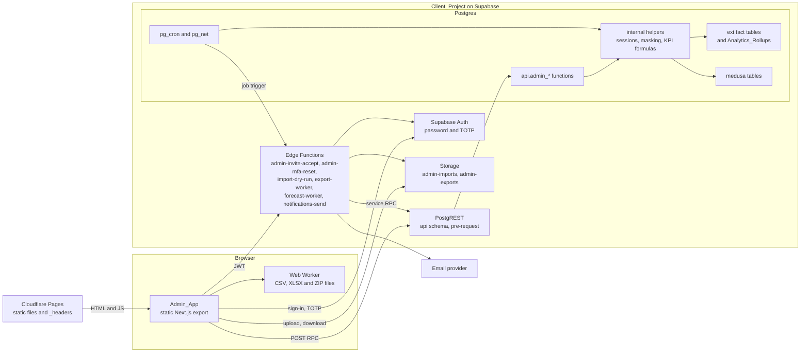
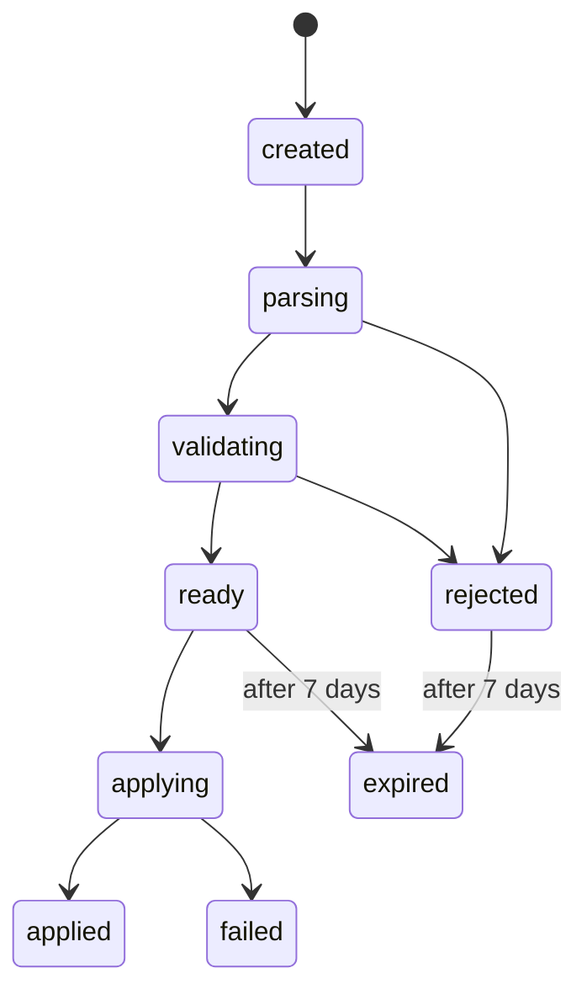

# Design Document: Admin Panel, Reports and Analytics

## Overview

The Admin_App is a static Next.js 15 App Router export, hosted on the Cloudflare Pages free tier at the admin subdomain. The Admin_App talks only to Supabase Auth, the Admin_API (POST RPCs to `api.admin_*` functions through PostgREST), Supabase Storage (for imports and exports) and a few Edge Functions (Req 1).

This spec builds on spec 1, which supplies the `medusa`, `ext`, `internal`, `api` and `reporting` schemas, the function conventions (SECURITY DEFINER, the error envelope, the Idempotency_Key and the Audit_Log), the Scheduler and the Notification_Service. This spec adds the backend parts that Req 25 lists.

Design goals, in priority order:

1. Protect store and customer data: TOTP MFA for every Admin_User, session and Permission checks in the database, and PII masked by default.
2. Correct numbers: one definition for each KPI, daily reconciliation to the paisa, and GST totals that match the tax lines.
3. Usable on a phone over slow networks: initial JavaScript within the 200 KB budget and Largest Contentful Paint within 3 seconds.
4. Low running cost on small Supabase plans: set-based work in Postgres and batched workers.

The design has these main parts: the Admin_App shell; sessions and MFA; Permissions and PII; operations screens over spec 1 functions; the import pipeline; the export pipeline; the analytics data layer and reports; the GST module; the forecasting and reorder engine; alerts; Scheduled_Reports; cutover.

## Architecture

### System context

The Admin_App and its Web Worker run in the browser. Cloudflare Pages serves the static files, an email provider delivers email, and everything else runs in the Client_Project on Supabase.

### Request paths

The Admin_App has no server of its own, so every data request enters through Supabase.

| Path | Entry point | Where the logic runs |
|---|---|---|
| Sign-in and TOTP | Supabase Auth, called from the browser | Supabase Auth; the Admin_API re-checks the session on every call (KD-4) |
| Reads and writes | POST RPC to `api.admin_*` | One PL/pgSQL transaction per call, with spec 1 conventions |
| Reveal and shipping printouts | POST RPC | Permission check, Audit_Log entry and unmasked values in one transaction (KD-6) |
| Invitation acceptance and TOTP reset | Edge Functions `admin-invite-accept` and `admin-mfa-reset` | Supabase Auth admin API with the service role, then an `api` function |
| CSV import | Upload to the `admin-imports` bucket, Edge Function `import-dry-run`, then a confirm RPC | Parse in the Edge Function, validate in SQL, apply in an in-database job (KD-10) |
| Immediate export | POST RPC that returns formatted rows in pages | Rows, masking and audit on the server; file packaging in a Web Worker (KD-11) |
| Background_Export | POST RPC that creates the job, then Edge Function `export-worker` | Postgres renders CSV pages; `export-worker` uploads them to the `admin-exports` bucket (KD-11) |
| Dashboard and Reports | POST RPC | Fact tables and Analytics_Rollups (KD-8); the pre-request function sets the report timeout (KD-9) |
| Forecasts | pg_cron job that calls Edge Function `forecast-worker` through pg_net | Batched TypeScript model fitting with leases (KD-12) |
| Alerts, Scheduled_Reports and reconciliation | pg_cron jobs and triggers | SQL; emails go through the spec 1 Notification_Service outbox (KD-14) |

### Repository layout

The Admin_App lives in its own folder, so its dependencies and build stay separate from the existing app at the repository root.

| Path | Contents | Deployed to |
|---|---|---|
| `apps/admin/` | The Admin_App: a Next.js app with its own `package.json` and lockfile, excluded from the root build, lint and tsconfig | Cloudflare Pages |
| `apps/admin/messages/` | `en.json` and `hi.json` message catalogs | Bundled into the Admin_App |
| `apps/admin/scripts/` | Post-build CSP hash script, route budget check and i18n completeness check | Build only |
| `supabase/migrations/` | Migrations for this spec (spec 2), ordered after spec 1's | Supabase |
| `supabase/functions/` | New Edge Functions `admin-invite-accept`, `admin-mfa-reset`, `import-dry-run`, `export-worker` and `forecast-worker`; changes to spec 1's `notifications-send` and `unsubscribe` | Supabase |
| `supabase/contracts/admin/` | One JSON Schema for each `api.admin_*` response; the Admin_App's TypeScript types are generated from these schemas | Tests and build |
| `src/app/admin/` | The Legacy_Admin; only the cutover redirect changes (KD-16) | Existing app |

### Interfaces with other specs

- Spec 1 supplies the backend and gains the additions that Req 25 lists.
- Spec 3, the storefront, supplies the product preview page that the Admin_App opens (Req 6).
- Spec 4 sets the admin subdomain, the Cloudflare Pages project and each client's initial Client_Branding.

## Key Decisions

Each decision states what was chosen, why, and what follows from it. A **Problem** line records a known risk and how the design handles it.

### KD-1: Static export

- **Decision.** The Admin_App is a Next.js 15 App Router app built with `output: 'export'`, `trailingSlash: true` and `images.unoptimized: true`. Every screen is a client component under a static shell. Record IDs travel as query parameters (for example `/orders/view/?id=...`), so one static page serves every record. The Admin_App has no route handlers, middleware, server actions or Pages Functions.
- **Why.** Req 1.1 and Assumption 5.
- **Consequences.** Cloudflare serves hashed assets with long cache lifetimes and HTML with a short one, set through `_headers`. Per-branch previews come from Cloudflare Pages.
- **Problem:** A static site cannot protect routes on a server, so screens and controls hide by Permission in the browser while the Admin_API stays the only authority (Req 2.3).

### KD-2: Security headers and CSP

- **Decision.** `_headers` sends on every path a `Content-Security-Policy` header of `frame-ancestors 'none'; connect-src 'self' https://<project host>; object-src 'none'; base-uri 'none'; form-action 'self'`, plus `Strict-Transport-Security: max-age=63072000; includeSubDomains`, `X-Content-Type-Options: nosniff`, `Referrer-Policy: no-referrer` and a `Permissions-Policy` that denies camera, microphone and geolocation. A post-build script computes a SHA-256 hash of every inline script in each exported HTML file and inserts a meta CSP as the first element of `<head>`: `default-src 'self'`, `script-src 'self'` plus the hashes, `style-src 'self' 'unsafe-inline'`, `img-src 'self' data: blob: https://<project host>`, `font-src 'self'`, `worker-src 'self' blob:` and the same `connect-src`.
- **Why.** The App Router writes inline scripts into pages, and a static host cannot issue per-request nonces. Hashes keep `script-src` free of `'unsafe-inline'`.
- **Consequences.** The browser applies both policies. CI fails when a page lacks the meta policy, an inline script lacks its hash or a header is missing (Req 1.5, 1.6). The sign-in, invitation and password-reset pages also allow `https://challenges.cloudflare.com` in `script-src` and `frame-src` for the Turnstile captcha that spec 1 enables in Supabase Auth; Cloudflare already serves the Admin_App's files, so this adds no new party.
- **Problem:** A meta policy cannot set `frame-ancestors`, so the header carries it, with the same `connect-src` so the two policies never conflict. `'unsafe-inline'` stays for styles only.

### KD-3: Data access

- **Decision.** The Admin_App uses `@supabase/auth-js` and `@supabase/postgrest-js` instead of the whole `supabase-js` package; `@supabase/storage-js` loads only on the import and export screens. Every Admin_API call is a POST to an `api.admin_*` function, so filters, search values and IDs never appear in request URLs or gateway logs. Responses live in an in-memory TanStack Query cache with no persistence. The Admin_App uses no service worker, no Realtime and no browser storage of store data. Badges and open Alerts refresh by polling every 60 seconds and on navigation.
- **Why.** Bundle size (Req 3.6), no store data at rest (Req 1.25) and no table exposure through Realtime.
- **Consequences.** One `callAdmin(fn, params)` wrapper adds the Idempotency_Key to writes, a 15-second abort timeout (Req 3.12), error-envelope mapping and the request ID. Response types are generated from the JSON Schemas in `supabase/contracts/admin/`, and contract tests check every response against its schema.

### KD-4: Session checks in the database

- **Decision.** Spec 1's `internal.require_permission(code)` first calls a new `internal.require_admin_session(p_sensitive)`, which rejects the call with a Session_Rejection code in these cases: the JWT is not `aal2` (`session_mfa_required`); the `amr` password timestamp is older than the Absolute_Session_Limit (`session_expired`); a verified TOTP factor of the Auth user in `auth.mfa_factors` is missing from `ext.admin_mfa_factor`, which lists the factors enrolled during invitation acceptance (`factor_not_allowed`, with a Security_Event); the admin link is disabled (`account_disabled`) or missing (`not_admin`). For a Sensitive_Action it also requires the `amr` TOTP timestamp to fall within the Re_Authentication_Window (`reauth_required`).
- **Why.** Browser checks can be bypassed by calling the Admin_API directly (Req 1.8, 1.15-1.17).
- **Consequences.** Step-up is a TOTP challenge and verify on the existing session, which issues a new access token whose `amr` TOTP timestamp is the verification time. The Admin_App then resends the call with the same Idempotency_Key (Req 1.19). The idle timeout stays in the browser, which alone sees Admin_Activity (Req 1.21).
- **Problem:** This relies on Supabase Auth updating the `amr` TOTP timestamp on each verification. An integration test checks it, and if that behavior changes, step-up moves to an Edge Function that verifies the code and records the time per session in `ext.admin_step_up`.

### KD-5: Tabs and Local_Admin_Data

- **Decision.** The Auth session lives in `localStorage` under one admin key that the origin's tabs share. A `BroadcastChannel` carries Admin_Activity pings (at most one per 15 seconds), warnings, sign-out and Session_Rejection to every tab, and the idle clock uses the newest Admin_Activity of any tab.
- **Why.** A second tab should not need a new password and TOTP sign-in, and all tabs must end together.
- **Consequences.** Ending a session signs out locally even when Supabase Auth is unreachable, clears `localStorage`, `sessionStorage`, IndexedDB, Cache Storage and the origin's cookies, broadcasts the end and reloads every tab to the sign-in screen, which drops data in memory (Req 1.20-1.26).
- **Problem:** Tokens in `localStorage` are readable by scripts of the origin. KD-2's script policy, no third-party scripts outside the Turnstile pages, the 1-hour JWT expiry and refresh-token rotation limit the risk. Memory-only tokens were rejected because every reload and new tab would need a full sign-in.

### KD-6: PII masking in the database

- **Decision.** `ext.pii_field` lists every PII column (table, column and kind: name, email, phone, address or IP), and `internal.mask_value(kind, value)` returns Masked_Values. Every admin read builds its JSON through helpers that mask registered columns, so a new screen cannot leak a field by omission. `api.admin_pii_reveal(p_record_type, p_record_id)` requires the `pii:reveal` Permission, counts the distinct records in `ext.pii_reveal_log` over the last 60 minutes against the Reveal_Limit, writes the Audit_Log entry and then returns the unmasked fields of one record (Req 2.12-2.19). `api.admin_print_shipping_document` returns the shipping name, address and phone to holders of the `order:fulfill` Permission, with an Audit_Log entry (Req 8.22). Email and phone search uses `ext.contact_search_index`, which stores HMAC-SHA-256 hashes, keyed with a Vault secret, of the normalized email address and phone number, so search matches complete values only and keeps no extra plaintext copy (Req 8.3-8.7, 10.3-10.6). Storefront search terms that contain "@" or 7 or more digits are masked when spec 1 ingests them (Req 16).
- **Why.** One masking point keeps screens, exports, logs and errors consistent (Req 2.7-2.11).
- **Consequences.** The Admin_App keeps revealed values in component state and drops them when the screen changes. The Audit_Log viewer masks the old and new values of registered columns.

### KD-7: Edit conflicts and idempotency

- **Decision.** Every editable record in an admin response carries a `version` (its `updated_at` as an opaque string). Saves send `p_expected_version` and get `edit_conflict` (409) on a mismatch. Every admin write takes `p_idempotency_key`, and `internal.admin_idempotency_begin(scope, key, fingerprint)` takes `pg_try_advisory_xact_lock` on the key.
- **Why.** No lost updates between Admin_Users and no double refunds, shipments or Role changes.
- **Consequences.** Bulk edits, imports and Order_Change confirmations store the versions read at preview or Dry_Run and re-check them at confirmation. A held lock returns `idempotency_in_progress` (409) at once, a committed record with the same fingerprint returns the stored response, and a different fingerprint returns `idempotency_conflict` (409). Records are kept for the key retention of 24 to 168 hours (Req 3.13-3.16).
- **Problem:** Spec 1's store functions let a concurrent duplicate wait, while admin writes reject it, as Req 3.16 requires. Both use `ext.idempotency_record`, with different scopes.

### KD-8: Analytics data layer

- **Decision.** Statement-level triggers on the Medusa order, line item, payment, refund, fulfillment and Order_Change tables keep the fact tables in `ext` (`order_fact`, `order_line_fact`, `refund_fact`, `fulfillment_fact`, and `payment_attempt_fact` from spec 1's Analytics_Events), each row with its Store_Timezone day. Analytics_Rollups (spec 1's daily rollups, extended) rebuild every 15 minutes for the last 3 days plus every day listed in `ext.rollup_dirty_day`, which triggers fill when an older Order, refund or Order_Change changes (Req 24.8). Nightly SQL computes `ext.customer_metrics` (Lifetime_Value, RFM scores and RFM_Segment, and Churn_Risk). KPIs and Reports read rollups when the filters allow and fact tables otherwise.
- **Why.** Incremental upkeep instead of materialized-view refreshes, and indexed facts meet the 3-second target at 1,000,000 Orders (Req 24.10).
- **Consequences.** The KPI formulas are written once, in `internal.kpi_*` functions, for the fact path. The Reconciliation_Job computes the same KPIs a second, independent way, straight from the Medusa tables, and any difference raises the critical Alert (Req 24.2-24.6). A Store_Timezone change rebuilds facts, rollups and Forecasts.

### KD-9: Report timeouts

- **Decision.** The PostgREST pre-request function `internal.pre_request()`, set through the `authenticator` role's `pgrst.db_pre_request` setting, sets `statement_timeout` for the transaction to the configured report query timeout when the request path is an `admin_report_*` or export-page function. Every other request keeps spec 1's role timeouts (3 seconds for `anon`, 8 seconds for `authenticated`).
- **Why.** Reports need up to 60 seconds (Req 24.11), and raising the `authenticated` limit would also lengthen storefront requests. Supabase caps Data API query timeouts at 60 seconds ([Supabase timeouts](https://supabase.com/docs/guides/database/postgres/timeouts)).
- **Consequences.** The function only compares the request path, so storefront requests pay almost nothing. A canceled query returns SQLSTATE `57014`, which the Admin_App shows as the shorter-period or export message.

### KD-10: Import pipeline

- **Decision.** The Admin_App uploads the CSV file to the private `admin-imports` bucket, under the Admin_User's own folder. A Storage policy allows only inserts into that folder, and the bucket's file size limit is 25 MB, the largest allowed CSV_Size_Limit. The `import-dry-run` Edge Function checks the stored file's size against the configured CSV_Size_Limit and its row count, parses the file with column headings accepted in English or Hindi (Req 4.18) and writes the rows in chunks of 1,000 to `ext.import_row` through a service RPC. `internal.import_validate` then checks all rows in set-based SQL and stores the errors, the create and update counts and the versions it read. `api.admin_import_confirm` accepts only an error-free Dry_Run and queues the apply. An in-database job applies every row in one transaction under its own `statement_timeout` (default 120 seconds) and re-checks the versions; an advisory lock per import kind allows one apply at a time (Req 6.17-6.27, 7.19-7.23, 9.5-9.9, 12.12-12.16). Uploaded files and staged rows are deleted after 7 days.
- **Why.** Parsing stays out of PL/pgSQL, validation in SQL is fast and sees the data, and the job avoids the 8-second request limit.
- **Consequences.** One pipeline serves Catalog_CSV, Stock_CSV, Bulk_Ship_CSV and Serviceability_Rule files, with one validator per import kind. The Admin_App polls the job status.
- **Problem:** An Edge Function gets 2 seconds of CPU time per request ([Supabase limits](https://supabase.com/docs/guides/functions/limits)). For a large file, the function saves its byte offset and continues in a new invocation until the whole file is parsed.

### KD-11: Export pipeline

- **Decision.** Postgres renders every export row: masking (Req 2.8-2.10), exact amounts, percentages with 4 decimals, ISO dates and times with the Store_Timezone offset, empty cells for dashes, and a leading apostrophe on text cells that start with `=`, `+`, `-`, `@`, a tab or a carriage return (Req 19.18, 19.19). An immediate export returns rendered CSV pages of 2,000 rows from `api.admin_export_page`. The `export-worker` Edge Function produces each Background_Export: it claims the job with a lease, calls `api.service_export_render_page` for pages of 20,000 rows and stores each page as the part object `admin-exports/<admin_user_id>/<export_id>/part-NNNNN.csv`. For both kinds of export, a Web Worker in the browser joins the pages into one CSV file with one byte-order mark, or writes an XLSX file with a streaming ZIP writer, and saves the file. A Background_Export download fetches its parts with the Admin_User's own JWT: a Storage RLS policy on the `admin-exports` bucket allows the read only to the requester while the export file lifetime lasts (Req 19.14), and `api.admin_export_download` returns the part list after the same check. A Scheduler job deletes expired parts.
- **Why.** The Edge Function only moves text, so each invocation stays within the CPU limit. Part objects avoid the single-file size limit of small Storage plans, and one assembly path gives CSV and XLSX files at every size.
- **Consequences.** The server never stores an XLSX file. GST exports use the same parts with the portal layouts, and the browser zips them (Req 18).
- **Problem:** A very large XLSX file takes tens of seconds to write on a phone, so the Admin_App shows progress and suggests CSV above 200,000 rows.

### KD-12: Forecasting

- **Decision.** The `forecast-worker` Edge Function implements the models in TypeScript: seasonal naive with a 7-day season, moving average, and Holt-Winters additive smoothing with weekly seasonality, with parameters chosen by a small grid search on the training days. pg_cron starts the nightly run. The worker claims batches of Forecast_Series with leases (default 100 per invocation, sized for the CPU limit), runs the Backtest, picks the model with the lowest WAPE, computes Confidence_Bands and writes each batch through a service RPC in one transaction. SQL handles Forecast_Series that lack enough history or recent sales, without the worker. Stock_Out_Predictions and Reorder_Suggestions are computed in SQL when read, from the stored Demand_Forecast and current stock (Req 22).
- **Why.** Iterative model fitting is slow in PL/pgSQL, plv8 is no longer offered on current Supabase Postgres versions, and TypeScript math is easy to test with fast-check.
- **Consequences.** A Confidence_Band is the forecast ± z × s, where s is the standard deviation of the Backtest errors over the holdout and z is 1.2816 for 80% or 1.96 for 95%; lower bounds are raised to 0 for counts and units. Each night's day-ahead forecast is kept for 90 days for the Anomaly rule (Req 23). A failed series keeps its previous Forecast (Req 21).
- **Problem:** Tens of thousands of active variants need hundreds of invocations a night. The inactivity rule removes slow variants first, and the batches spread over the nightly window.

### KD-13: Alerts

- **Decision.** Alert_Rules are rows in `ext.alert_rule`, each with a type, parameters, an Alert_Severity, recipient Roles and an email flag. Event rules (Payment_Incident, job failure, webhook failure, unmasked export and reconciliation mismatch) run in triggers inside the event's transaction. Forecast-based rules run after the nightly Forecast run, and the other rules run in a pg_cron job at the evaluation interval. Each match upserts one open Alert per Alert_Rule and Alert_Subject through a unique key and applies the rule's cooldown; stock and metric Alerts resolve automatically after 2 clear evaluations (Req 23). Delivery rows go to the Notification_Service outbox: critical Alerts at once, and other Alerts in one digest per Alert_Rule and digest interval.
- **Why.** SQL sees the data directly, and triggers meet the 1-minute target without another job.

### KD-14: Scheduled work and email

- **Decision.** Each new recurring task is a pg_cron job that writes `ext.job_run` records and skips overlapping runs (spec 1 KD-6): rollup refresh (every 15 minutes), Reconciliation_Job (daily, default 03:00), customer metrics (nightly), Forecast run start (checked every 15 minutes; starts once per Store_Timezone day after the refresh time, default 02:00), alert evaluation (every 15 minutes), alert digests (every 5 minutes), Scheduled_Report dispatcher (every minute), import apply (every minute), export cleanup (hourly) and staged import cleanup (daily). Scheduled_Run rows are unique per schedule and scheduled time, and the outbox idempotency key combines the schedule, the scheduled time and the recipient, so a recipient gets at most one email per scheduled time (Req 20). Emails use per-language templates in spec 1's `ext.notification_template`, and CSV attachments come from the export renderer without PII_Fields.
- **Why.** One Scheduler and one outbox keep retries, at-most-once delivery and run records consistent with spec 1.

### KD-15: GST documents and numbering

- **Decision.** A trigger on an Order's first shipment issues the Tax_Invoice in the same transaction. Refunds, Returns and Order_Changes after invoicing issue Credit_Notes or Debit_Notes. Numbers come from `ext.gst_counter`, which has one row per series and Financial_Year; the issuing transaction locks the row `FOR UPDATE` and increments it, so numbers stay consecutive with no gaps under concurrent shipments. The default format, `INV/2627/000123`, stays within 16 characters (Req 18). GST_Documents and their lines are immutable, because a trigger rejects updates and deletes. Each tax line maps to a GST_Tax_Head through a configured tax-rate code map, and GST_Reports read only GST_Documents.
- **Why.** A Postgres sequence can skip numbers on rollback, which an invoice series must not do. Immutable documents keep filed numbers stable.
- **Problem:** The counter row serializes issuance per series. Issuing takes milliseconds, so concurrent shipments wait only briefly.

### KD-16: Cutover

- **Decision.** `api.admin_cutover_confirm` requires the owner Role, counts as a Sensitive_Action, runs the readiness checks of Req 25 and records the confirmation in `ext.cutover_state`. From then on the Legacy_Admin's `public.is_admin()` returns false, so every legacy admin RLS policy denies writes. The Legacy_Admin layout reads the cutover state, cached for 60 seconds, and redirects to the Admin_App URL.
- **Why.** The RLS change stops legacy writes in the database at once, whatever the legacy deployment does. The redirect only guides people.

### KD-17: Languages and formatting

- **Decision.** English and Hindi message catalogs live in `apps/admin/messages/`, and only the active language's catalog loads. A small formatter fills ICU-style placeholders. Admin_API errors arrive as codes and field names, which the Admin_App translates. Numbers and amounts use `Intl.NumberFormat` with the `en-IN` locale and Latin digits in both languages (lakh and crore grouping, and ₹ with 2 decimals). Dates use `Intl.DateTimeFormat` in the active language, in day, month, 4-digit year order, with 12-hour times and `timeZone` set to the Store_Timezone; `formatToParts` sets the AM or PM marker of the active language (Req 4.9-4.15). A string without Hindi text falls back to English marked `lang="en"`, and a release build fails when a Hindi string is missing (Req 4.1, 4.8).
- **Why.** The browser's Intl data covers both locales with no extra bundle weight.

### KD-18: Performance budget

- **Decision.** CI measures each route's compressed initial JavaScript with an empty cache and fails the build above the budget (Req 3.6). Heavy modules load only where they are used. Charts are small in-house SVG components (line with band, bar and sparkline), each with a table view for screen readers. The XLSX and ZIP writer, the CSV parser, `@supabase/storage-js` and the date-range picker load on demand. Lighthouse CI takes the median Largest Contentful Paint of 5 runs on the sign-in screen and the Dashboard (Req 3.7).
- **Why.** The Next.js and React runtime uses about half of a 200 KB budget, so every other dependency is chosen by size.

## Components and Interfaces

Each component lists its responsibility, its interfaces, the steps where correctness matters and the requirements it covers.

### Admin_App shell

- **Responsibility.** Routes, navigation, layout, accessible primitives, forms and screen states (Req 2, 3).
- **Routes.** Each screen, its paths and the Permission it needs:

| Screen | Path | Permission |
|---|---|---|
| Sign-in | `/sign-in/` | None |
| TOTP verification | `/sign-in/totp/` | A password session |
| Invitation acceptance | `/accept-invite/`, with the token in the URL fragment | None |
| Password reset | `/reset-password/` | None |
| Dashboard | `/dashboard/` | `reports:read` |
| Orders | `/orders/` and `/orders/view/?id=` | `order:read` |
| Payment_Incidents | `/orders/incidents/` | `payment:refund` |
| Products | `/catalog/products/` and `/catalog/products/edit/?id=` | `catalog:write` |
| Categories and collections | `/catalog/categories/` and `/catalog/collections/` | `catalog:write` |
| Prices and Price_Lists | `/catalog/prices/` | `pricing:write` |
| Inventory | `/inventory/` and `/inventory/item/?id=` | `inventory:adjust` |
| Reorder | `/inventory/reorder/` | `reports:read` |
| Customers | `/customers/` and `/customers/view/?id=` | `customer:read` |
| Promotions | `/promotions/` and `/promotions/edit/?id=` | `promotion:write` |
| Reviews | `/reviews/` | `review:moderate` |
| Enquiries | `/enquiries/` | `enquiry:manage` |
| Quotations | `/quotations/` | `quotation:manage` |
| Reports | `/reports/<report>/` | `reports:read` |
| GST_Reports | `/reports/gst/` | `gst:read` |
| Forecasts and trends | `/forecasts/` | `reports:read` |
| Data health and Metric_Dictionary | `/reports/data-health/` and `/reports/metrics/` | `reports:read` |
| Scheduled_Reports | `/reports/schedules/` | `reports:read`; creating and editing also need `reports:export` |
| Exports | `/exports/` | `reports:export` |
| Imports | `/imports/` | The Permission of the import kind |
| Alerts | `/alerts/` | A recipient Role of the Alert (Alert_Rules need `alerts:manage`) |
| Settings | `/settings/<area>/` | `settings:write` |
| Staff and Roles | `/staff/` and `/staff/roles/` | `admin_user:manage` and `role:manage` |
| Audit_Log and Security_Events | `/audit/` | `audit:read` |
| Cutover | `/cutover/` | The owner Role |

- **Start screen.** `/` opens the Dashboard, or the first screen the Admin_User may open.
- **Session bootstrap.** `api.admin_me` requires an admin session and returns the Admin_User, the Admin_User's Roles and Permissions, the saved language and the Store_Settings the shell needs: Store_Timezone, Client_Branding, currencies, Optional_Features, List_Page_Size, Idle_Timeout, Absolute_Session_Limit and Re_Authentication_Window. The shell calls `api.admin_me` again on every navigation, so Role changes apply from the next screen (Req 2.6). `api.admin_set_language(p_language)` saves the Admin_User's choice of English or Hindi (Req 4.4).
- **Navigation.** One route registry holds each entry's path, label key, Permission and badge source. Entries without the Permission are hidden, and a screen opened by URL without the Permission shows the permission message (Req 2.1-2.4).
- **Layout.** Below 768 px the shell shows a top bar, a bottom bar with up to 5 permitted screens and a More menu, lists as cards and sticky action bars. From 768 px the shell shows side navigation and tables. Wide tables scroll inside their container (Req 3.1-3.3).
- **Accessible primitives.** Radix UI dialog, dropdown menu, popover and tabs, loaded only on routes that use them; a skip link, visible focus, 44 × 44 px targets and reduced motion; Client_Branding colours as CSS variables (Req 3.4, 3.5, 12.7).
- **Forms.** A small form-state helper, field errors from the error envelope, and an unsaved-changes guard on route changes and `beforeunload` (Req 6.35).
- **Screen states.** Every screen has an error boundary and a loading skeleton, and an offline banner shows while `navigator.onLine` is false.

### Sessions, MFA and invitations

- **Responsibility.** Sign-in, TOTP, step-up, warnings, sign-out and invitations (Req 1).
- **Sign-in.** The sign-in page sends the email, password and Turnstile token. TOTP verification follows on a fresh page load, so the Turnstile script is gone before the `aal2` session exists, and then the shell calls `api.admin_me`. Five consecutive rejected codes sign the session out (Req 1.13, 1.14). Messages never reveal whether an account exists (Req 1.10).
- **Password reset.** The Supabase Auth recovery email redirects to the Admin_App, and after the new password is saved the person signs in again with TOTP.
- **Invitation acceptance.** The Invitation_Link carries the token in the URL fragment, which the page reads and then removes from the address bar. Edge Function `admin-invite-accept` checks the token through `api.service_invite_inspect` and returns the masked email and whether an Auth account exists. For a new person the function creates the Auth user with the chosen password through the Auth admin API; a person with an existing account signs in with that account's password. The person then enrolls a TOTP factor (QR code and text secret) and verifies a code. `api.admin_accept_invite(p_token, p_factor_id)` checks `aal2` and the verified factor, and in one transaction records the `ext.admin_mfa_factor` row, the admin link with the invited Roles and the accepted invitation (Req 1.7, 13.5-13.8).
- **Factor reset.** Edge Function `admin-mfa-reset` (owner Role, Sensitive_Action) deletes the Admin_User's TOTP factors and signs out every session through the Auth admin API. Then `api.service_mfa_reset_complete` removes the `ext.admin_mfa_factor` rows, writes the Audit_Log entry and issues a new invitation with the same Roles (Req 1.28-1.30).
- **Step-up.** A Sensitive_Action opens a TOTP dialog when the last TOTP verification is older than the Re_Authentication_Window, and on a `reauth_required` rejection. After verification the Admin_App resends the request with the same Idempotency_Key and input (Req 1.18, 1.19).
- **Timers.** KD-5 keeps the timers in step across tabs. An idle warning with a keep-active control shows 60 seconds before the Idle_Timeout, and the session ends at the Idle_Timeout. An absolute warning shows 10 minutes before the Absolute_Session_Limit, counted from the `amr` password timestamp, and the session ends at the limit (Req 1.20-1.23).
- **Session end.** Every tab completes the KD-5 steps within 2 seconds. The sign-in screen then shows the account-disabled or not-an-Admin_User message when that is the reason (Req 1.11, 1.25-1.27).
- **Interfaces.** Each interface, its caller and its purpose:

| Interface | Caller | Purpose |
|---|---|---|
| `api.admin_me` | Admin_App | Session bootstrap |
| `internal.require_admin_session` | Every `api.admin_*` function | KD-4 checks |
| `api.service_invite_inspect` | `admin-invite-accept` | Token check |
| `api.admin_accept_invite` (spec 1, extended with `p_factor_id`) | Admin_App | Invitation acceptance |
| `api.service_mfa_reset_complete` | `admin-mfa-reset` | Reset record and new invitation |
| Edge Functions `admin-invite-accept` and `admin-mfa-reset` | Admin_App | Auth admin API calls with the service role |

### Permissions, PII and audit

- **Responsibility.** Permission-aware data, masking, reveal, printouts, contact search, and the Audit_Log and Security_Events viewers (Req 2, 8, 10, 13).
- **Masking rules.** `internal.mask_value(kind, value)` returns null for null and otherwise keeps these parts of each kind:

| Kind | What stays visible |
|---|---|
| Name | The first letter of each word, and the spaces (`R*** K****`) |
| Email | The first character of the local part, the `@` and the domain (`r****@example.com`); only the local part counts toward the masked share |
| Phone | The first 2 and the last 2 digits of the national number, without the country code (`98******10`) |
| Address | The first character of each address line and the first 2 characters of the postal code. City, state and country are not PII_Fields and stay visible, because shipping and the GST Place_Of_Supply need them |
| IP | The first octet of an IPv4 address, with the rest masked (`203********`); an IPv6 address is masked in full |

- **Masked share.** Each hidden character becomes one `*`. When a kind's rule would leave half or more of the counted characters visible, as in a short name such as `Al`, the whole value is masked, so every Masked_Value meets the more-than-half rule of the Masked_Value definition (Property 5).

- **Registry check.** A pgTAP test lists every `medusa` and `ext` column whose name looks like personal data (`email`, `phone`, `first_name`, `last_name`, `address_1`, `address_2`, `postal_code`, `ip`) and fails unless `ext.pii_field` registers the column or marks the column as not personal data.
- **Reveal steps.** `api.admin_pii_reveal` requires `pii:reveal` and checks that the record exists and that its type allows reveal: Customer, Order, address, Enquiry, Quotation, review author or Admin_User. The function then counts the distinct records in `ext.pii_reveal_log` for the Admin_User over the last 60 minutes; a record revealed again inside the window counts once. When this reveal would take the count over the Reveal_Limit, the function rejects the call with `reveal_limit_exceeded` and the time of the next allowed reveal, and spec 1's inner-block pattern keeps the Security_Event despite the rejection. Otherwise the function writes the Audit_Log entry and the `ext.pii_reveal_log` row and then returns the values (Req 2.12-2.19).
- **Printouts.** `api.admin_print_shipping_document(p_order_id, p_document)` (`order:fulfill`) returns the full shipping name, address and phone for a packing slip or shipping label and writes an Audit_Log entry. `api.admin_order_invoice` returns the invoice data with masked PII_Fields, and the Admin_App fills in the values that the Admin_User has revealed on screen (Req 8.20-8.23).
- **Contact search.** Triggers keep `ext.contact_search_index` for Customers, Orders, Enquiries and Quotations. Each row holds the subject type, the subject ID, the HMAC-SHA-256 hash (KD-6) of the normalized email address and the HMAC-SHA-256 hash of the phone number in E.164 form, with +91 as the default country code. The search functions take the search value in the POST body, hash the value in the database and never write the value to a log.
- **Viewers.** `api.admin_audit_list` and `api.admin_security_events_list` filter by the criteria of Req 13.20-13.21 and page by keyset on (time, ID). `api.admin_audit_get` masks the old and new values of registered columns, and spec 1's redaction keeps Secrets out of the Audit_Log. Exports of the Audit_Log and Security_Events go through the export pipeline and need both `audit:read` and `reports:export`.

### Operations screens

- **Responsibility.** The screens of Req 6 to 14, built on spec 1's functions plus the list, detail and preview functions of this spec.
- **List pattern.** `api.admin_<resource>_list(p_filters, p_sort, p_cursor, p_page_size)` validates the filters on the server, pages by keyset on (sort key, ID) so that each row shows once while new rows arrive (Req 8.12, 13.22), and uses the List_Page_Size. Saved_Views store the filters, columns and sort order.
- **Detail pattern.** `api.admin_<resource>_get(p_id)` returns the record with masked PII_Fields, its version and the actions allowed in its current state, taken from spec 1's order state machine or the resource's own rules (Req 8.18-8.19).
- **Write pattern.** Writes use spec 1's admin functions where they exist, extended with `p_expected_version` and `p_idempotency_key` (KD-7). New write functions follow the same pattern.
- **Bulk edits.** `api.admin_products_bulk_preview` returns the current and new values with their versions. `api.admin_products_bulk_apply` re-checks the versions and applies the change to all products or to none (Req 6.28-6.32).
- **Functions by area.** Each area, the functions this spec adds, the spec 1 functions it uses and its Permissions:

| Area | New in this spec | Spec 1 functions used | Permission |
|---|---|---|---|
| Catalog | `api.admin_products_list`, `api.admin_products_get`, `api.admin_products_bulk_preview`, `api.admin_products_bulk_apply`, `api.admin_preview_token` | `api.admin_upsert_product`, `api.admin_set_product_status`, `api.admin_delete_product`, `api.admin_upsert_variant`, `api.admin_upsert_category`, `api.admin_upsert_collection`, `api.admin_set_product_attributes`, Edge Function `admin-media-upload` | `catalog:write`; prices through `api.admin_upsert_prices` and `api.admin_upsert_price_list` need `pricing:write` |
| Inventory | `api.admin_inventory_list`, `api.admin_inventory_get`, `api.admin_inventory_movements_list`, `api.admin_low_stock_list`, `api.admin_stock_claims_list`, `api.admin_stock_location_priority_set` | `api.admin_adjust_inventory`, extended with the Adjustment_Reason and a note | `inventory:adjust` |
| Orders | `api.admin_orders_list`, `api.admin_orders_search`, `api.admin_orders_get` (totals breakdown, payments, fulfillments, Returns, Refundable_Amount, allowed actions and timeline), `api.admin_order_note_add`, `api.admin_order_invoice`, `api.admin_print_shipping_document` | The spec 1 Order_Change functions | `order:read`, `order:update` |
| Fulfillment and Cash_On_Delivery | Bulk shipping through the import pipeline | `api.admin_create_fulfillment`, `api.admin_mark_shipped` (the tracking URL must start with `https://`), `api.admin_mark_delivered`, `api.admin_cancel_fulfillment`, `api.admin_record_cod_payment`, `api.admin_record_cod_refusal` | `order:fulfill`, `cod:manage` |
| Returns and refunds | `api.admin_order_change_preview` (the difference computed on the server, with versions) | `api.admin_create_return`, `api.admin_receive_return`, `api.admin_create_exchange`, `api.admin_create_claim`, the order edit functions, `api.admin_cancel_order`, `api.admin_refund_payment` | `order:update`, `order:cancel`, `payment:refund` |
| Payment_Incidents | `api.admin_payment_incidents_list`, `api.admin_payment_incident_resolve` (refund or backorder; a refund above the refund threshold is a Sensitive_Action) | The spec 1 refund path | `payment:refund` |
| Customers | `api.admin_customers_list`, `api.admin_customers_search`, `api.admin_customers_get` (Lifetime_Value, RFM_Segment, Churn_Risk, COD status with the COD_Refusal_Count, deletion status and erased marker), `api.admin_customer_note_add`, `api.admin_customer_group_add` and `api.admin_customer_group_remove` (one membership per call, so concurrent changes by other Admin_Users stay intact, Req 10.13) | `api.admin_reenable_cod` | `customer:read`, `customer:write`, `cod:manage` |
| Promotions | `api.admin_promotions_list`, `api.admin_promotions_get` (usage per currency, budget progress and blocked attempts in the Code_Attempt_Window), `api.admin_promotion_codes_generate`, `api.admin_promotion_codes_export` | `api.admin_upsert_promotion`, `api.admin_upsert_campaign` | `promotion:write` |
| Reviews, Enquiries and Quotations | `api.admin_reviews_list`, `api.admin_reviews_moderate` (1 to 100 reviews, all or none), `api.admin_enquiries_list`, `api.admin_enquiries_get`, `api.admin_enquiry_set_status`, `api.admin_enquiry_assign`, `api.admin_enquiry_reply` (email through the outbox, stored on the Enquiry), `api.admin_quotations_list` | `api.admin_moderate_review`, `api.admin_price_quotation` | `review:moderate`, `enquiry:manage`, `quotation:manage` |
| Settings | `api.admin_branding_update`, `api.admin_notification_template_preview`, `api.admin_notification_test_send` (to the Admin_User's own address only); the spec 2 setting definitions | `api.admin_get_settings`, `api.admin_update_settings`, Edge Function `admin-providers` (Credential_Check) | `settings:write` |
| Staff | `api.admin_users_list`, `api.admin_invitations_list`, `api.admin_invitation_resend`, `api.admin_invitation_revoke`, `api.admin_roles_list` | `api.admin_invite_user`, `api.admin_set_user_roles`, `api.admin_disable_user`, `api.admin_upsert_role`, `api.admin_delete_role` | `admin_user:manage`, `role:manage` |

- **Code generation.** `api.admin_promotion_codes_generate` takes bytes from `gen_random_bytes` and maps each byte to a Code_Alphabet symbol by the byte's value modulo 32. Because 256 is a multiple of 32, every symbol is equally likely. The function inserts the codes against the unique index on the normalized code and draws codes that collide again inside the same transaction until the batch is complete (Req 11.8-11.14).
- **Storefront preview.** `api.admin_preview_token(p_product_id)` (`catalog:write`) returns an HMAC-signed token, valid for 10 minutes, that spec 3's preview page checks through a store function, so unpublished products can be previewed (Req 6.34).
- **Badges.** `api.admin_badge_counts` returns the counts of pending reviews, new Enquiries, requested Quotations, unresolved Payment_Incidents and open Alerts, each only for permitted screens and enabled Optional_Features (Req 14.26-14.28).
- **Customer text.** Review text, Enquiry messages, Quotation notes and other text that Customers enter render only as text nodes, and a lint rule forbids `dangerouslySetInnerHTML` in the code base (Req 14.30).

### Import pipeline

- **Responsibility.** Dry_Run and all-or-nothing apply for Catalog_CSV, Stock_CSV, Bulk_Ship_CSV and Serviceability_Rule files (Req 6.14-6.27, 7.19-7.23, 9.5-9.9, 12.12-12.16).
- **Job states.** An import job moves through these states:

- **Steps.** An import runs in this order:

1. `api.admin_import_create(p_kind, p_file_name, p_file_size, p_idempotency_key)` checks the Permission of the kind and the CSV_Size_Limit, and returns the import ID and the Storage path `admin-imports/<admin_user_id>/<import_id>.csv`.
2. The browser uploads the file with `storage-js`. The bucket policy allows an insert only into the Admin_User's own folder and only for an import in the `created` state.
3. Edge Function `import-dry-run` accepts only the job owner's Admin_User JWT, streams the file and rejects a file that exceeds the CSV_Row_Limit, lacks a required column or has no data rows (Req 6.18-6.20). The function maps the headings through the kind's English and Hindi heading map and inserts the rows in chunks of 1,000 through `api.service_import_add_rows`. When its CPU budget runs low, the function saves its byte offset and continues in a new invocation (KD-10).
4. `internal.import_validate(job)` runs the kind's validator in set-based SQL. The validator checks types and formats, references, duplicates within the file and business rules, and records the current version of each target record. The function stores each error with its row number and message key, and stores the job's create and update counts.
5. The Admin_App shows the Dry_Run result with paged errors and enables confirmation only for a result with no errors (Req 6.17, 6.22).
6. `api.admin_import_confirm(p_import_id, p_idempotency_key)` rejects the confirmation when the job has errors (Req 6.23), when an apply of the same kind is already running (`import_in_progress`, Req 6.27) or when the Dry_Run is older than 24 hours. Otherwise the function marks the job `applying`.
7. The import apply job takes `pg_try_advisory_xact_lock` for the kind, sets its `statement_timeout` (default 120 seconds) and re-checks every target version. A changed record fails the whole import as an Edit_Conflict, and the result lists the changed rows and asks for a new Dry_Run (Req 6.26). Rows go through the internal write functions that single edits use, so each row writes its Audit_Log entry, Catalog_Change_Events and Inventory_Movements in the usual way. Any failure rolls back every row and marks the job `failed` with the failing row and its error (Req 6.24-6.25).

- **Kinds.** Each import kind, its Permission, the action for each row and the validator's checks:

| Kind | Permission | Row action | Validator checks |
|---|---|---|---|
| Catalog_CSV | `catalog:write`, plus `pricing:write` for price columns | Upsert of the product, variants, options, prices and category and collection assignments | Unique handles and SKUs, unique option sets per product, existing categories, prices of at least 0 with at most the currency's decimal places |
| Stock_CSV | `inventory:adjust` | A signed stock adjustment with its Adjustment_Reason | Unknown SKU or Stock_Location, missing Adjustment_Reason, stock below zero after the change (Req 7.21) |
| Bulk_Ship_CSV | `order:fulfill` | Mark the fulfillment shipped | Fulfillment unknown, already shipped, canceled or repeated in the file; tracking URL that does not start with `https://` (Req 9.6) |
| Serviceability_Rule CSV | `settings:write` | Upsert of the rule | Postal code format of the row's country, a range start after the range end, repeated postal codes (Req 12.14) |

- **Round trip.** Export and import share one column map per kind, and a property test checks that importing an unchanged export changes nothing (Req 6.16).
- **Safety.** Files are read as data only. Formula characters in imported text are stored as entered and guarded on export (KD-11).

### Export pipeline

- **Responsibility.** Report_Exports, Background_Exports, Purchase_Lists, promotion code lists, Audit_Log and Security_Events exports, and GST exports (Req 2.8-2.10, 18, 19, 22).
- **Steps.** An export runs in this order:

1. **Create.** `api.admin_export_create(p_source, p_filters, p_format, p_include_unmasked_pii, p_idempotency_key)` requires `reports:export` and the read Permission of the source, plus `pii:reveal` when unmasked personal data is requested (Req 2.9), and runs the Sensitive_Action check. The function counts the rows and rejects an export of more than 1,000,000 rows, returning the row count (Req 19.13). It chooses an immediate export up to the export row threshold and a Background_Export above it, and enforces the running export limit (Req 19.12). It writes the Audit_Log entry with the source, filters, Reporting_Period, row count, format and unmasked flag (Req 2.10, 19.17), and records the `ext.export_job` row. A Background_Export also queues a pg_net wake-up of `export-worker`, which fires only when the transaction commits; a pg_cron run every minute is the fallback.
2. **Immediate export.** The Admin_App calls `api.admin_export_page(p_export_id, p_page)` for pages of 2,000 rendered rows, under the report timeout of KD-9.
3. **Background_Export.** Edge Function `export-worker` claims the job with a lease, takes pages of 20,000 rows from `api.service_export_render_page` and uploads each page as a part object. The function stops before its CPU or wall-clock budget runs out, and the next wake-up continues from the stored page number. The last page marks the job `ready`; a failure marks the job `failed` with the reason and deletes the job's parts (Req 19.16).
4. **Rendering.** `internal.export_render_row` applies the masking rules of Req 2 and writes amounts as stored at full minor-unit precision, percentages with 4 decimal places, dates as `YYYY-MM-DD` and times in ISO 8601 with the Store_Timezone offset. The function writes an empty cell for each dash and a leading apostrophe on text cells that start with `=`, `+`, `-`, `@`, a tab or a carriage return. Headings use the exporting Admin_User's language, except in the GST layouts (Req 4.17, 19.18-19.20). A Report with no rows exports the heading row only (Req 19.21).
5. **Download.** `api.admin_export_download` checks the requester and the file lifetime and returns the part list. The Storage RLS policy on the `admin-exports` bucket allows reads only by the requester until the lifetime ends. The Web Worker joins the parts, or the pages of an immediate export, into one CSV file with one byte-order mark, or streams the rows into an XLSX file with the `fflate` ZIP library. The Web Worker names the file from the source, the Reporting_Period dates, the Store_Timezone and the creation time (Req 19.20).
6. **Cleanup.** An hourly job deletes the parts once the export file lifetime (default 24 hours) ends and marks the job `expired`. Opening an expired download shows the expired message (Req 19.14-19.15).

- **GST layouts.** Each GST portal table (`b2b`, `b2cl`, `b2cs`, `cdnr`, `cdnur`, `exemp`, `hsn(b2b)`, `hsn(b2c)`, `docs`) has one renderer for the template version recorded in Store_Settings. The Web Worker writes one CSV file per table and zips the files (Req 18).
- **Interfaces.** Each interface, its caller and its purpose:

| Interface | Caller | Purpose |
|---|---|---|
| `api.admin_export_create` | Admin_App | Checks, Audit_Log entry and export job |
| `api.admin_export_page` | Admin_App | Rendered pages of an immediate export |
| `api.service_export_render_page` | `export-worker` | Rendered pages of a Background_Export |
| `api.admin_export_download` | Admin_App | Part list after the requester and lifetime checks |
| `api.admin_exports_list` | Admin_App | The Admin_User's exports with status and progress (Req 19.11) |

### Analytics data layer

- **Responsibility.** Fact tables, Analytics_Rollups, dirty days, customer metrics, the Reconciliation_Job and the Store_Timezone rebuild (Req 5, 15-17, 24).
- **Fact tables.** Each fact table, what one row stands for, its main columns and what keeps the table up to date:

| Fact | One row per | Main columns | Kept up to date by |
|---|---|---|---|
| `ext.order_fact` | Order | Local day, placed time, Sales_Channel, Region, currency, Customer, canceled flag, gross sales, discounts, tax, shipping, units, payment method (`mixed` for several), Promotion IDs, Storefront_Session and attribution | Statement-level triggers on the Medusa order tables |
| `ext.order_line_fact` | Order line | Local day, Order, variant, product, product title as stored on the line, category IDs, collection, units, gross sales, discounts, tax | The same triggers |
| `ext.refund_fact` | Refund | Refund local day, Order, currency, amount without tax and shipping, tax, shipping, reason | Triggers on refunds |
| `ext.fulfillment_fact` | Fulfillment | Placed time, first shipment time, delivery time, Stock_Location, Shipping_Option, Cash_On_Delivery outcome | Triggers on fulfillments and Cash_On_Delivery records |
| `ext.payment_attempt_fact` | Payment attempt | Attempt time, Payment_Provider, method, outcome | Spec 1 payment Analytics_Events |
| `ext.customer_metrics` | Customer and currency | First and last Order times, order count, Lifetime_Value, R, F and M scores, RFM_Segment, Churn_Risk | The nightly customer metrics job |

- **Amounts.** Facts take tax amounts from spec 1's tax lines and remove the tax included in tax-inclusive prices, so gross sales and discounts are always without tax (Req 5.1-5.2).
- **Local day.** A fact's local day is `(<event time> AT TIME ZONE <Store_Timezone>)::date`, so Postgres handles 23-hour and 25-hour days (Req 24.13).
- **Rollups.** The Analytics_Rollups are spec 1's `daily_sales_rollup`, `daily_product_rollup` and `daily_funnel_rollup`, plus the new `daily_payment_rollup`, `daily_cart_rollup` (abandoned and recovered Carts) and `daily_search_term_rollup`, each keyed by local day and dimensions. `internal.refresh_rollups` rebuilds the last 3 days and every day listed in `ext.rollup_dirty_day`, then clears those days (Req 24.7-24.8). Search terms are normalized and masked before they reach the rollup (KD-6).
- **Dirty days.** When an Order is canceled or refunded, or an Order_Change applies, the trigger updates the Order's facts and inserts the placement day and the refund day into `ext.rollup_dirty_day` in the same transaction.
- **Reconciliation_Job.** Daily at the configured time, the job computes the previous day's KPIs straight from the Medusa orders, line items, tax lines, refunds and payments, with SQL written separately from the fact path, compares each KPI per Sales_Channel and currency with the rollups to the minor unit and records the run in `ext.reconciliation_run`. On a difference the job raises the critical Alert, marks the day dirty and rebuilds the day (Req 24.2-24.6). The data health screen shows the last run.
- **Store_Timezone change.** Saving a new Store_Timezone (a Sensitive_Action) starts a rebuild job that recomputes the local days of all facts, then all rollups and Forecasts, in batches. While `ext.rebuild_state` shows a running rebuild, report functions return `rebuild_in_progress` and the Admin_App shows the message in place of values (Req 24.14, 24.15).
- **Data_Freshness.** Each rollup row stores `refreshed_at`. A KPI's Data_Freshness is the oldest `refreshed_at` among the rollup rows the KPI reads, or the facts' last change time when the KPI reads facts (Req 5.26, 24.9).
- **Indexes.** Facts have indexes on (local day, currency, Sales_Channel) plus the filter columns (Region, payment method, GIN on Promotion IDs); line facts have indexes on (local day, product) plus GIN on category IDs.

### Reports and KPI engine

- **Responsibility.** Dashboard KPIs, Reports, comparisons, filters, Saved_Views and the Metric_Dictionary (Req 5, 15-17, 19, 24).
- **KPI values.** `internal.kpi_values(p_period, p_filters)` returns every KPI of Req 5 per currency, from rollups when every filter is a rollup dimension (Sales_Channel, Region, currency) and from facts otherwise. The function returns a dash for a zero divisor and 0 for a period with no records (Req 5.11-5.12).
- **Comparisons.** `internal.comparison_period` returns the previous period of equal length or the same dates one year earlier, with 29 February moved to 28 February. Changes are computed from unrounded values with the dash rules of Req 5.18-5.22. Rounding half up to the minor unit and to 1 decimal place happens only for display (Req 5.24-5.25).
- **Dashboard.** `api.admin_dashboard(p_period, p_comparison)` returns the KPIs, changes, Data_Freshness and stale flags, the open Alert count with up to 5 open Alerts, and the net sales Forecast per currency for the Default_Sales_Channel. A KPI that fails returns an error item and the other KPIs still return (Req 5.29-5.35).
- **Report functions.** Each report function, its Report, its main sources and its requirements:

| Function | Report | Main sources | Req |
|---|---|---|---|
| `api.admin_report_sales` | Sales by Report_Bucket and group | Rollups, `order_fact`, `order_line_fact`, `refund_fact` | Req 15 |
| `api.admin_report_products` | Product performance, top and bottom lists | `daily_product_rollup`, `order_line_fact` | Req 15 |
| `api.admin_report_customers` | New_Customers and Returning_Customers, Cohorts, RFM_Segments, Churn_Risk, Lifetime_Value bands | `customer_metrics`, `order_fact` | Req 16 |
| `api.admin_report_funnel` | Storefront_Funnel | `daily_funnel_rollup` | Req 16 |
| `api.admin_report_abandoned_carts` | Abandoned_Carts and recovery | `daily_cart_rollup` | Req 16 |
| `api.admin_report_attribution` | UTM_Parameters and referrer domains | `order_fact`, `daily_funnel_rollup` | Req 16 |
| `api.admin_report_search_terms` | Top and zero-result search terms | `daily_search_term_rollup` | Req 16 |
| `api.admin_report_inventory` | Stock, Sell_Through_Rate, Days_Of_Cover, slow movers, stock value | Medusa inventory levels, `order_line_fact` | Req 17 |
| `api.admin_report_payments` | Method mix, attempt outcomes, Cash_On_Delivery share and refusal rate, refunds by reason | `order_fact`, `payment_attempt_fact`, `fulfillment_fact`, `refund_fact` | Req 17 |
| `api.admin_report_shipping` | Median and 90th percentile times, backlog, postal codes without delivery | `fulfillment_fact`, spec 1 postal code check events | Req 17 |
| `api.admin_report_promotions` | Redemptions, discount cost, net sales | `order_fact` | Req 17 |
| `api.admin_report_gst` | GST_Report sections | GST_Documents | Req 18 |

- **Shared shape.** Every report function takes `p_period`, `p_comparison`, `p_filters` (Sales_Channel, Region, currency and the Report's own filters), `p_group`, `p_sort` and `p_page`, and returns rows, totals per currency, the Data_Freshness and the Report's notes, such as the refund-date note and the multi-category note (Req 15).
- **Report_Buckets.** The Report_Buckets are day, Monday-to-Sunday week and month, with partial buckets flagged (Req 15).
- **Filters in the URL.** The Admin_App keeps applied filters in the query string, never a searched PII value, and ignores an invalid value in a URL with a message (Req 19.2-19.4).
- **Saved_Views.** `ext.saved_view` stores each Saved_View's creator, screen, name, shared flag and definition, and `api.admin_saved_views_list`, `api.admin_saved_view_save` and `api.admin_saved_view_delete` manage Saved_Views under the rules of Req 19.5-19.8. A definition that names a deleted filter value opens without that filter and shows a message.
- **Metric_Dictionary.** `supabase/contracts/metrics.json` defines each KPI and measure: the formula text in English and Hindi, the source data, the date rule and the Reports that use it. The Metric_Dictionary screen renders the file, and tests check that `internal.kpi_values` follows each formula (Req 24.16, 24.17).
- **Performance.** A Report over 2 years reads at most 730 rollup days per dimension set, or one index range scan of the facts. Before each release a load test with 1,000,000 synthetic Orders checks the 95th percentile response time target (Req 24.10).

### GST module

- **Responsibility.** GST profiles, issuing Tax_Invoices, Credit_Notes and Debit_Notes, numbering, GST_Report sections, reconciliation and portal exports (Req 12, 18).
- **Configuration.** `ext.gst_profile` holds the HSN_Code, Unit_Quantity_Code and GST_Treatment per product, with variant rows overriding the product; `ext.tax_head_map` maps each tax rate code to IGST, CGST, SGST or cess; `ext.gst_state` maps state names and ISO subdivision codes to 2-digit GST state codes; Store_Settings hold the store GSTIN (checked by `internal.is_valid_gstin`: state code and check character), the filing frequency, the minimum HSN_Code digits (4, 6 or 8), the B2C large threshold, the series prefixes (`INV/`, `CN/`, `DN/`) and the portal template version.
- **Issuing steps.** GST_Documents are issued in this order:

1. A trigger on the first fulfillment of an Order marked shipped calls `internal.gst_issue_invoice(order_id)` when the GST feature is on and the Order has no Tax_Invoice.
2. The function locks the `ext.gst_counter` row of the invoice series and the shipment date's Financial_Year `FOR UPDATE`, takes the next number, builds the number text (prefix, Financial_Year such as `2627`, a slash and 6 digits), checks the 16-character limit and allowed characters, and writes `ext.gst_document` and its lines from the Order's lines and tax lines.
3. Buyer details come from the Order: the buyer name, and the buyer GSTIN that spec 3's checkout stores in the Order metadata, kept only when it is a Valid_GSTIN; an invalid GSTIN is kept as a warning and the invoice is B2C.
4. Place_Of_Supply is the shipping address state, else the billing address state, else the store's state. GST_Supply_Type follows the Glossary.
5. Refunds, Returns, cancellations and Order_Changes after invoicing call `internal.gst_issue_note(kind, order_id, source_id)`, which writes a Credit_Note or Debit_Note from the source's tax lines, with its own series and counter and a reference to the Tax_Invoice number and date. A Return and its refund produce one Credit_Note, so the refund of a Return that already has a Credit_Note issues none (Req 18.9).
6. Triggers reject every update and delete of GST_Documents and their lines.

- **Printable invoice.** With the GST feature on, the printable invoice of Req 8.20 is the Tax_Invoice once it exists; before the first shipment the Admin_App prints an order summary marked "not a tax invoice".
- **Report sections.** `internal.gst_section(p_filing_period, p_section)` builds B2B; B2C large; B2C small by Place_Of_Supply and rate, net of the notes for B2C small supplies dated in the period; notes to registered buyers and notes for B2C large invoices; nil-rated, exempt and non-GST supplies; the HSN summary split into B2B and B2C supplies (HSN_Code, description, Unit_Quantity_Code, total quantity, total value, taxable value, rate, IGST, CGST, SGST and cess); and documents issued per series (first and last number, total, and a canceled count that stays 0 because GST_Documents never change). The GSTR-3B summary gives outward taxable, zero-rated, nil-rated and exempt, and non-GST supplies, and inter-state supplies to unregistered buyers by Place_Of_Supply and rate; input tax credit is out of scope (Assumption 12).
- **Reconciliation and warnings.** Each section's taxable value and GST_Tax_Head totals must equal the sums of its document lines to the paisa; a difference, or a tax line whose rate code `ext.tax_head_map` does not map, blocks the export with the section and the difference (Req 18.19). A missing or short HSN_Code, a missing Unit_Quantity_Code and an invalid buyer GSTIN are warnings: they show at the top of the Report and in the export's summary file, and an export with warnings needs the Admin_User's confirmation (Req 18.20).
- **Export.** The export pipeline's GST layouts (KD-11), with amounts in 2 decimal places as recorded, B2B receiver names unmasked and no other PII_Fields (Req 18.21-18.22).
- **Interfaces.** Each interface, its caller and its purpose:

| Interface | Caller | Purpose |
|---|---|---|
| `internal.gst_issue_invoice` | Shipment trigger | Tax_Invoice and number |
| `internal.gst_issue_note` | Refund, Return, cancellation and Order_Change functions | Credit_Note or Debit_Note |
| `api.admin_report_gst(p_filing_period)` | Admin_App (`gst:read`) | Sections, reconciliation result and warnings |
| `api.admin_gst_documents_list` and `api.admin_gst_document_get` | Admin_App (`gst:read`) | Document lists and printouts |

### Forecasting and reorder engine

- **Responsibility.** Forecasts, trends, Stock_Out_Predictions and Reorder_Suggestions (Req 21, 22).
- **Series data.** Daily values from the rollups, net sales with refunds on the refund day, and 0 for days without Orders; migrated Orders count on their original placement day (Req 21).
- **Nightly run steps.** The nightly run goes in this order:

1. A job that runs every 15 minutes starts the run once per Store_Timezone day after the refresh time (default 02:00) has passed, which also covers daylight-saving gaps. `internal.forecast_run_start` creates `ext.forecast_run` and sorts the Forecast_Series: a series below the minimum history gets "not enough data"; a variant with no units in the inactivity window gets a zero Forecast and "no recent sales" without the worker; every other series is queued.
2. A pg_net wake-up starts `forecast-worker`. Each invocation claims up to 100 queued series with `FOR UPDATE SKIP LOCKED` and a lease, and reads their daily values through `api.service_forecast_inputs`.
3. For each series the worker splits the training days from the holdout (default 28 days) and fits each model that has enough training days (7 for seasonal naive, the window for the moving average, 14 for Holt-Winters). The worker computes each model's Backtest WAPE, rounded to 2 decimal places, and picks the lowest; ties go to seasonal naive, then moving average, then Holt-Winters. A holdout whose actual values sum to 0 or less uses seasonal naive and shows "no recent sales" for the WAPE.
4. The worker refits the chosen model on all days, forecasts the horizon (default 30 days) and sets the Confidence_Bands of KD-12, raising forecast values and lower bounds to 0 for counts and units.
5. `api.service_forecast_save` writes the batch in one transaction: the run's `ext.forecast_point` rows and each series' model, WAPE and Data_Freshness. The day-ahead points, with 80% and 95% bands, stay for 90 days for the Anomaly rule.
6. A series that fails, or is unfinished when the run window ends, keeps its previous Forecast, model, WAPE and Data_Freshness, and the run records the failure, which triggers the job-failure Alert (Req 21, 23).

- **Holt-Winters.** Additive level, trend and weekly season; α, β and γ from the grid 0.1, 0.3, 0.5, 0.7 and 0.9, chosen by the lowest squared error on the training days; the initial season from the first 2 weeks.
- **Trends.** `api.admin_trends` compares units in the last and previous Trend_Window from `order_line_fact` with the minimum volume, the percentage change ("new" when the previous window had 0 units) and the sort order of Req 21, and returns "not enough data" when the Order history does not cover both windows.
- **Stock-out and reorder.** `api.admin_reorder_list` computes in SQL when read, for each variant that manages inventory and has a Demand_Forecast: the Stock_Out_Prediction from the cumulative Demand_Forecast against the Available_Quantity summed over Stock_Locations ("out of stock now" or "no stock-out within the forecast horizon" where they apply); Safety_Stock as the `internal.normal_quantile` of the service level × the sample standard deviation of the daily Backtest errors × √Lead_Time, or 0 without a Backtest; the reorder quantity of Req 22, rounded up to the pack size, never below 0, repeating the last forecast day beyond the horizon; and the order-by date as the stock-out date minus the Lead_Time ("order now" when that is today or earlier). Rows sort by order-by date, then SKU, with rows without an order-by date last, and carry the backorder flag; the function accepts filters by category and collection (Req 22). `internal.normal_quantile` uses Acklam's rational approximation. Lead_Time, pack size and unit cost come from `ext.variant_supply_profile`, which the product editor sets per variant. A variant without a lead time uses the configured default lead time (default 7 days), and the inventory Report's stock value uses the unit cost (Req 17.4).
- **Purchase_List.** The export pipeline source `reorder`, with `reports:export` and the Sensitive_Action check (Req 22).
- **Special_Dates.** `ext.special_date` rows managed in settings, marked on charts inside their date range (Req 21).
- **Interfaces.** Each interface, its caller and its purpose:

| Interface | Caller | Purpose |
|---|---|---|
| `internal.forecast_run_start` | Scheduler | Run creation and series sorting |
| `api.service_forecast_inputs` | `forecast-worker` | Daily values for claimed series |
| `api.service_forecast_save` | `forecast-worker` | Results of one batch |
| `api.admin_forecasts` | Admin_App (`reports:read`) | Forecasts with model, WAPE, bands and Data_Freshness |
| `api.admin_trends` | Admin_App (`reports:read`) | Growing and declining products |
| `api.admin_reorder_list` | Admin_App (`reports:read`) | Stock_Out_Predictions and Reorder_Suggestions |

### Alerts

- **Responsibility.** Alert_Rules, evaluation, deduplication, cooldown, delivery, acknowledgment, resolution and history (Req 23).
- **Tables.** `ext.alert_rule` holds each Alert_Rule's type, parameters, Alert_Severity, recipient Roles, email flag, enabled flag and system flag; `ext.alert` holds each Alert's Alert_Rule, Alert_Subject key and label, status, severity, first and last match times, match count, clear count and resolution kind; `ext.alert_note` holds the notes on Alerts; `ext.alert_delivery` holds each delivery's Alert, recipient, channel, digest batch and status.
- **Default rules.** Each default Alert_Rule, its Alert_Subject, its Alert_Severity and when it is evaluated:

| Alert_Rule | Alert_Subject | Alert_Severity | Evaluated |
|---|---|---|---|
| Low stock | Variant | Warning | At the interval |
| Stock_Out_Prediction within N days | Variant | Warning | After the Forecast run |
| Anomaly in daily net sales or order count | Forecast_Series | Warning | After the Forecast run |
| Payment failure rate | Payment_Provider | Critical | At the interval |
| Cash_On_Delivery refusal rate | Store | Warning | At the interval |
| Failed Scheduler job run | Job | Critical | On the event |
| Webhook_Handler failures per hour | Webhook_Handler | Critical | On the event |
| Security_Events per hour | Store | Critical | At the interval |
| New Payment_Incident | Payment_Incident | Critical | On the event |
| Export with unmasked PII_Fields | Export | Info, to owners | On the event |
| Reconciliation_Job mismatch | Day and KPI | Critical | On the event |

- **Anomaly.** The Anomaly rule compares the previous full day's actual value with that day's stored day-ahead forecast. `forecast-worker` stores the standard deviation s with each day-ahead point, so the rule builds the band forecast ± z(p) × s for the configured anomaly band probability p (Req 23).
- **Matching.** `internal.alert_match(rule, subject_key, label, details)` upserts against a unique index on the rule and the Alert_Subject key that covers open and acknowledged Alerts. A match creates an Alert unless the last Alert of that rule and Alert_Subject was resolved less than the cooldown ago; a repeat match updates the last match time and the match count.
- **Event rules.** Triggers on `ext.payment_incident`, on failed `ext.job_run` rows, on `ext.error_log` rows written by Webhook_Handlers (Data Models), on unmasked exports in `ext.export_job` and on differences in `ext.reconciliation_run` call `internal.alert_match` in the event's own transaction.
- **Interval rules.** `internal.alert_evaluate` runs at the evaluation interval (default 15 minutes) for low stock, payment failure rate, Cash_On_Delivery refusal rate and Security_Event counts. A low-stock, stock-out, Anomaly, payment failure or Cash_On_Delivery refusal Alert whose condition is clear in 2 consecutive evaluations of its rule is resolved with the resolution kind automatic (Req 23.18).
- **Resolution.** `api.admin_alert_acknowledge` and `api.admin_alert_resolve` take a note of 1 to 500 characters. Security_Event, job failure, webhook failure, unmasked export and reconciliation Alerts are resolved only by an Admin_User. A Payment_Incident Alert is resolved when its Payment_Incident is resolved, and a manual resolve of that Alert is rejected.
- **Delivery.** Recipients are the active Admin_Users who hold one of the rule's recipient Roles when the Alert is delivered. `api.admin_alerts_list` shows Alerts newest first, with filters by rule, severity, status and date range. A critical Alert's email enters the outbox at once; the digest job, which runs every 5 minutes, sends one email per rule and recipient when the digest interval has passed since that rule's last digest. Emails use per-language templates, hold no PII_Fields and link to the Alert.
- **Rule editing.** `api.admin_alert_rules_list` and `api.admin_alert_rule_save` list and save Alert_Rules with `alerts:manage`; a rule without a recipient Role is rejected.

### Scheduled_Reports

- **Responsibility.** Schedules, Scheduled_Runs, recipients, emails, retries and unsubscribe (Req 20).
- **Tables.** `ext.scheduled_report` holds each schedule's Report, filters, frequency, weekday or day of month, local time, status, CSV flag, creator and next run time; `ext.scheduled_report_recipient` holds each recipient's Admin_User, added time, and removal time and reason; `ext.scheduled_run` holds each Scheduled_Run's schedule, scheduled time, Covered_Period and status (sent, sent late, partly failed, failed or skipped), with a unique key on the schedule and the scheduled time.
- **Next run.** `internal.schedule_next_run` converts the local time in the Store_Timezone. A local time inside a daylight-saving gap runs at the end of the gap, and a local time that occurs twice runs once, at its first occurrence.
- **Dispatcher.** A job that runs every minute claims due schedules with `FOR UPDATE SKIP LOCKED` and inserts the Scheduled_Run with `ON CONFLICT DO NOTHING`, so a scheduled time runs at most once. The dispatcher sets the Covered_Period: the previous complete day, Monday-to-Sunday week or month. Scheduled times that pass while a schedule is paused are recorded as skipped, with no catch-up after resume. For runs missed while the Scheduler was stopped, the dispatcher sends once, marked late, inside the catch-up window, and otherwise records them as skipped.
- **Recipients.** At send time only the active Admin_Users who hold `reports:read` receive the email. Other recipients are removed, with the reason shown on the schedule, and a run with no recipients left is skipped.
- **Email.** Each email holds the Report's KPI summary for the Covered_Period from `internal.kpi_values`, the Data_Freshness with a stale-data note beyond the Stale_Data_Limit, and a link to the Report. Emails use per-language templates and hold no PII_Fields. The optional CSV attachment comes from the export renderer without PII_Fields, and a note replaces the attachment when the file is larger than the attachment size limit (default 5 MB).
- **Delivery.** Each email is an outbox notification with the idempotency key schedule + scheduled time + recipient, retried with growing delays up to the configured number of attempts. The run status sums up the results of the deliveries, and a failed run raises the job-failure Alert.
- **Pause and delete.** Pausing or deleting a schedule cancels its pending deliveries in the same transaction, and the outbox sender skips a claimed delivery whose schedule is no longer active, so no unsent email goes out (Req 20.16).
- **Unsubscribe.** Each email carries a one-click link with an HMAC-signed token for the schedule and the recipient. Spec 1's unsubscribe Edge Function, extended, shows a confirmation page and removes the recipient on POST; an altered token or a deleted schedule changes nothing.
- **Admin functions.** `api.admin_scheduled_reports_list`, `api.admin_scheduled_report_save`, `api.admin_scheduled_report_pause`, `api.admin_scheduled_report_resume` and `api.admin_scheduled_report_delete` manage schedules. Listing, pausing, resuming and deleting need `reports:read`, and saving also needs `reports:export` (Req 20.1). The functions enforce the limits on recipients per schedule and schedules per store.

### Cutover and readiness

- **Responsibility.** The readiness check, the confirmation and the switch of the Legacy_Admin (Req 25).
- **Readiness.** `api.admin_cutover_readiness`, with the owner Role, returns each item as passed or failed: spec 1's Migration_Tool cutover is confirmed; every active Admin_User has a verified TOTP factor recorded in `ext.admin_mfa_factor`; at least one active owner exists; every enabled Payment_Provider other than Cash_On_Delivery passes a Credential_Check that runs at that moment through `admin-providers`; and the email provider is configured.
- **Confirmation.** `api.admin_cutover_confirm`, with the owner Role, the Sensitive_Action check and an Idempotency_Key, re-runs the readiness items and rejects the request with the failing items when any item fails. Otherwise the function records `ext.cutover_state` with the Admin_User and the time and writes the Audit_Log entry.
- **Legacy switch.** A migration replaces `public.is_admin()` so that it returns false once `ext.cutover_state` holds a confirmation, which makes every legacy admin RLS policy deny access. The Legacy_Admin layout calls a public cutover-status function, caches the answer for 60 seconds and redirects every `/admin` route to the Admin_App URL from its environment (KD-16).
- **Timing.** After spec 1's Migration_Tool cutover the store no longer reads the legacy tables that the Legacy_Admin edits, so the cutover screen tells the owner to confirm the Admin_App_Cutover right after the Migration_Tool cutover.

## Data Models

This spec adds no Medusa_Parity_Table and no column to a Medusa_Parity_Table (Req 25.3). The component subsections say what each table holds. This section gives the shared conventions, the columns this spec needs on spec 1 tables, the Storage buckets, the relations, and the keys, indexes and default retention of each new Extension_Schema table.

### Conventions

- Spec 1's conventions apply to every new table: IDs from `internal.generate_id` with an `ext` prefix, `created_at` and `updated_at` as `timestamptz` with default `now()`, money as `numeric` next to a `currency_code`, foreign keys to `medusa` tables with `ON DELETE RESTRICT`, and RLS enabled with no policy (spec 1 KD-2).
- Fact tables use the source record's ID as their primary key (`order_fact.order_id`, `order_line_fact.line_item_id`, `refund_fact.refund_id` and `fulfillment_fact.fulfillment_id`), so a trigger rewrites a fact row with an upsert. `payment_attempt_fact` uses the ID of its spec 1 Analytics_Event.
- The append-only tables `pii_reveal_log`, `import_row` and `import_error` use a `bigint` identity.
- Every editable record keeps its `updated_at`, which admin responses return as the opaque `version` (KD-7).
- Fact rows and the new rollup rows store their Store_Timezone day in a `local_day` column of type `date`; spec 1's rollups keep their `date` column.
- Fact amounts are without tax and at full precision. GST_Document amounts are rounded to 2 decimal places when the document is written, so printed and exported amounts equal the stored amounts.
- `contact_search_index` stores HMAC-SHA-256 hashes keyed with a Vault secret, so a copy of the table alone cannot be matched against guessed phone numbers. A searched email address or phone number is stored in `export_job.filters` as its hash and Masked_Value, never as the value, and the export query matches the hash.
- No admin response returns a hash, a token or a TOTP secret.

### Columns on spec 1 tables

A migration adds each of these columns that spec 1 does not already define.

| Spec 1 table | Columns and rules | Used by |
|---|---|---|
| `ext.idempotency_record` | Admin scopes named after the writing function. Admin lookups ignore records older than the key retention period (default 24 hours, allowed 24 to 168 hours), and the cleanup job deletes them | KD-7, Req 3.14 |
| `ext.admin_invite` | `revoked_at` and `revoked_by` | Staff screen |
| `ext.enquiry` | `assigned_to`, a reference to `ext.admin_user_link` | Req 14.13-14.14 |
| `ext.inventory_movement` | `note`, up to 500 characters. `reason` keeps the Adjustment_Reason text, so removing a reason from the list leaves past movements unchanged | Req 7.2-7.10 |
| `ext.payment_incident` | `status` (`open` or `resolved`), `resolution` (`refund` or `backorder`), `resolved_by`, `resolved_at` and `note` | Req 9 |
| `ext.notification_template` | English and Hindi templates for invitations, Alert emails, Scheduled_Report emails and Enquiry replies; reply templates have the kind `enquiry_reply` | Req 4, 14.15, 20, 23 |
| `ext.error_log` | `source`, the failing function or Webhook_Handler, indexed with `created_at`. A Webhook_Handler writes a row after each rolled-back processing call, so every failure counts toward the webhook failure Alert | Alerts |
| `ext.setting_definition` | The settings of this spec, each with its default and allowed range | Req 12 |
| `ext.admin_user_link` | `language` (`en` or `hi`), null until the Admin_User chooses a language | Req 4.4, 4.5 |
| `ext.daily_sales_rollup`, `ext.daily_product_rollup` and `ext.daily_funnel_rollup` | `refreshed_at`, the time of the row's last rebuild, which Data_Freshness reads | Req 5.26, 24.9 |

### Storage buckets

Both buckets are private. Their policies call two `SECURITY DEFINER` functions in a separate `policy` schema, which the Data API does not expose: `policy.admin_import_upload_allowed(name)` and `policy.admin_export_read_allowed(name)`. `authenticated` has `USAGE` on `policy` and `EXECUTE` on these two functions only. Each function requires an `aal2` session of an active Admin_User whose ID matches the first folder of the path, and returns false instead of raising, so a failed check is an ordinary Storage denial.

| Bucket | Object path | Insert | Read | Update and delete | Bucket limits |
|---|---|---|---|---|---|
| `admin-imports` | `<admin_user_id>/<import_id>.csv` | The Admin_User, for the Admin_User's own import job in the `created` state | The same Admin_User; `import-dry-run` reads with the owner's JWT | No policy, so a file cannot change after upload and a second upload to the same path fails | `file_size_limit` of 25 MB, the largest allowed CSV_Size_Limit; `allowed_mime_types` of `text/csv`, which the Admin_App sets on upload |
| `admin-exports` | `<admin_user_id>/<export_id>/part-NNNNN.csv` | `export-worker` with the service role only | The requesting Admin_User, while the export is `ready` and its file lifetime lasts | No policy | None beyond the plan limit |

- `import-dry-run` checks the stored file's real size against the configured CSV_Size_Limit before parsing, so a size declared to `api.admin_import_create` cannot bypass the limit.
- Cleanup deletes objects through the Storage API, because deleting `storage.objects` rows in SQL leaves the stored files behind ([Supabase: Delete Objects](https://supabase.com/docs/guides/storage/management/delete-objects)). The hourly export cleanup and the daily staged import cleanup call a cleanup endpoint of `export-worker` through pg_net with the job secret (spec 1 KD-7). The endpoint deletes the listed objects and then marks the jobs `expired`.

### Relations

Entity names use the schema as an underscore prefix, as in spec 1, because Mermaid does not accept dots in entity names.

```mermaid
erDiagram
    ext_admin_user_link ||--o{ ext_admin_mfa_factor : enrolls
    ext_admin_user_link ||--o{ ext_pii_reveal_log : reveals
    ext_admin_user_link ||--o{ ext_saved_view : creates
    ext_admin_user_link ||--o{ ext_import_job : uploads
    ext_import_job ||--o{ ext_import_row : stages
    ext_import_job ||--o{ ext_import_error : reports
    ext_admin_user_link ||--o{ ext_export_job : requests
    medusa_order ||--o| ext_order_fact : "summarized by"
    ext_order_fact ||--o{ ext_order_line_fact : has
    ext_order_fact ||--o{ ext_refund_fact : has
    ext_order_fact ||--o{ ext_fulfillment_fact : has
    medusa_customer ||--o{ ext_customer_metrics : "scored in"
    medusa_order ||--o{ ext_gst_document : "documented by"
    ext_gst_document ||--o{ ext_gst_document_line : has
    medusa_product ||--o{ ext_gst_profile : has
    ext_forecast_run ||--o{ ext_forecast_point : writes
    ext_forecast_series ||--o{ ext_forecast_point : has
    medusa_product_variant ||--o| ext_variant_supply_profile : has
    ext_alert_rule ||--o{ ext_alert : raises
    ext_alert ||--o{ ext_alert_note : has
    ext_alert ||--o{ ext_alert_delivery : sends
    ext_scheduled_report ||--o{ ext_scheduled_report_recipient : has
    ext_scheduled_report ||--o{ ext_scheduled_run : runs
    medusa_order ||--o{ ext_admin_note : has
    medusa_customer ||--o{ ext_admin_note : has
    ext_enquiry ||--o{ ext_enquiry_reply : has
```

### Extension_Schema index

| Area | Tables | Keys and indexes | Default retention |
|---|---|---|---|
| Sessions | `admin_mfa_factor`, `admin_step_up` (only with the KD-4 fallback) | `admin_mfa_factor`: primary key `factor_id`, the Auth factor ID; index on `auth_user_id`. `admin_step_up`: primary key `session_id`. | Factor rows until a factor reset; step-up rows 1 day after the session's last verification. |
| PII | `pii_field`, `pii_reveal_log`, `contact_search_index` | `pii_field`: primary key (`table_name`, `column_name`). `pii_reveal_log`: index on (`admin_user_id`, `revealed_at`). `contact_search_index`: primary key (`subject_type`, `subject_id`); indexes on `email_hash` and `phone_hash`. | Reveal log 90 days, while the Audit_Log keeps every reveal. Index rows live as long as their subject, and spec 1's erasure deletes an Erased_Customer's rows. |
| Saved_Views | `saved_view` | Unique (`created_by`, `lower(name)`); index on (`screen`, `shared`). | Until deleted. |
| Imports | `import_job`, `import_row`, `import_error` | `import_job`: index on (`created_by`, `created_at`); partial unique index on `kind` where `status = 'applying'`, so one apply per kind runs at a time. `import_row`: primary key (`import_id`, `row_number`). `import_error`: index on (`import_id`, `row_number`). | Files, rows and errors 7 days; job records 90 days. |
| Exports | `export_job` | Index on (`requested_by`, `created_at`); partial index on `lease_until` where `status` is `queued` or `running`. | Parts until the export file lifetime ends; job records 90 days. |
| Facts | `order_fact`, `order_line_fact`, `refund_fact`, `fulfillment_fact`, `payment_attempt_fact` | Indexes on (`local_day`, `currency_code`, `sales_channel_id`) plus the filter columns, and GIN on `promotion_ids`. `order_line_fact`: index on (`local_day`, `product_id`) and GIN on `category_ids`. | Kept, so Reports cover any Reporting_Period; `payment_attempt_fact` 25 months, like Analytics_Events. |
| Rollups and checks | `daily_payment_rollup`, `daily_cart_rollup`, `daily_search_term_rollup`, `rollup_dirty_day`, `reconciliation_run`, `rebuild_state` | Rollups: primary key on `local_day` plus their dimensions. `rollup_dirty_day`: primary key `local_day`. `reconciliation_run`: index on (`day`, `ran_at`). `rebuild_state`: one row. | Rollups kept; dirty days until the next refresh; reconciliation runs 13 months. |
| Customer metrics | `customer_metrics` | Primary key (`customer_id`, `currency_code`); indexes on (`currency_code`, `rfm_segment`) and on `churn_risk`. | Rewritten nightly. |
| GST | `gst_profile`, `tax_head_map`, `gst_state`, `gst_counter`, `gst_document`, `gst_document_line` | `gst_profile`: unique (`product_id`, `variant_id`) with `NULLS NOT DISTINCT`. `tax_head_map`: primary key `tax_rate_code`. `gst_state`: primary key `name_norm`, so a state can have several names; index on `iso_subdivision_code`. `gst_counter`: primary key (`series`, `financial_year`). `gst_document`: unique `document_number` and unique (`series`, `financial_year`, `sequence_number`); partial unique index on `order_id` where `kind = 'invoice'`; index on `document_date`. `gst_document_line`: index on `document_id`. | Never deleted (KD-15). |
| Forecasting | `forecast_run`, `forecast_series`, `forecast_point`, `special_date`, `variant_supply_profile` | `forecast_series`: unique (`kind`, `currency_code`, `sales_channel_id`, `variant_id`) with `NULLS NOT DISTINCT`; partial index on `lease_until` where `status = 'queued'`. `forecast_point`: primary key (`series_id`, `run_id`, `day`). `special_date`: index on (`starts_on`, `ends_on`). `variant_supply_profile`: primary key `variant_id`. | Each series' current Forecast until a newer run replaces it; day-ahead points 90 days; runs 90 days unless a series' current Forecast still comes from them. |
| Alerts | `alert_rule`, `alert`, `alert_note`, `alert_delivery` | `alert_rule`: unique `code`. `alert`: partial unique index on (`rule_id`, `subject_key`) where `status` is `open` or `acknowledged`; index on (`rule_id`, `subject_key`, `resolved_at`) for the cooldown; index on `created_at` for the history. `alert_delivery`: partial index on (`rule_id`, `recipient_id`) where `status = 'pending'`. | Open and acknowledged Alerts kept; resolved Alerts, with their notes and deliveries, 13 months after resolution. |
| Scheduled_Reports | `scheduled_report`, `scheduled_report_recipient`, `scheduled_run` | `scheduled_report`: partial index on `next_run_at` where `status = 'active'`. `scheduled_report_recipient`: partial unique index on (`schedule_id`, `admin_user_id`) where `removed_at` is null. `scheduled_run`: unique (`schedule_id`, `scheduled_for`). | Schedules until deleted; Scheduled_Runs and removed recipients 13 months. |
| Notes and replies | `admin_note`, `enquiry_reply` | `admin_note`: index on (`subject_type`, `subject_id`, `created_at`). `enquiry_reply`: index on (`enquiry_id`, `created_at`). | Kept with their subject; spec 1's erasure deletes the notes on an Erased_Customer's profile. |
| Cutover | `cutover_state` | One row. | Kept. |

### Retention

- Spec 1's `retention_cleanup` job applies these defaults, read from Store_Settings, except the Storage cleanups above.
- GST_Documents are exempt from every retention job and from erasure. An Erased_Customer's GST_Documents keep the recorded buyer name and GSTIN, because section 36 of the CGST Act requires a registered person to keep tax records for 72 months from the due date of the year's annual return. `ext.pii_field` registers `gst_document.buyer_name`, so screens mask it like any other name.

## Correctness Properties

*A property is a characteristic or behavior that should hold true across all valid executions of a system, essentially a formal statement about what the system should do. Properties serve as the bridge between human-readable specifications and machine-verifiable correctness guarantees.*

These properties are checked with property-based tests: fast-check for TypeScript code and for SQL functions called against a local Supabase database, with parallel sessions for the concurrency properties. Each reference model is written separately from the code it checks.

### Property 1: Session checks

*For any* `api.admin_*` call and any combination of assurance level, sign-in age, last TOTP verification age, factor origin, admin link status and Sensitive_Action flag, the call proceeds only when the session is `aal2`, the sign-in is within the Absolute_Session_Limit, every verified TOTP factor was enrolled through an invitation, the admin link is active and, for a Sensitive_Action, the last TOTP verification is within the Re_Authentication_Window. Otherwise the call returns the code of the first failed check in KD-4 order and changes no data.

**Validates: Requirements 1.8, 1.15, 1.16, 1.17, 2.3**

### Property 2: Permission checks

*For any* Admin_User, Role assignment and `api.admin_*` function, the function returns or changes data only when one of the Admin_User's Roles grants the function's Permission at the time of the call, so a Role change applies from the next call.

**Validates: Requirements 2.3, 5.37, 18.1, 20.1, 22.1, 23.1, 25.10**

### Property 3: Invitation links

*For any* invitation and any sequence of sends, resends, revocations and acceptances, a presented Invitation_Link is accepted only when it is the invitation's latest link, was sent at most 72 hours earlier and the invitation is neither revoked nor accepted. An accepted invitation records the invited Roles and one TOTP factor verified during the acceptance, and every other presentation grants no Role.

**Validates: Requirements 1.7, 13.5, 13.6, 13.7**

### Property 4: An active owner always remains

*For any* set of concurrent Role changes and disablings, every committed state has at least one active Admin_User who holds the owner Role.

**Validates: Requirements 13.17, 13.18**

### Property 5: Masked_Value form

*For any* value of each PII kind, `internal.mask_value` returns null for null and otherwise a string in which `*` replaces more than half of the counted characters: the local part of an email address, the national number of a phone number and the whole value of every other kind.

**Validates: Requirements 2.7, 2.8, 2.11**

### Property 6: No unmasked PII outside the allowed responses

*For any* generated records with PII values of 3 or more characters, no admin response other than a reveal, a packing-slip or shipping-label response, an opted-in unmasked export and the B2B receiver names of a GST_Report export contains any of those values, and neither does any error envelope or Diagnostic_Log entry.

**Validates: Requirements 2.7, 2.8, 2.11, 2.12, 8.5, 8.7, 10.4, 10.6, 18.22**

### Property 7: Emails without PII

*For any* generated store data, the subject, body and attachment of every Alert email and Scheduled_Report email contain no PII value, masked or unmasked.

**Validates: Requirements 20.8, 23.15**

### Property 8: Reveal limit and audit

*For any* sequence of reveal requests by one Admin_User over time, a reveal succeeds only when the distinct records that the Admin_User revealed in the preceding 60 minutes, counting the requested record, number at most the Reveal_Limit. Each successful reveal writes one Audit_Log entry before returning values, and each rejected reveal writes a Security_Event and returns no value.

**Validates: Requirements 2.14, 2.18, 2.19**

### Property 9: Unmasked exports

*For any* export request, the export holds unmasked PII_Fields only when the requester holds `pii:reveal` and `reports:export`, opted in and passed the Sensitive_Action check. Every such export writes an Audit_Log entry that names each included PII_Field and creates the unmasked-export Alert.

**Validates: Requirements 2.9, 2.10, 23.3**

### Property 10: Contact search matching

*For any* stored and searched email addresses and phone numbers, a search finds a record exactly when the normalized values are equal: email addresses compared without letter case, and phone numbers compared in E.164 form with +91 added to a number without a country code.

**Validates: Requirements 8.4, 10.3**

### Property 11: Idempotent admin writes

*For any* admin write and any sequence of repeats with the same Idempotency_Key, the write applies at most once. A repeat with the same body within the key retention period returns the first result, a repeat with a different body is rejected and changes nothing, and a repeat that arrives while the first write runs gets `idempotency_in_progress` while the first write completes.

**Validates: Requirements 3.13, 3.14, 3.15, 3.16, 11.14**

### Property 12: Edit_Conflict

*For any* editable record and any save, bulk edit, import confirmation or Order_Change confirmation that carries a version other than the record's current version, the request is rejected with `edit_conflict` and no record changes.

**Validates: Requirements 6.26, 6.32, 6.36, 9.20**

### Property 13: Concurrent stock adjustments

*For any* set of concurrent stock adjustments to one Inventory_Item at one Stock_Location, the stocked quantity changes by exactly the sum of the applied changes, each applied change has one Inventory_Movement with its Adjustment_Reason, and no applied change takes the stocked quantity below zero.

**Validates: Requirements 7.6, 7.7, 7.8**

### Property 14: Order quantity and refund bounds

*For any* Order and any set of concurrent fulfillment, Return and refund requests, each line's fulfilled quantity stays at or below the line's quantity, each line's quantity on Returns stays at or below its fulfilled quantity, succeeded and pending refunds never exceed the captured payments plus recorded Cash_On_Delivery receipts, and no refund is accepted while another refund of the Order is pending.

**Validates: Requirements 9.2, 9.16, 9.22, 9.25**

### Property 15: Single Payment_Incident resolution

*For any* Payment_Incident and any set of concurrent resolutions, exactly one resolution applies, and every other resolution returns the applied resolution's Admin_User, action and time.

**Validates: Requirements 9.31**

### Property 16: All-or-nothing batches

*For any* confirmed import, bulk edit, review moderation batch or promotion code batch in which one generated item fails, no item of the batch changes data, and when no item fails, every item applies.

**Validates: Requirements 6.24, 6.31, 7.23, 9.9, 11.13, 12.16, 14.7**

### Property 17: Imports need a clean Dry_Run

*For any* CSV file, a confirmation applies data only when the file's Dry_Run reported no error, the Dry_Run is at most 24 hours old and no other import of the same kind is applying, and no Dry_Run writes store data.

**Validates: Requirements 6.23, 6.27, 7.22, 9.8, 12.15**

### Property 18: Dry_Run errors

*For any* generated Stock_CSV, Bulk_Ship_CSV or Serviceability_Rule file, the Dry_Run reports an error on exactly the rows that break the kind's rules: an unknown SKU or Stock_Location, a missing Adjustment_Reason or a negative resulting stock; an unknown, shipped, canceled or repeated fulfillment or a tracking URL that does not start with `https://`; or a postal code that fails its country's format, a reversed range or a repeated postal code.

**Validates: Requirements 7.21, 9.4, 9.6, 12.14**

### Property 19: Catalog round trip

*For any* generated catalog, exporting the products to a Catalog_CSV file and importing the unchanged file, with English or Hindi headings, leaves every product, variant, option, price and category and collection assignment unchanged.

**Validates: Requirements 4.18, 6.16**

### Property 20: Bulk price rounding

*For any* set of prices and any percentage change, the bulk edit sets each new price to the old price times (1 + percentage ÷ 100), rounded half up to the currency's minor unit, and rejects the whole edit when any new price would be below zero.

**Validates: Requirements 6.29, 6.30**

### Property 21: Promotion codes

*For any* batch size from 1 to 10,000, any Promotion_Code_Length and any set of concurrent batches, every generated code has the configured length, uses only Code_Alphabet symbols and differs from every other promotion code of the store, and each symbol is equally likely at each position.

**Validates: Requirements 11.10, 11.11, 11.12**

### Property 22: KPI formulas

*For any* generated Orders, line items, discounts, refunds, Storefront_Sessions and Carts in several currencies, with tax-inclusive and tax-exclusive prices, `internal.kpi_values` returns, per currency, the KPI values of a reference model written from the formulas of Requirement 5, with a dash for each zero divisor and 0 for a monetary or count KPI without records.

**Validates: Requirements 5.1, 5.2, 5.3, 5.4, 5.5, 5.6, 5.7, 5.8, 5.9, 5.10, 5.11, 5.12, 24.12**

### Property 23: Period presets and comparisons

*For any* current time, Store_Timezone, preset and pair of KPI values, each preset's dates follow Requirement 5, the previous-period Comparison_Period has the same number of days and ends the day before the Reporting_Period, the year-earlier period moves both dates back one calendar year with 29 February moved to 28 February, and each change is computed from unrounded values with the dash rules.

**Validates: Requirements 5.14, 5.16, 5.17, 5.18, 5.19, 5.20, 5.21, 5.22**

### Property 24: Rounding for display

*For any* monetary or percentage value, the displayed value is the exact value rounded half up to the currency's minor unit or to 1 decimal place, and an export writes the exact value.

**Validates: Requirements 5.24, 5.25, 19.18**

### Property 25: Rollups, facts and direct computation agree

*For any* generated history of Orders, cancellations, refunds and Order_Changes, including changes to Orders placed on earlier days, after one rollup refresh every KPI and Report total read from Analytics_Rollups equals the same total read from the fact tables and the total computed directly from the Medusa tables, per currency, to the minor unit.

**Validates: Requirements 15.6, 24.2, 24.8, 24.12**

### Property 26: Store_Timezone days

*For any* event time and Store_Timezone, including the 23-hour and 25-hour days of a time zone with daylight saving, the event counts in exactly one local day: the day that contains the event's time in the Store_Timezone.

**Validates: Requirements 24.13**

### Property 27: Report grouping and statistics

*For any* generated Orders and fulfillments, grouping by payment method places each Order in exactly one group ("mixed" for several methods and "(none)" for none), grouping by category or collection counts each line in every category or collection of its product or under "(none)", each median and 90th percentile equals its nearest-rank value, and each backlog Order falls in exactly one age band.

**Validates: Requirements 15.8, 15.10, 17.5, 17.10, 17.11, 17.12**

### Property 28: RFM scores, segments and Churn_Risk

*For any* set of Customers with Orders in several currencies, each recency, frequency and monetary score equals ⌈5 × (scored Customers with an equal or worse value) ÷ (scored Customers)⌉, comparing monetary values within one currency; each Customer gets the RFM_Segment of the first matching rule; and Churn_Risk follows the ratio rule for 2 or more non-canceled Orders, with a median gap of 0 days taken as 1 day, the days rule for 1 Order and no level for a Customer without Orders.

**Validates: Requirements 16.6, 16.7, 16.8, 16.9, 16.10**

### Property 29: GSTIN check

*For any* string, `internal.is_valid_gstin` returns true exactly when the string has 15 uppercase letters and digits, starts with a GST state code and ends with the check character computed over the first 14 characters, so changing any single character of a Valid_GSTIN makes it invalid.

**Validates: Requirements 12.6, 18.13**

### Property 30: GST issue and numbering

*For any* set of concurrent shipments, refunds, Returns and Order_Changes, each Order has at most one Tax_Invoice, issued exactly when its first fulfillment is marked shipped and dated on that day in the Store_Timezone, and none when the Order is canceled before shipment. The numbers of each series in each Financial_Year run from 1 with no gap, duplicate or reuse, each at most 16 characters of letters, digits, hyphens and slashes.

**Validates: Requirements 18.4, 18.5, 18.6, 18.7**

### Property 31: GST documents add up

*For any* Order with a Tax_Invoice and any sequence of later refunds, Returns, cancellations, exchanges and Order edits, the Tax_Invoice's taxable value and tax, minus those of its Credit_Notes and plus those of its Debit_Notes, equal the Order's taxable value and tax after those changes, with a Return and its refund counted once.

**Validates: Requirements 18.9, 18.10**

### Property 32: GST documents never change

*For any* GST_Document, any later change to its Order, Customer, product variant or Store_Settings, and any direct update or delete attempt, the document's number, date and recorded content stay unchanged.

**Validates: Requirements 18.8**

### Property 33: Supply type and section totals

*For any* set of GST_Documents, each document's Place_Of_Supply follows the shipping, billing and store state order, each document is intra-state exactly when that state's GST code equals the first two digits of the store GSTIN, and each GSTR-1 and GSTR-3B section's taxable value and GST_Tax_Head totals equal the sums of its documents' recorded lines to the paisa, so an export is blocked exactly when they differ.

**Validates: Requirements 18.11, 18.12, 18.14, 18.17, 18.18, 18.19**

### Property 34: Forecast model choice

*For any* daily series, holdout length and moving-average window, the chosen model is the eligible model with the lowest WAPE rounded to 2 decimal places, with ties going to seasonal naive, then moving average, then Holt-Winters. A holdout whose actual values sum to 0 or less gives seasonal naive, and a series without the minimum history or without an eligible model gets "not enough data".

**Validates: Requirements 21.4, 21.5, 21.6, 21.7**

### Property 35: Forecast output and failures

*For any* series, chosen model and generated set of failing series, each Forecast has one value and one 80% Confidence_Band per day of the forecast horizon, each band contains its value, no value or bound is below 0 in an order count or units series, a variant without units in the inactivity window gets zeros, and each failed series keeps its previous Forecast, model, WAPE and Data_Freshness.

**Validates: Requirements 21.2, 21.3, 21.8, 21.11**

### Property 36: Stock-out and reorder formulas

*For any* Demand_Forecast, Available_Quantity, Incoming_Quantity, Lead_Time, review period, pack size and service level, `api.admin_reorder_list` returns the Stock_Out_Prediction, Safety_Stock, reorder quantity and order-by date of a reference model written from Requirement 22, and every reorder quantity is a non-negative multiple of the pack size.

**Validates: Requirements 22.3, 22.4, 22.6, 22.7, 22.8, 22.9**

### Property 37: Trend lists

*For any* product unit history, each trend list holds exactly the products that reach the minimum volume across both Trend_Windows, lists each product as growing or declining by the sign of its change, and sorts by absolute change, then by last-window units, then by title.

**Validates: Requirements 21.14, 21.16, 21.17**

### Property 38: Alert deduplication and cooldown

*For any* sequence of matches of one Alert_Rule for one Alert_Subject, at most one Alert is open or acknowledged at a time, a repeat match only updates that Alert's last-matched time and match count, and no new Alert starts within the cooldown after the last resolution.

**Validates: Requirements 23.10, 23.11**

### Property 39: Alert resolution

*For any* sequence of evaluations and admin actions, a low-stock, stock-out, Anomaly, payment failure or Cash_On_Delivery refusal Alert resolves automatically after 2 consecutive clear evaluations, every other Alert resolves only through an Admin_User or, for a Payment_Incident Alert, through the incident's resolution, and each rejected acknowledgment or resolution leaves the Alert unchanged.

**Validates: Requirements 23.16, 23.17, 23.18, 23.19**

### Property 40: One email per scheduled time

*For any* schedule and any number of dispatcher runs, repeated job runs and send retries, each recipient gets at most one email per scheduled time, no email goes out for a scheduled time that passes while the schedule is paused, and no unsent email goes out after a pause or deletion.

**Validates: Requirements 20.11, 20.14, 20.16, 20.17**

### Property 41: Next run time and Covered_Period

*For any* schedule, Store_Timezone and current time, including daylight-saving gaps and repeated hours, the next run is the first matching local time after the current time, run once at the end of a gap or at the first occurrence of a repeated time, and its Covered_Period is the last complete day, Monday-to-Sunday week or month that ended at or before the scheduled time.

**Validates: Requirements 20.4, 20.5**

### Property 42: Display formats

*For any* number, amount, date and time, in English and in Hindi, the formatter writes Latin digits with lakh and crore grouping, INR with ₹, 2 decimal places and the minus sign before ₹, other currencies with their ISO code and decimal places, dates as day, month and 4-digit year, and 12-hour times in the Store_Timezone whatever the device's time zone.

**Validates: Requirements 4.9, 4.10, 4.11, 4.12, 4.13, 4.14**

### Property 43: Export cells

*For any* rows of text and numbers, a CSV parser reading the exported file gets back each rendered cell, and a text cell starts with an added apostrophe exactly when its value starts with =, +, -, @, a tab or a carriage return.

**Validates: Requirements 19.18, 19.19**

### Property 44: Contrast_Ratio

*For any* brand colour and text colour, the computed Contrast_Ratio equals (L1 + 0.05) ÷ (L2 + 0.05) from the WCAG relative luminances of the lighter and the darker colour, shown rounded down to 2 decimal places, and the brand colour is accepted exactly when the ratio is at least 4.5.

**Validates: Requirements 12.7, 12.8**

### Property 45: Keyset paging

*For any* list and any rows inserted between page loads, paging from the first page to the last never returns a row twice and returns every row that existed throughout the paging.

**Validates: Requirements 8.12, 13.22**

### Property 46: Cutover

*For any* Legacy_Admin write and readiness state, legacy RLS allows the write only while the Admin_App_Cutover is unconfirmed, and a confirmation succeeds only when every readiness item passes.

**Validates: Requirements 25.12, 25.13, 25.16**

## Error Handling

Every Admin_API rejection uses spec 1's error envelope and error codes, with the request ID for support. This spec adds the codes below. The Admin_App maps each code to a message in the active language (KD-17) and never shows SQL text or provider error bodies.

### Error codes

| HTTP status | Codes | Admin_App reaction |
|---|---|---|
| 401 | `session_mfa_required`, `session_expired`, `factor_not_allowed`, `account_disabled`, `not_admin` | Ends the session in every tab (KD-5) and shows the sign-in screen with the matching message |
| 401 | `reauth_required` | Opens the TOTP step-up dialog, then resends the request with the same Idempotency_Key and input |
| 403 | `permission_denied` | Shows the permission message that names the missing Permission, and keeps the input |
| 409 | `edit_conflict` | Shows the edit-conflict message with a reload control, and keeps the input |
| 409 | `idempotency_in_progress` | Resends with the same Idempotency_Key after 2 seconds, up to 3 times, then shows a retry control |
| 409 | `idempotency_conflict`, `import_in_progress`, `import_has_errors`, `dry_run_expired`, `export_limit_reached`, `incident_already_resolved` (with the first resolution), `alert_state_conflict` (with the current status) | Shows the message and does not resend |
| 410 | `export_expired` | Shows the expired-file message |
| 422 | `validation_failed` (with field errors and allowed ranges), `export_too_large` (with the row count), `cutover_not_ready` (with the failed items), `gst_reconciliation_failed` (with the section and the difference), `gst_not_configured` (with the missing settings) | Shows each error next to its field or at the top of the screen |
| 429 | `reveal_limit_exceeded` (with the next allowed time), `rate_limited` | Shows the time at which the action is allowed again |
| 503 | `rebuild_in_progress` | Shows the rebuild message in place of values and checks again every 60 seconds |
| 500 | SQLSTATE `57014`, a query canceled at the report query timeout, which PostgREST returns with HTTP 500 ([PostgREST errors](https://docs.postgrest.org/en/v12/references/errors.html)) | Shows the message that suggests a shorter Reporting_Period or a Report_Export (Req 24.11) |
| 500 | `internal_error` | Shows a retry control and the request ID |

### Retries

- The Admin_App resends a write only after a network failure, a request timeout (Req 3.12), a 503, `idempotency_in_progress` or a completed step-up after `reauth_required`, and always with the same Idempotency_Key and body, so a resend never applies a write twice (Property 11).
- Reads are resent freely. Any other rejected request is resent only after the Admin_User changes it.

### Workers and jobs

- `import-dry-run`, `export-worker` and `forecast-worker` hold leases. A crashed invocation's lease expires, and the next wake-up or the every-minute fallback job continues from the stored byte offset, page number or unclaimed series.
- A job item that fails 3 times (configurable) is marked failed: the import job with the error, the Background_Export with the reason and no parts, or the Forecast_Series with its previous Forecast kept.
- Every failed Scheduler job run, including a failed Scheduled_Run and a Forecast run with failed series, raises the job-failure Alert (Req 20.15, 21.11, 23.7).
- An import apply that fails rolls back every row, marks the job failed with the failing row and its error, and frees the kind for the next apply (Req 6.25).

### Email and uploads

- Alert and Scheduled_Report emails go through spec 1's outbox with retries and growing delays, and a send that still fails after the last attempt is recorded with the recipient and the error (Req 20.14, 20.15).
- A Storage upload that fails or stops leaves the import job in `created`, and the Admin_App offers the upload again. A different file needs a new import job, because the bucket allows no overwrite.
- A rejected logo file keeps the previous logo (Req 12.9, 12.10).

### Logging

- The Admin_App sends no client-side logs to any service. Its console messages carry the error code and the request ID, never field values.
- Database functions and Edge Functions write PII_Fields to `ext.error_log` and to function logs only as Masked_Values, including a searched email address or phone number (Req 2.11, 8.7, 10.6).
- Every Admin_API response carries the request ID, and error messages show it, so an owner can find the matching Audit_Log, Security_Event and `ext.error_log` entries.

## Testing Strategy

Tests extend spec 1's setup: a local Supabase stack (`supabase start`), pgTAP, and Vitest with fast-check. The Admin_App adds Playwright for browser tests. Every test command runs once, never in watch mode (for example `vitest --run` and `supabase test db`).

### Test layers

| Layer | Tool | What it covers |
|---|---|---|
| Database unit tests | pgTAP through `supabase test db` | The main path and every error code of each `api.admin_*` function; grants and RLS on every new table and both buckets; a check that every `api.admin_*` function calls `internal.require_admin_session` before anything else; the PII registry check; the immutability triggers on GST_Documents. |
| Property-based tests | Vitest with fast-check, calling functions through `postgrest-js` and `pg` | Properties 1-46, with at least 100 runs per property and 1,000 runs for the money and GST properties (14, 20, 22, 24, 25, 31, 33, 36). Generators produce Orders with tax-inclusive and tax-exclusive prices, refunds, Order_Changes, time zones with daylight saving, CSV files, PII values in Latin and Devanagari script, and event sequences. |
| Concurrency tests | A `pg` connection pool with parallel sessions | Idempotent writes, stock adjustments, fulfillments and refunds, incident resolutions, owner removals, code batches, GST numbering and Alert matching (Properties 4, 11, 13, 14, 15, 21, 30, 38). |
| Edge Function tests | Deno tests with fakes for Storage and the Auth admin API | Lease expiry and continuation in `import-dry-run`, `export-worker` and `forecast-worker`; the forecast models against hand-computed series; invitation acceptance and factor reset. |
| Contract tests | JSON Schemas in `supabase/contracts/admin/` | Every Admin_API response against its schema, and the Admin_App's types regenerated from the same schemas (KD-3). |
| Browser tests | Playwright with axe-core | The main flows at 320, 768 and 1280 px wide, in English and Hindi: sign-in with TOTP, step-up, an Order from fulfillment to refund, a stock adjustment, a CSV import, an export and an Alert acknowledgment; no WCAG 2.2 A or AA violation that axe reports; 44 × 44 px targets; session end in every tab within 2 seconds (Req 1.25, Req 3). A manual screen-reader pass follows before each release. |
| Performance tests | Lighthouse CI and the route budget check | The median Largest Contentful Paint of 5 runs on the sign-in screen and the Dashboard, and each route's compressed initial JavaScript against the budget (KD-18, Req 3.6, 3.7). |
| Load tests | A generated store with 1,000,000 Orders over 2 years | The 95th percentile response time of every Report with a 2-year Reporting_Period, the rollup refresh time and the nightly Forecast run (Req 24.10). |
| GST fixtures | Hand-checked Orders against the GST portal offline tool templates | Each section's columns and totals, the B2B and B2C HSN parts, Credit_Note and Debit_Note references and a Financial_Year change (Req 18). |
| Build checks | Post-build scripts and lint | The CSP hash of every inline script, no Secret in the static build, a Hindi string for every English key, and the lint rule against `dangerouslySetInnerHTML` (KD-2, KD-17, Req 1.4, 4.1, 14.30). |

### Platform checks

- An integration test signs in, verifies TOTP, waits past the Re_Authentication_Window, verifies again and checks that the `amr` TOTP timestamp moved forward (KD-4).
- A Storage test checks that one Admin_User cannot read or write another Admin_User's import and export objects, and that the parts of an expired export cannot be read.

### Property test tags

Each property test is tagged `Feature: admin-panel-analytics, Property N: <title>`, and each property maps to exactly one test.

### CI gates

- Every pull request runs the pgTAP, property-based, concurrency, Edge Function, contract, build and Playwright tests.
- Lighthouse CI and the route budget check run on every pull request that changes `apps/admin/`.
- The load test and the GST fixtures run before every release.

Any failure blocks the merge.
