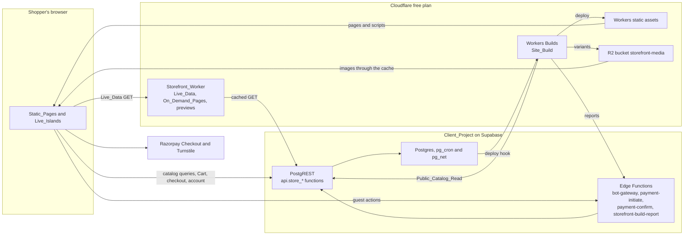
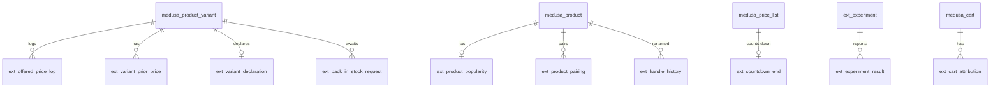

# Design Document: Storefront Redesign

## Overview

The Storefront is an Astro site. Site_Builds pre-render it into Static_Pages in English and Hindi, and Cloudflare serves them as Workers static assets on the free plan, where static requests are free and unlimited (Req 1). The Storefront_Worker runs only for Live_Data, On_Demand_Pages and previews. Shoppers' browsers call spec 1's Store_API directly for catalog queries, Carts, checkout and accounts.

This spec builds on spec 1 (the Store_API, the Bot_Check gateway, payments, Analytics_Events and catalog versions) and on spec 2 (the Admin_App, Alerts, the Storefront_Funnel and the analytics facts). It adds the backend parts and Admin_App screens that Req 22 lists.

Design goals, in priority order:

1. Honest selling: every price, count, date and claim comes from Backend data, and no Dark_Pattern appears on any page (Req 10, 11, 16).
2. Speed on budget phones: Largest Contentful Paint within 2.5 seconds on slow 4G, and at most 60 KB of JavaScript before the first interaction on catalog pages (Req 3).
3. Phone-first use: one-handed reach, short pages, and the deciding facts before the details (Req 4, 9).
4. No hosting cost for small and medium stores: Cloudflare's free plan, with known limits and safe fallbacks (Req 1).
5. Measured persuasion: every Persuasion_Component can be switched off and tested against the store's own sales (Req 19).

The Legacy_Storefront misses these goals in specific ways. Its product page stacks about ten information sections, it ships the React and Next.js runtime on every page, and its checkout calls a third-party PIN code service. The redesign keeps the Legacy_Storefront's URLs (Req 23) and replaces the rest.

The design has these main parts: the page shell and design system; the page designs; the Persuasion_Components; the Site_Build pipeline; the Storefront_Worker and Live_Data; images; languages; navigation, search and catalog pages; prices and the Prior_Price; delivery dates and countdowns; Cart and checkout; accounts and orders; shopper requests; legal disclosures; consent, analytics and Experiments; Business_Presets and Sections; search engine data; security; backend and Admin_App additions; cutover.

## Architecture

### System context

Pages, scripts and PIN code shards come from Workers static assets, images come from R2 through Cloudflare's cache, and data comes from Supabase.

### Request paths

| Path | Entry point | Where the work runs | Cost on the free plan |
|---|---|---|---|
| Page views | Workers static assets | No server code (Req 1.3) | Free and unlimited |
| Live_Data | `GET /_live/v1/products` | Storefront_Worker with the Cache API; `api.store_live_data` on a miss (KD-3) | About one Worker request per page view |
| Pages of records published after the last Site_Build | Storefront_Worker fallback route | Astro rendering in the Worker, cached by catalog version (KD-5) | One Worker request per view |
| Previews from the Admin_App | `GET /_preview/...` with a preview token | Storefront_Worker | One Worker request per view |
| Filters, sorting, search, suggestions, reviews and postal code checks | GET to `api.store_*` | Spec 1 catalog reads in Postgres | Supabase only |
| Cart, checkout and account | POST to `api.store_*` | Spec 1 functions | Supabase only |
| Guest placement with Cash_On_Delivery, order access, Enquiries, Quotations, reviews, Back_In_Stock_Alerts and newsletter sign-up | Edge Function `bot-gateway` | Turnstile check, then a service function | One Edge Function call |
| Online payment | `payment-initiate`, Razorpay Checkout, `payment-confirm` | Spec 1 payment flow; `payments-webhook` completes the Order if the browser closes | Two Edge Function calls |
| Site_Builds | pg_cron and pg_net call the Workers Builds deploy hook | Build on Cloudflare from Public_Catalog_Read data (KD-4) | Build minutes |
| Images | `media.<store domain>` | Cloudflare's cache in front of R2 (KD-6) | No egress charge; R2 reads on cache misses only |

### Repository layout

| Path | Contents | Deployed to |
|---|---|---|
| `apps/storefront/` | The Astro app, with its own `package.json` and lockfile, excluded from the root build | Cloudflare Workers |
| `apps/storefront/src/pages/` | Routes; each route builds the English page and the `/hi/` page | Static_Pages |
| `apps/storefront/src/islands/` | Preact Live_Islands | Static assets |
| `apps/storefront/src/persuasion/` | Persuasion_Components and `rationale.json`, which holds each Component_Rationale in English and Hindi | Static assets; read by the Admin_App |
| `apps/storefront/src/lib/` | Pure modules: price display, delivery dates, countdowns, URL state, formatting, sanitizing, consent and Experiment assignment | Static assets and the Storefront_Worker |
| `apps/storefront/src/worker.ts` | The Storefront_Worker entry | Cloudflare Workers |
| `apps/storefront/presets/` | The seven Business_Preset definitions | Read by the Admin_App and the build |
| `apps/storefront/data/pincodes/` | The India Post PIN code directory and its licence note | Split into static shards at build |
| `apps/storefront/scripts/` | Data fetch, image processing, budget and CSP checks, `_headers` and `_redirects` generation, build reports and deploy | Build only |
| `supabase/migrations/` | Spec 3 migrations, ordered after spec 2's | Supabase |
| `supabase/functions/storefront-build-report/` | Receives Site_Build reports | Supabase |
| `apps/admin/` | The Admin_App screens of Req 22.5 | Cloudflare Pages |
| `src/` | The Legacy_Storefront; only the cutover redirect and the order guard change | Existing app |

### Interfaces with other specs

- Spec 1 supplies the Store_API and gains the additions listed in "Backend and Admin_App additions".
- Spec 2 supplies the Admin_App, Alerts, `order_fact` and the Storefront_Funnel rollups, and gains the screens of Req 22.5.
- Spec 4 sets the store domain, the Cloudflare account, the R2 bucket, the Workers Builds project with its secrets, and the initial Business_Preset.

## Key Decisions

Each decision states what was chosen, why, and what follows from it. A **Problem** line records a known risk and how the design handles it.

### KD-1: Astro static output on Workers static assets

- **Decision.** The Storefront is an Astro 6 site with static output and Astro's Cloudflare adapter. Every page that exists at build time is pre-rendered in English and Hindi and deployed as Workers static assets. A custom Worker entry handles only Live_Data, On_Demand_Pages and previews (KD-3, KD-5).
- **Why.** Requests to static assets are free and unlimited ([Cloudflare](https://developers.cloudflare.com/workers/static-assets/billing-and-limitations)), while Worker requests on the free plan stop at 100,000 a day, with 10 ms of CPU time each ([Workers limits](https://developers.cloudflare.com/workers/platform/limits/)). Astro sends no JavaScript for a component unless the component asks for it, and the Astro team now works at Cloudflare ([Cloudflare blog](https://blog.cloudflare.com/astro-joins-cloudflare)). Next.js through OpenNext was rejected because it renders pages in the Worker, so every page view would use the daily Worker allowance, and React's runtime alone would use most of the 60 KB budget.
- **Consequences.** Page content changes through a Site_Build, while prices, stock and the Cart change through Live_Islands. A free-plan deployment holds at most 20,000 files, which fits about 9,000 products in two languages. A larger catalog fails the build with the exceeded limit (Req 1.8) and needs the Workers Paid plan, which allows 100,000 files.

### KD-2: Preact islands with shared stores

- **Decision.** Interactive parts are Preact components hydrated as Astro islands: the header and the Buy_Box hydrate at once, rails and reviews when they near the viewport, and the consent banner when the browser is idle. Islands share the Cart, session, consent and Live_Data state through nanostores.
- **Why.** Preact with signals adds about 5 KB, while React would use most of the budget before any feature code (Req 3.2).
- **Consequences.** A page with no other interactive part ships only the shell script for the Cart count, the bottom navigation and the consent check. CI measures each page type's compressed initial JavaScript (Req 3.3).

### KD-3: Live_Data through the Storefront_Worker

- **Decision.** Each page collects the product IDs of its Live_Islands and sends one request, `GET /_live/v1/products?ids=…&region=…`, after the first render. The Storefront_Worker reads the store's catalog version from the Cache API, refreshed from spec 1's `api.store_catalog_versions` at most every 10 seconds. It answers from the cache entry keyed by that version, the sorted IDs and the Region, and on a miss calls the new `api.store_live_data` and keeps the answer for the Live_Data_Max_Age (Req 2.1, 2.3).
- **Why.** A shared cache keeps repeat views off Postgres, and the version key shows a change at the next request instead of after the cache lifetime.
- **Consequences.** A page view costs about one Worker request, so the free plan covers about 100,000 page views a day. When the Worker fails or is over its limit, the client calls `api.store_live_data` on Supabase directly (Req 1.12).
- **Problem:** Customer_Group prices must never enter a shared cache, so a signed-in Registered_Customer's prices come from spec 1's `api.store_price_for_customer` with the shopper's JWT and `no-store` (Req 2.7).

### KD-4: Site_Builds on Workers Builds

- **Decision.** Workers Builds builds and deploys the Storefront from the repository. A Scheduler job runs every minute and calls the project's deploy hook through pg_net when a Storefront change is newer than the last build's data snapshot, no build is running, the last build started at least one Rebuild_Interval ago and the month's build minutes are below 90% of the allowance (Req 1.4, 1.5, 1.7). The hook URL is a Secret in Supabase Vault (Req 21.8). The build reads only Public_Catalog_Read data with the public key, and reports to the Edge Function `storefront-build-report` with a build-report secret that can write build records only.
- **Why.** Workers Builds' free plan includes 3,000 build minutes a month, one build at a time and a 20-minute timeout ([Workers Builds limits](https://developers.cloudflare.com/workers/ci-cd/builds/limits-and-pricing/)), and one build per interval covers every change made in it. A Cloudflare API token in the database was rejected because it would grant far more than starting builds.
- **Consequences.** Prices and stock never wait for a build. A build with no end report 30 minutes after its deploy hook call counts as failed and as 20 minutes used.
- **Problem:** Every project in the Cloudflare account shares the build minutes, so spec 4 gives each client its own account, and an owner can lower the allowance setting when the account builds other projects.

### KD-5: On_Demand_Pages through a fallback route

- **Decision.** Workers static assets answer every request for an existing file. Any other request reaches the Storefront_Worker, which accepts product, category, collection and preview paths in both languages and returns the static not-found page with status 404 for every other path. For a catalog path, the Worker calls the new `api.store_resolve_path`, which returns the published record, the current handle of a renamed record, or nothing. The Worker then renders an On_Demand_Page with the same Astro components as the build (Req 1.9), redirects with status 301 to the current handle (Req 20.8), or returns the not-found page (Req 1.10). Rendering reads the layout, content, Component_Switches and Experiments from a JSON file that the last Site_Build deployed as a static asset, and the Worker caches each rendered page by the record's catalog version.
- **Why.** Astro pre-renders a route only for the paths known at build time. One fallback in the Worker entry covers new records and renamed handles, with no redirect file that grows with every rename.
- **Consequences.** A new product's page works at once, and the next Site_Build makes it a Static_Page.
- **Problem:** The free plan allows 10 ms of CPU time per Worker request, so CI renders the largest product page in the Workers runtime and fails when rendering takes more than 6 ms of CPU time.

### KD-6: Images in R2 behind Cloudflare's cache

- **Decision.** Each Site_Build processes new and changed product images. It downloads each original from spec 1's `catalog-media` bucket or a legacy Cloudinary URL, writes WebP and JPEG variants 320, 480, 720, 1080 and 1440 px wide with `sharp`, and uploads them to the R2 bucket `storefront-media`, which `media.<store domain>` serves with a one-year cache lifetime. Pages use `<picture>` elements with WebP and JPEG `srcset` lists (Req 3.4). Image work stops after 8 minutes of a build, and an image without variants uses its original URL until a later build processes it.
- **Why.** Cloudflare Images' free plan allows 5,000 unique transformations a month ([Cloudflare Images pricing](https://developers.cloudflare.com/images/pricing)), which a few hundred products in several sizes use up. R2 charges nothing for egress ([R2 pricing](https://developers.cloudflare.com/r2/pricing/)), and cached responses do not read R2 at all.
- **Consequences.** Images never count toward the deployment's 20,000 files. The first builds after migration work through the image backlog.
- **Problem:** R2's free tier covers 10 GB of storage, enough for more than 10,000 images with their variants, but activating R2 needs a payment method on the Cloudflare account. AVIF variants were left out because they take several times longer to encode.

### KD-7: Persuasion_Components read evidence, never literals

- **Decision.** Each Persuasion_Component is a function of one typed evidence object from the Backend, such as `{band: 25}` for the Popularity_Notice or `{endsAt, nextAmount}` for the Sale_Countdown, and renders nothing when the evidence is missing. Store_API reads return bands, end times and thresholds, never raw sales counts. Lint rules reject a count, timer or claim rendered from a literal value, and an optional input that starts selected (Req 11.21, 11.22).
- **Why.** The Dark_Pattern guidelines ban false urgency, basket sneaking and the 11 other listed practices ([Grant Thornton summary](https://www.grantthornton.in/globalassets/1.-member-firms/india/assets/pdfs/dark_pattern_flyer_2024.pdf)), and from 1 January 2027 the store must audit its interface every year (Req 16.7-16.9).
- **Consequences.** Each component is a small pure function with property tests, and its Component_Rationale lives next to its code.

### KD-8: Prior_Price from a log of offered prices

- **Decision.** `ext.offered_price_log` records each change of each variant's anonymous offered price per currency and Region. Triggers on price rows record changes at once, and a job records Price_List starts and ends when they happen, using spec 1's `internal.next_price_boundary`. `internal.prior_price` finds the most recent fall and the lowest price of the 30 days before it, and `ext.variant_prior_price` stores the result for reads (Req 10.8, 10.9).
- **Why.** The 2026 amendment defines the prior price as the lowest price of the 30 days before a price reduction ([S.S. Rana](https://ssrana.in/articles/indias-new-e-commerce-rules-what-the-consumer-protection-e-commerce-amendment-rules-2026-mean-for-platforms-marketplaces-and-sellers-in-india/)). A log of what shoppers were offered avoids rebuilding past Price_Lists, which may have been edited since.
- **Consequences.** No struck-through price can show an amount that was not offered in the 30-day window. The MRP is shown when declared but never used as a reference price (Req 10.4).
- **Problem:** The log starts when this spec is deployed, so for the first 30 days the window holds only the logged days.

### KD-9: Experiments assigned before the first paint

- **Decision.** Each Site_Build writes the running Experiments into every page as a small JSON block. A hashed inline script at the top of `<head>` reads the Consent_Choice and the analytics session ID, assigns the session by comparing an FNV-1a hash of the session ID and the Experiment ID with the treatment share, and sets an attribute on `<html>` before the first paint. Both Experiment_Variants are in the page, and CSS shows the assigned one (Req 19.5, 19.6).
- **Why.** Assigning in a later script would show the control and then switch, which skews results and distracts shoppers.
- **Consequences.** Starting or stopping an Experiment takes effect with the next Site_Build, so the Admin_App offers to start one at once. Results count only Exposures from deployed pages, and no verdict appears before both variants reach the planned sample size (Req 19.9, 19.10).

### KD-10: Consent before measurement

- **Decision.** Until the shopper chooses, every optional purpose counts as refused (Req 17.2). Without analytics consent, the Storefront creates no session ID, sends no Analytics_Events, assigns no Experiment, loads no Marketing_Tag, and creates Carts without attribution or session ID, so spec 1's server events stay unlinked to any Storefront_Session (Req 18.5).
- **Why.** India's DPDP Rules apply their notice and consent duties from 13 May 2027 ([DPDP Rules timeline](https://perimattic.com/products/dpdp-compliance/dpdp-rules-2025/)), and consent-first measurement meets them from launch.
- **Consequences.** Funnel Reports and Experiments cover consenting sessions only, while revenue Reports cover every Order. The Admin_App shows the share of recorded Consent_Choices that allow analytics next to funnel figures.

### KD-11: Hindi pages built with the English pages

- **Decision.** Astro's i18n routing builds each page in English at the root and in Hindi under `/hi/`, from `src/i18n/en.json` and `hi.json`, with `hreflang` links between them (Req 5.2). Store content shows as written and carries its language (Req 5.6).
- **Why.** Pre-built Hindi pages load as fast as English ones and can rank in Hindi searches, which translation in the browser cannot offer.
- **Consequences.** The file count doubles, which sets the catalog size of KD-1.

### KD-12: One-page checkout

- **Decision.** Checkout is one page whose steps (contact, delivery address, delivery option and payment) open in turn and collapse into summaries with an edit control (Req 13.2). Guest checkout is the default (Req 13.1). The address step asks for the postal code first, then fills city and state and shows serviceability, Cash_On_Delivery and the Delivery_Estimate (Req 13.4). UPI comes first through Razorpay's display configuration and Cash_On_Delivery last (Req 13.9). The pay control states the exact total, which the Storefront sends as spec 1's expected total (Req 13.10).
- **Why.** In Baymard's testing, non-linear checkouts confused participants ([Baymard](https://baymard.com/blog/checkout-flow-ux-optimization)), and extra costs are the top reason for abandoned checkouts, at 39% ([Baymard](https://baymard.com/learn/reduce-cart-abandonment)). UPI carried 67% of India's digital transactions in 2025 ([Mint](https://www.livemint.com/news/india-digital-payments-cards-upi-emi-decline-net-banking-sector-payment-trends-seasonality-11777297943038.html)).
- **Consequences.** Checkout never changes page, so its 120 KB budget holds the form, the checks and the payment loader.

### KD-13: PIN code directory as static shards

- **Decision.** The build splits the All India Pincode Directory from data.gov.in, published under the Government Open Data License – India, into at most 90 JSON shards by the first two digits, and the browser fetches one shard when a shopper types a code.
- **Why.** It replaces the third-party lookup that the Legacy_Storefront calls, so a shopper's postal code goes only to the store's own domain and spec 1, and lookup keeps working when that service is down.
- **Consequences.** The footer credits the data source, as the licence requires, and a script refreshes the directory from the published file.

### KD-14: One header CSP for every page

- **Decision.** Every inline script in the Storefront is one of a small fixed set whose text is the same on every page, such as the `<head>` Experiment script, so one `Content-Security-Policy` header with their SHA-256 hashes covers every page. `_headers` sends it with `frame-ancestors 'none'`, HSTS, `nosniff` and the referrer policy, and the Storefront_Worker adds the same headers to its responses (Req 21.1, 21.2). Script sources are the Storefront's origin plus Turnstile, Razorpay and the configured Marketing_Tags, and `connect-src` adds the Supabase project. The build fails on an inline script outside the set.
- **Why.** A static host cannot issue nonces, and fixed scripts keep the hashes stable across pages.
- **Consequences.** Data for islands travels in `type="application/json"` blocks, which browsers never run, and store HTML passes an allowlist sanitizer at build and in On_Demand rendering (Req 21.3).

### KD-15: System fonts by default

- **Decision.** Text uses the system font stacks for Latin and Devanagari. Client_Branding may add one self-hosted, subset heading font per script, shown with `font-display: swap`, and the Devanagari font loads only on Hindi pages and pages with Devanagari store content (Req 3.9).
- **Why.** Android phones ship Noto Sans and Noto Sans Devanagari, so system fonts show Hindi well at no download cost.

## Components and Interfaces

Each component lists its responsibility, its interfaces, the steps where correctness matters and the requirements it covers.

### Page shell and design system

- **Responsibility.** The layouts, header, bottom navigation, footer, tokens and accessible primitives of every page (Req 4, 6.10, 7.1, 7.9).
- **Layouts.** Phones below 768 px get one column, a 2-column product grid and the bottom navigation. Tablets from 768 px get a 3-column grid. Desktops from 1,024 px get a filter column and a sticky Buy_Box column, and a 4-column grid from 1,280 px (Req 4.1, 8.1).
- **Header.** The logo, the search field (an icon on PDPs to save height), the Cart count and the account entry. On phones the header slides away while the shopper scrolls down and returns on any scroll up.
- **Bottom navigation.** Home, Categories, Search, Cart and Account, each a 44 × 44 px target within the thumb's reach. It hides while a page shows a bottom action bar: the Cart, checkout, and a PDP while the Sticky_Buy_Bar shows (Req 4.2, 4.3). About half of phone users hold the phone in one hand ([Hoober, A List Apart](https://alistapart.com/article/how-we-hold-our-gadgets/)), so primary actions sit at the bottom of the screen.
- **Footer.** The links of Req 7.9, the language switch, the PIN code data credit and a summary of the Seller_Details.
- **Tokens.** Client_Branding colours become CSS variables. Body text is at least 16 px, so phones do not zoom into form fields, and spacing follows a 4 px scale.
- **Primitives.** A sheet and a dialog with a focus trap and Escape; disclosure sections; tabs; a polite live region for messages; fields whose labels stay visible and whose errors show when the shopper leaves the field (Req 4.9); and inputs with `inputmode` and `autocomplete` values (Req 4.10).
- **WCAG 2.2 details.** Sticky bars set `scroll-padding-bottom`, so they never hide a focused field (2.4.11). Carousels and sliders have buttons as well as swipe (2.5.7). One_Time_Code fields accept paste and autofill (3.3.8). The billing address defaults to the delivery address (3.3.7). The help link sits in the same footer place on every page (3.2.6) (Req 4.5, 4.6).
- **Motion.** Carousels move only on a swipe or tap (Req 4.7), and the reduced-motion preference turns transitions off (Req 4.8).
- **Back navigation.** A PLP keeps its filters, sort order and loaded count in the URL and its scroll position in `history.state`, and restores them on the back control (Req 4.11).

### Page designs

Each page answers the shopper's questions in the order the shopper asks them. The order below is the phone layout; tablets and desktops keep the order and place parts side by side.

| Page | Phone order | Tablet and desktop | Why this order |
|---|---|---|---|
| Home | Header with search; one hero banner with one action; a category grid of up to 8 tiles; Recently_Viewed, for returning shoppers only; a best-selling rail; an offer banner, only while a Promotion runs; Review_Highlights; Trust_Strip; new arrivals; brand story; FAQ; newsletter sign-up | Wider grids, and rails with 4 to 5 cards | Most visitors look for a product, so search and categories come first. One static hero keeps the first screen to one image and one message. Returning shoppers see their recent products before anything new |
| PLP | Breadcrumbs; the title and the product count; a sticky bar with sort and filter controls; filter chips; a 2-column grid of Product_Cards; a load-more button with "Showing 24 of 120"; the category description | Filters in a sheet on tablets and in a column on desktops | One card per product with swatches keeps the list short; Baymard found that 42% of sites list variations separately ([Baymard](https://baymard.com/research-articles/mobile-ux-ecommerce)). The count on the apply button shows each filter's effect before the shopper applies it. Load-more keeps the footer reachable and the position restorable |
| PDP | Gallery; name; Review_Summary and Popularity_Notice; price block; variant buttons; status line with stock and the Dispatch_Countdown; postal code with the Delivery_Promise; quantity, add-to-cart and Bundle_Offer; Trust_Strip; Key_Highlights; PDP_Blocks, collapsed except the description; reviews with Review_Highlights; Goes_Well_With and one more rail | Gallery and details side by side on tablets; on desktops the Buy_Box column stays in view | The order follows the shopper's questions: what is it, is it good, what does it cost, which one, when will it arrive, how do I buy. Five Key_Highlights replace the Legacy_Storefront's long sections, and the details stay one tap away (Req 9.1, 9.8, 9.9) |
| Cart | Lines with quantity controls; Free_Delivery_Progress; Savings_Summary; "Have a promotion code?"; totals with every charge; Trust_Strip; a bottom bar with the total and the checkout control | Lines and a sticky summary side by side | Shoppers see the full cost before checkout, because unexpected costs are the top abandonment reason ([Baymard](https://baymard.com/learn/reduce-cart-abandonment)) |
| Checkout | Checkout_Progress; a collapsed order summary with the total; contact; address with the postal code first; delivery options with dates; payment with UPI first; a bottom bar with "Pay ₹…" | The form and a sticky summary side by side | The postal code answers the delivery date and Cash_On_Delivery early, before the shopper invests more effort. Guests check out without an account (Req 13) |
| Confirmation | Order number; Delivery_Promise; items and total; payment status; next steps; account creation for guests | The same, centred | After paying, the shopper first wants to know that the Order went through and when it arrives (Req 14.1, 14.2) |

### Persuasion_Components

Each row is the Component_Rationale that `rationale.json` holds and that the Admin_App shows next to the Component_Switch (Req 11.25). The metric is the Storefront_Funnel step or spec 2 measure that an Experiment compares (Req 19). Sources named without a link are the original published studies.

| Component | Principle and evidence | Shown only when | Expected effect and metric | Dark_Pattern guard |
|---|---|---|---|---|
| Review_Summary | Social proof: products with 5 reviews were about 270% more likely to be bought than products with none ([Spiegel Research Center](https://spiegel.medill.northwestern.edu/how-online-reviews-influence-sales)) | The product has at least 1 published review | More product views lead to Cart additions; View_To_Cart_Rate | Published reviews only, with the review count beside the average |
| Review_Highlights | Two-sided messages are more credible than praise alone (Eisend, 2006, meta-analysis) | A 4 or 5 star review and a 1 to 3 star review, each with at least 100 characters, exist | Trust before buying; View_To_Order_Rate | Picked by rule, the newest of each, never by hand |
| Popularity_Notice | Social proof (Cialdini, 1984) | At least 5 non-canceled Orders in 7 days | View_To_Cart_Rate | A banded true count, and no "people viewing now" |
| Low_Stock_Notice | Scarcity raises perceived value (Worchel, Lee and Adewole, 1975) | Sellable_Quantity above 0 and at or below the threshold, with no backorders | Cart additions; View_To_Cart_Rate | The exact live quantity, hidden when Live_Data is stale |
| Sale_Countdown | Loss aversion: losses weigh about twice as much as equal gains (Tversky and Kahneman, 1992) | A real Price_List or Promotion ends within 48 hours | Orders during sales; conversion rate | The real end time, never restarted, with the later price shown at zero |
| Dispatch_Countdown | A concrete deadline makes a benefit tangible, and slow delivery is a leading abandonment reason ([Baymard](https://baymard.com/lists/cart-abandonment-rate)) | Cutoff set, a working day, before the cutoff, in stock | Checkout starts; the checkout started step | The store's real cutoff and the server's clock |
| Delivery_Promise | Certainty: Baymard advises a delivery date instead of a shipping speed, which 41% of sites do not show ([Baymard](https://baymard.com/blog/shipping-speed-vs-delivery-date)) | The postal code is known | Completed checkouts; the Order placed step | Dates from Serviceability_Rules and working days only |
| Free_Delivery_Progress | Goal gradient: people speed up as they near a reward ([Kivetz, Urminsky and Zheng, 2006](https://journals.sagepub.com/doi/abs/10.1509/jmkr.43.1.39)) | A threshold Shipping_Option applies to the address | Higher average order value | The real threshold for the address |
| Savings_Summary | Mental accounting: one total saving reads as one clear gain (Thaler, 1985) | The total saving is above 0 | Checkout starts | Prior_Price savings and Promotion discounts only, never the MRP |
| Trust_Strip | Risk reduction: distrust of card security and of return terms are leading abandonment reasons ([Baymard](https://baymard.com/lists/cart-abandonment-rate)) | Store_Settings and the Backend confirm each statement | Checkout starts | No statement without a Backend fact |
| Goes_Well_With | Complements cut search effort (choice architecture, Thaler and Sunstein, 2008) | The store paired products | Items per Order | Nothing enters the Cart without its own tap |
| Bundle_Offer | Price bundling raises perceived value (Stremersch and Tellis, 2002) | An active buy-get Promotion names the set | Higher average order value | The set price and the saving shown, and the set added only by its own tap |
| Recently_Viewed | Recognition over recall (Nielsen's usability heuristics) | The device has viewed products | Conversion on return visits | Kept on the device only, with a clear control |
| Back_In_Stock_Alert | Commitment: a shopper who asks to be told is likely to buy (Cialdini, 1984) | The variant has a Sellable_Quantity of 0 | Orders after alert emails | One email, deleted after sending or after 90 days |
| First_Order_Offer | Reciprocity: a welcome gift invites a first purchase (Cialdini, 1984) | A first-order Promotion is configured; once per session; not within 30 days after a close | First-Order conversion | The conditions shown, and a close control as clear as the offer |
| Checkout_Progress | Goal gradient and visible progress (Kivetz and colleagues, 2006; [Baymard](https://baymard.com/blog/checkout-flow-ux-optimization)) | Always in checkout | Completed checkouts | Only the real steps |
| Sticky_Buy_Bar | Thumb reach: about half of phone use is one-handed ([Hoober](https://alistapart.com/article/how-we-hold-our-gadgets/)), and a sticky add-to-cart keeps the action in reach ([The Good](https://thegood.com/insights/sticky-add-to-cart/)) | Phone width, with the Buy_Box out of view | Cart additions; View_To_Cart_Rate | The Buy_Box's own price and state, never covering a focused field |

- **Price block.** `src/lib/price-display.ts` turns a variant's price, Prior_Price, MRP, net quantity and tier prices into the price block: the price with "incl. of all taxes"; in a Price_Reduction only, the struck-through Prior_Price with a control that explains it and the saving as an amount and as a percentage rounded down to a whole number; the MRP line, never struck through; the unit sale price; and each tier's minimum quantity, unit price and saving per unit (Req 10.1-10.6).
- **Badges.** A Product_Card shows at most 2 badges, in the Business_Preset's priority order, each only while its rule holds: Sale (a Price_Reduction), New (published in the last 30 days), Best seller (among the 20 best-selling products of the last 30 days), Low stock (the Low_Stock_Notice rule), Free delivery (the price reaches the Free_Delivery_Threshold) and Made in India (the declared country of origin) (Req 8.3).
- **Honest behavior.** No control pre-selects a paid item or a consent (Req 11.22). Decline, close and skip controls match the size and contrast of the accept control and use neutral words (Req 11.23). The First_Order_Offer, the Hindi prompt and the consent banner never block the page, and each interrupting element shows at most once per Storefront_Session (Req 5.5, 11.24, 17.1).
- **Countdowns.** Countdowns use the server time from the latest Live_Data response, so a wrong device clock cannot show a false deadline. They tick once a second only while visible, and their live region stays silent, with a static "Offer ends at 9:00 PM" text for screen readers.
- **Stale data.** When Live_Data is older than the Live_Data_Max_Age or has not loaded within 8 seconds, the Low_Stock_Notice, the Popularity_Notice and both countdowns hide, and the price shows the note that the Cart confirms the price (Req 2.4).

### Site_Build pipeline

- **Responsibility.** Building, checking and deploying the Static_Pages, and recording each Site_Build (Req 1).
- **Changes that need a build.** Catalog_Change_Events, review moderation, and saves of the Sections, PDP_Blocks, Business_Preset, Client_Branding, Component_Switches, Experiments, product pairings, Key_Highlights, Mandatory_Declarations and the content of Req 16. Triggers set `ext.storefront_state.last_change_at` (Req 1.4).
- **Steps.** A Site_Build runs in this order:

1. **Start.** `scripts/build-report.mjs` reports the start, and the Edge Function records the data snapshot time.
2. **Data.** `scripts/fetch-catalog.mjs` reads `api.store_catalog_export` in pages of 250 products, plus categories, collections, layouts, content, Component_Switches, running Experiments and the legacy URL list, with the public key only (Req 21.8).
3. **Images.** `scripts/process-images.mjs` makes the variants of new and changed images, for at most 8 minutes (KD-6).
4. **Pages.** `astro build` writes the Static_Pages in both languages, the sitemaps, the robots file, the PIN code shards and the configuration JSON that On_Demand rendering reads (KD-5).
5. **Checks.** The build fails when the file count exceeds the plan limit (20,000 on the free plan), a page type exceeds its JavaScript budget, an inline script is outside the hashed set, or a legacy URL of a published record has no page or route. It lists products that lack required Mandatory_Declarations as warnings (Req 1.8, 3.3, 16.5, 23.2).
6. **Headers.** The build writes `_headers` with the CSP and its hashes, and `_redirects` with the Legacy_Storefront's non-catalog paths (Req 23.1).
7. **Deploy.** `scripts/deploy.mjs` runs `wrangler deploy` and reports the result with the duration, page count, file count and warnings. A failure in any step stops before deploy, so the previous deployment keeps serving, and the report records the failed step (Req 1.8).

- **Records.** `api.service_site_build_report` writes `ext.site_build`, and a failed build also writes a failed `ext.job_run` row, which raises spec 2's job-failure Alert (Req 1.8). The month's build minutes are the sum of the reported durations, rounded up per build (Req 1.6, 1.7).

### Storefront_Worker and Live_Data

- **Responsibility.** Live_Data, On_Demand_Pages, previews and the not-found response for each request that no static file answers (Req 1.9-1.12, 2.1-2.4, 21.7).
- **Routes.** The Worker accepts only GET and HEAD and answers every other method with 405 (Req 21.7):

| Path | Handling |
|---|---|
| `/_live/v1/products?ids=…&region=…` | Live_Data for up to 60 products, from the cache or `api.store_live_data` (KD-3) |
| `/product/<handle>`, `/shop/<category path>`, `/collections/<handle>`, and the same paths under `/hi/` | `api.store_resolve_path`, then an On_Demand_Page, a 301 to the current handle, or the not-found page with 404 (KD-5) |
| `/_preview/<path>?token=…` | A render with the draft layout or unpublished product that `api.store_preview` returns for a valid token, with `Cache-Control: private, no-store` and `noindex` |
| Every other path, including `/_ondemand/` | The static not-found page from the assets binding, with 404 |

- **Live_Data contents.** For each product: `available`, which is false for an unpublished or deleted product, and the current handle. For each variant: the price and currency, the Prior_Price in a Price_Reduction, the Stock_State, the Sellable_Quantity only at or below the low-stock threshold, the backorder flag, the Popularity_Count band, and the end time and later price behind an allowed countdown (KD-7). Each response also carries the server time, the data time and the dispatch settings: the Dispatch_Cutoff, working days and holidays.
- **Unavailable products.** When `available` is false, the Buy_Box states that the product is no longer available and disables the add-to-cart control (Req 1.11).
- **Layout.** Each Live_Island keeps the box of its built value, so loading Live_Data shifts nothing (Req 2.2).
- **Cache keys.** Keys hold the catalog version, the Region and the sorted IDs, so the order of IDs never splits the cache. The Cache API works on the store's own domain, and on `*.workers.dev` preview hosts the Worker skips it.
- **Signed-in prices.** A request with an `Authorization` header is never answered from the cache or stored in it, and a signed-in Registered_Customer's islands read prices from spec 1's `api.store_price_for_customer` (Req 2.7).
- **On_Demand rendering.** The Worker rewrites a catalog path to an internal `/_ondemand/` Astro route that uses the same components as the static route; outside requests for `/_ondemand/` get the not-found page.
- **Fallback.** A response that is not Live_Data JSON, such as Cloudflare's error page once the daily request limit is reached, counts as a failure, and the island calls `api.store_live_data` on Supabase with GET (Req 1.12).
- **Static file caching.** `_headers` gives the content-hashed files under `/_astro/` `Cache-Control: public, max-age=31536000, immutable`, and HTML pages `max-age=0, must-revalidate`, so a new deployment shows at once (Req 1.2). The Worker adds KD-14's security headers to its own responses, because `_headers` covers static files only.
- **Abuse limit.** Unknown paths reach the Worker and count toward the daily limit, so the free plan's rate limiting rule caps each client IP's requests to `/_live/`, `/_preview/` and catalog paths; spec 4 sets it up.

### Images

- **Responsibility.** Image variants, markup and loading order (Req 3.4-3.6, 3.8).
- **URLs.** Variants live at `media.<store domain>/<image id>/<content hash>/<width>.<webp|jpg>`, so a changed image gets new URLs and the one-year cache never serves an old image.
- **Markup.** `<picture>` with a WebP `<source>` and a JPEG ``, `srcset` lists with width descriptors, `sizes` for each slot (for example `50vw` for phone grid cards), and `width` and `height` from the original's aspect ratio (Req 3.6).
- **Loading.** The largest image of the first viewport (the hero, the first PLP row or the first gallery image) gets `fetchpriority="high"`; every other image gets `loading="lazy"` and `decoding="async"` (Req 3.5).
- **Save-Data.** When `navigator.connection.saveData` is true, the `<head>` script starts a `MutationObserver` that replaces the `srcset` of each lazy image and its `<source>` elements with the 1× candidate that the build writes in a `data-sd` attribute, before the image starts loading. Videos show their poster and a play control (Req 3.8). The largest image of the first viewport keeps its `srcset`, because the browser's preload scanner can fetch it before any script runs.

### Languages

- **Responsibility.** Language routing, the switch, remembered choices and formats (Req 5).
- **Routing.** `/<path>` is English and `/hi/<path>` is Hindi. Each page links to the other with `hreflang` (`en-IN`, `hi-IN` and `x-default`), sets `<html lang>`, and marks store content with its language: `hi` for Devanagari text and `en` otherwise (Req 5.2, 5.6).
- **Switch.** The switch maps the path to the other language and keeps the query string, so the filters, the sort order and the search query carry over; the Cart lives on the device and is unaffected (Req 5.3). The choice is stored on the device and, for a signed-in Registered_Customer, in the Customer's metadata through spec 1's `api.store_update_customer` (Req 5.4).
- **Hindi prompt.** With no stored choice, an English page whose browser lists Hindi first shows a small bar once, which blocks nothing; closing it stores the close time (Req 5.5).
- **Formats.** `src/lib/format.ts` uses `Intl.NumberFormat` in `en-IN` or `hi-IN` with `numberingSystem: 'latn'` and shows INR with no decimals unless the amount has paise (Req 5.7). Dates use `Intl.DateTimeFormat` with the weekday, the day and the short month, the year only outside the current year, and `timeZone` set to the Store_Timezone (Req 5.8).
- **Completeness.** CI fails when `hi.json` lacks a key of `en.json`, and a lint rule rejects interface text written directly in components (Req 5.1, 5.9).

### Navigation, search and catalog pages

- **Responsibility.** The category menu, search, breadcrumbs, and PLP and PDP behavior (Req 7, 8, 9).
- **Category menu.** The top-level categories in the store's order, each opening its subcategories, with a link to every top-level PLP; on phones it opens from the bottom navigation's Categories entry (Req 7.2).
- **Search.** The field has a submit button (Req 7.3). After 2 characters and a 250 ms pause, suggestions show up to 6 products with images and prices and up to 4 categories, with the matched text highlighted, from spec 1's `store_list_products` with `p_q` (Req 7.4). Submitting opens the results PLP with spec 1's spelling-tolerant matching (Req 7.5), and no results show the query, the top-level categories and a best-seller rail (Req 7.6). An empty focused field shows the last 5 searches with a clear control (Req 7.7).
- **Breadcrumbs.** From the home page to the current category on PLPs and PDPs (Req 7.8).
- **PLP.** The Static_Page holds the first 24 products in the default order. Filters, sort orders and load-more query spec 1's `store_list_products` with GET, so repeated queries come from the cache (Req 8.6-8.8). The filter sheet's apply button shows the count from the same query with a page size of 1 (Req 8.4). Each Product_Card is one product with its swatches (Req 8.2), and the sort control links to the Ranking_Disclosure (Req 8.10).
- **PDP gallery.** Swipe and buttons, a position such as "2 of 6", and a full-size view with pinch and button zoom (Req 9.2).
- **Variants.** Every option value is a button or swatch. Values without an available variant are marked out of stock and stay selectable, so the Back_In_Stock_Alert can show (Req 9.3). Selecting a variant updates the price, images, Stock_State, SKU and Delivery_Estimate in place and writes `?variant=` with `history.replaceState` (Req 9.4).
- **Phone details.** PDP_Blocks are collapsible with only the description open (Req 9.9), and the Sticky_Buy_Bar shows when an `IntersectionObserver` reports the Buy_Box out of view (Req 9.7).
- **Share.** `navigator.share` where the browser has it; otherwise a copy-link control and a WhatsApp link (Req 9.11).

### Prices and the Prior_Price

- **Responsibility.** The offered price log, the Prior_Price, unit and tier prices, delivery charges and offer conditions (Req 10).
- **Log.** A trigger on spec 1's `ext.catalog_variant_price` writes `ext.offered_price_log` whenever a variant's anonymous calculated amount changes in a currency and Region: it closes the open row and opens a new one. Spec 1's `price_boundary` job refreshes prices when a Price_List starts or ends and sets the transaction setting `app.price_effective_at` to the boundary time, so the log records when the price changed, not when the job ran (Req 10.8).
- **Prior_Price.** When a variant's most recent logged change was a fall at time t, `internal.prior_price` returns the lowest amount offered at any moment in the 30 days before t, and otherwise none. The variant is in a Price_Reduction exactly when its current price is below that amount, so a later rise ends the Price_Reduction, and a later fall can claim a saving only against the lowest price of its own 30-day window. The trigger stores the result in `ext.variant_prior_price`, which Public_Catalog_Read responses and Live_Data return (Req 10.2, 10.3, 10.9).
- **Original_Price.** Spec 1's Original_Price, Medusa's compare-at price, is never shown struck through, because the store can set it to any value.
- **Unit and tier prices.** The unit sale price is the price divided by the net quantity from `ext.variant_declaration`, per 1 kg, 1 L, 1 m or 1 unit, rounded to the paisa (Req 10.5). Quantity tiers come from spec 1's tier prices, each with its saving per unit against the single-unit price (Req 10.6).
- **Delivery charges.** `api.store_delivery_rules` returns the Region's charge rules, free-delivery thresholds and Cash_On_Delivery fee for the PDP summary, and `api.store_cart_delivery_preview` returns the Cart's exact charges for a postal code without setting an address (Req 10.7, 12.3). Placement checks the expected total, so no charge can appear after the payment step.
- **Customer_Group prices.** A signed-in Customer's group price shows as "Your price" with no struck-through price, because the log covers anonymous prices only.
- **Offer conditions.** `api.store_list_offers` returns the running automatic Promotions and the code Promotions that the store marks as advertised, each with its conditions in words and its end time, and never an unadvertised code (Req 10.10).

### Delivery dates and countdowns

- **Responsibility.** The Delivery_Estimate, the Dispatch_Countdown and the Sale_Countdown (Req 9.10, 11.6-11.9).
- **Inputs.** The Store_Timezone; the server time, the Dispatch_Cutoff, the working days (default Monday to Saturday) and the holidays from Live_Data; and `eta_min_days` and `eta_max_days` from spec 1's `api.store_check_postal_code`.
- **Dispatch day.** Today, when a Dispatch_Cutoff is set, today is a working day and the store's local time is before the cutoff; otherwise the next working day.
- **Delivery_Estimate.** From the dispatch day plus `eta_min_days` working days to the dispatch day plus `eta_max_days` working days, as dates in the Store_Timezone. A variant with no Sellable_Quantity gets no Delivery_Promise (Req 11.21).
- **Dispatch_Countdown.** The time from now to today's cutoff. At zero it hides and the estimate moves to the next dispatch day (Req 11.8).
- **Sale_Countdown.** The first time a Price_List's end comes within 48 hours, the Backend records that end in `ext.countdown_end`. Live_Data carries the countdown only while the current end equals the recorded end, so after an Admin_User moves the end, that Price_List never shows a countdown again (Req 11.6, 11.7). At zero, the price block shows the later price that Live_Data sent. Promotion countdowns on offer banners and Cart offer lines follow the same rule, and the Admin_App warns before an end with a recorded countdown is moved.
- **Postal code memory.** The last valid postal code is stored on the device and applied on later PDPs and in the Cart (Req 9.10).

### Cart and checkout

- **Responsibility.** The add-to-cart flow, the Cart panel and page, checkout, payment and placement (Req 2.5, 2.6, 2.9, 9.5, 9.6, 12, 13).
- **Cart state.** A nanostore holds the Cart from the latest Store_API response. A Guest_Cart's ID and Cart_Token stay on the device (Req 12.8). A `BroadcastChannel` and the `storage` event update the Cart count in every open tab within 2 seconds (Req 2.9). At sign-in the Storefront calls spec 1's `api.store_cart_transfer`.
- **Panel and page.** The Cart opens as a sheet from the header and the add-to-cart confirmation, and as the `/cart` page, each listing every line with its image, name, variant, unit price, quantity control, line total and remove control (Req 12.1). Signed-in Customers can move a line to the Wishlist (Req 12.7), and an empty Cart links to the top-level categories and the Recently_Viewed products (Req 12.9).
- **Add to cart.** The Buy_Box calls `api.store_cart_add_item`, first creating the Cart when needed, and opens a confirmation sheet with the added line, the subtotal, the Free_Delivery_Progress and controls for the Cart and checkout. A line price that differs from the shown price is stated with both prices (Req 2.5, 2.6, 9.5). A missing option is named and receives the focus (Req 9.6), and a quantity below the minimum order quantity gets the minimum in the error (Req 22.3).
- **Line changes.** A quantity change is sent 400 ms after the last tap and applies the Store_API's response. A removal offers undo for 10 seconds, which adds the same variant and quantity back (Req 12.2). When the Cart opens, each line is compared with the price, availability and quantity stored when it was added, and every change is marked (Req 12.5). An unavailable line keeps checkout disabled until it is removed (Req 12.6).
- **Totals.** The subtotal, Promotion discounts, the delivery charge for the remembered postal code (or the lowest charge, marked as an estimate), the Cash_On_Delivery fee where it applies, the total including taxes, the Savings_Summary and the Free_Delivery_Progress (Req 11.10, 11.11, 12.3). The promotion code field opens from "Have a promotion code?" and shows the Store_API's message on a rejection (Req 12.4).
- **Checkout steps.** One page (KD-12):

1. **Contact.** The email address and the mobile number, checked after removing spaces, a leading 0 or +91: 10 digits starting with 6, 7, 8 or 9 (Req 13.3, 13.6). A signed-in Customer starts at the address step with the default address selected (Req 13.15).
2. **Address.** The postal code first. The city and state fill from the PIN code shard and stay editable, and spec 1's postal code check shows serviceability, Cash_On_Delivery and the Delivery_Estimate; a non-serviceable code keeps payment disabled (Req 13.4, 13.5). The landmark, a different billing address and the GSTIN are optional; a Valid_GSTIN asks for the business name, and both go to `api.store_cart_set_business_details` (Req 13.7).
3. **Delivery option.** Each Shipping_Option with its charge and delivery dates, with the lowest charge selected first (Req 13.8).
4. **Payment.** UPI, then cards, net banking and wallets in Razorpay Checkout's display order, and Cash_On_Delivery last with its fee when spec 1 reports the Cart eligible (Req 13.9). The bottom bar states "Pay ₹1,499" or "Place order, pay ₹1,548 on delivery" (Req 13.10).

- **Placement.** The Storefront creates one Idempotency_Key when the shopper confirms, reuses it for every retry, and sends the shown total as spec 1's expected total (Req 13.10, 13.13). Cash_On_Delivery placement calls `api.store_complete_cart` for a Registered_Customer and the `bot-gateway` placement action for a Guest_Customer. Online payment calls `payment-initiate`, which first verifies a Turnstile token for a Guest_Cart, then opens Razorpay Checkout and sends its result to `payment-confirm`. Turnstile runs at this step only (Req 13.14, 21.4).
- **Recovery.** `totals_changed` shows the old and new totals and asks the shopper to confirm (Req 13.11). A failed payment or a closed payment window keeps the shopper on checkout with every detail kept, and offers a retry or another method (Req 13.12). If the tab closes during payment, spec 1's `payments-webhook` completes the Order, and the order email leads to it.
- **Marketing consent.** One unselected checkbox per channel (email, SMS and WhatsApp) goes to `api.store_cart_set_marketing_consent`, and placement records the chosen channels in spec 1's `ext.marketing_consent` (Req 13.16).

### Accounts and orders

- **Responsibility.** Sign-up, sign-in, the confirmation page, the account area and order access (Req 14).
- **Confirmation.** The placement response fills the confirmation page. A guest's Order_Access_Token stays in `sessionStorage` until the browser session ends, so a reload still shows the Order (Req 14.1). A guest can create an account by choosing a password: Supabase Auth sends the confirmation email, and spec 1 links the guest's Orders once the email is confirmed (Req 14.2).
- **Auth.** Supabase Auth sign-up, sign-in and password reset with its Turnstile captcha, on pages that load Turnstile only there (Req 3.7, 14.7). The return path after sign-in must be a path on the Storefront's own origin.
- **Account area.** Static pages that load the Customer's data in the browser: Orders, addresses, Wishlists, the Customer's reviews from `api.store_list_my_reviews`, marketing preferences, the Storefront_Language and account deletion through spec 1's `account-deletion` Edge Function (Req 14.8). No Customer data enters a Static_Page.
- **Order view.** The status, items, totals, delivery address, payment method, tracking link and status history. The cancel and return controls show only when the order read's allowed actions include them, and the Tax_Invoice opens as a printable page from `api.store_get_tax_invoice` once issued (Req 14.4-14.6, 22.4).
- **Guest access.** `/track-order` takes the Order number and the email address, passes the Bot_Check through the gateway, verifies the One_Time_Code and opens the Order with the issued Order_Access_Token (Req 14.3).
- **Sign-out.** Removes the Supabase session, the loaded account data and the reference to the Customer's Cart from the device (Req 14.9).

### Shopper requests

- **Responsibility.** Reviews, Enquiries, Quotations, saved products, Back_In_Stock_Alerts and newsletter sign-up (Req 11.16-11.18, 15).
- **Gateway actions.** Each request goes through spec 1's `bot-gateway` with a Turnstile token: `submit_review` with the Customer's JWT, `submit_enquiry`, `request_quotation`, and the new `back_in_stock` and `newsletter_signup` (Req 21.4).
- **Reviews.** The form shows only to a Registered_Customer whom spec 1's review rules allow, and the new review shows to its author as awaiting moderation (Req 15.1). Published reviews come from spec 1's `api.store_list_reviews`, with sorting, star filters and spec 1's `verified_purchase` label (Req 9.12).
- **Enquiries and Quotations.** Forms on PDPs and the contact page, with the configured reply time in the confirmation (Req 15.2). Priced Quotations list through `api.store_list_my_quotations` and convert through spec 1's `api.store_accept_quotation` (Req 15.3).
- **Saved products.** A guest saves up to 50 products on the device, and a signed-in Customer saves to the default Wishlist, created on first use. At sign-in the device list moves into the default Wishlist and is cleared (Req 15.4, 15.5).
- **Back_In_Stock_Alert.** The gateway action stores the email address and the variant in `ext.back_in_stock_request`, once per address and variant. When a Catalog_Change_Event shows the variant leaving out of stock, a job queues one `back_in_stock` email per request through spec 1's outbox and deletes the requests; unsent requests are deleted 90 days after they were recorded (Req 11.16-11.18).
- **Newsletter.** Double opt-in: the gateway action emails a link with an HMAC-signed token, and spec 1's consent record is written only when spec 1's `unsubscribe` Edge Function, extended with a confirm action, accepts the token, so nobody can subscribe another person's address.
- **Disabled features.** A Site_Build leaves out the entry points of disabled Optional_Features, and a `feature_disabled` response hides any that remain until the next build (Req 15.6).

### Legal disclosures

- **Responsibility.** Seller details, policies, product declarations, the Ranking_Disclosure and the Compliance_Certificate (Req 16, 17.4).
- **Pages.** Policy pages under `/policies/` for returns, refunds, exchanges, cancellations, shipping and delivery, payment methods, warranties and guarantees, privacy and terms; a seller page with the Seller_Details, the Grievance_Officer, the 48-hour acknowledgement time, the one-month resolution time and the National Consumer Helpline; and a contact page (Req 16.1, 16.2, 16.10). All come from content that Admin_Users edit, passed through the sanitizer. The privacy notice has an English and a Hindi version, and a Site_Build warns when one is missing (Req 17.4).
- **PDP summary.** A short return, warranty and delivery summary with links to the full policies (Req 16.3), and the Mandatory_Declarations that apply, from `ext.variant_declaration` and the reserved attributes, including the country of origin and an importer's name and address (Req 16.4).
- **Ranking_Disclosure.** Generated from the sort orders of Req 8.7 and their factors: the store's own order for featured, the strength of the text match for relevance, the publication time, the price, the average rating with the review count, and the units sold in the last 30 days. It states that no seller pays for placement (Req 16.6).
- **Compliance_Certificate.** The certificate's date, text and optional image on a page linked from the footer (Req 16.7). The Admin_App's checklist maps each of the 13 Dark_Patterns to the pages and Persuasion_Components that the self-audit reviews (Req 16.9).

### Consent, analytics and Experiments

- **Responsibility.** Consent_Choices, Analytics_Events, Core_Web_Vitals, Experiment assignment and Exposures (Req 3.10, 17, 18, 19.5-19.7).
- **Banner.** At the bottom of the page, blocking nothing, with "Accept all", "Only necessary" and "Choose" as equal buttons. "Choose" opens two switches, both off: analytics with Experiments, and Marketing_Tags (Req 17.1, 17.3). The footer's privacy choices link opens the same panel (Req 17.6).
- **Records.** A random consent ID, the purposes, the privacy notice version and the time, stored on the device and sent to `api.store_record_consent` (Req 17.5). A page with a newer notice version asks again (Req 17.8).
- **Withdrawal.** Withdrawing analytics deletes the session ID, the waiting events and the Exposure records. Withdrawing Marketing_Tags deletes their first-party cookies (`_ga*`, `_gcl_*` and `_fbp`) and reloads the page, which stops their scripts (Req 17.7).
- **Events.** With analytics allowed, the Storefront sends `session_started` with the UTM_Parameters, referrer domain, landing path, device class and Storefront_Language; spec 1's `product_viewed`, `collection_viewed`, `search_performed` (with the normalized query and the result count) and `checkout_step_viewed`; and the new `experiment_exposed` and `web_vital`. Cart additions, removals and completed checkout steps are spec 1's server events, linked to the Storefront_Session through `api.store_cart_set_session` (Req 18.1).
- **Queue.** Events wait on the device, at most 200 with the oldest dropped first, and go to `api.store_track_events` in batches of at most 50: every 10 seconds while events wait, and on `visibilitychange` to hidden with `fetch` and `keepalive`. Failures retry with growing delays (Req 18.2, 18.4).
- **Session ID.** A random UUID, replaced after 30 minutes without shopper activity (Req 18.3).
- **No PII.** One event builder lists the allowed fields of each event type, and search terms with "@" or 7 or more digits are masked as in spec 2 (Req 17.9).
- **Core_Web_Vitals.** The `web-vitals` library loads when the browser is idle after consent and sends LCP, INP and CLS with the page type. A job adds the values to daily histograms per page type and metric, from which the Admin_App reads 28-day 75th percentiles (Req 3.10).
- **Assignment.** For each running Experiment, KD-9's `<head>` script puts the session in the treatment when `fnv1a32(session_id + ":" + experiment_id) / 2^32` is below the treatment share. Sessions without analytics consent get the control and send no Exposure (Req 19.5, 19.6).
- **Exposure.** An `IntersectionObserver` on the area that the Experiment changes sends one `experiment_exposed` per session and Experiment once half of the area is visible (Req 19.7).
- **Marketing_Tags.** GA4, Google Ads and Meta Pixel load only with Marketing_Tag consent and after the page's `load` event, and their purchase events carry the Order total and product IDs but no PII_Field (Req 3.7, 17.9).

### Business_Presets and Sections

- **Responsibility.** Presets, home Sections, PDP_Blocks, PLP filters, badges and preset attributes (Req 6).
- **Preset files.** Each of the seven files in `apps/storefront/presets/` lists the Sections with their settings, the PDP_Blocks in order, the PLP filters, the badge priority and the attribute definitions: the key, the type, the unit, the PDP_Block that shows it, and whether it is a required Mandatory_Declaration.
- **Stored layout.** `storefront.*` Store_Settings hold the applied preset, the Sections, the PDP_Block order, filters, badges, Component_Switches and the content of Req 16, each checked by a JSON Schema in `ext.setting_definition`.
- **Applying a preset.** `api.admin_storefront_preset_preview` lists what would change, and `api.admin_storefront_preset_apply` saves it only with the preview's version (Req 6.2).
- **Drafts and preview.** The Section editor saves drafts in `ext.storefront_draft`, and the preview opens `/_preview/` with a 10-minute HMAC token from spec 2's `api.admin_preview_token`, extended to drafts (Req 6.3).
- **Sections and rails.** The ten Section types of Req 6.4. Product rails resolve at build from a collection, a category, the newest products, the 30-day best sellers or a picked list, and a rail with fewer than 2 products is left out (Req 6.5).
- **PDP_Blocks.** Each block declares the attributes it needs and renders only with data, in the stored order (Req 6.6, 6.7). The comparison block shows the product beside up to 2 products that the store pairs as comparisons, on the key specification attributes.
- **B2B.** A product with the `price_on_request` attribute, or with no price, shows the Quotation and Enquiry controls in place of the price and the add-to-cart control (Req 6.8).
- **Grocery.** Single-variant Product_Cards get an add control with a stepper, and a signed-in Customer sees a "Buy again" rail from `api.store_buy_again` (Req 6.9).
- **Branding.** The build writes the Client_Branding colours as CSS variables and puts the logo and name in the header (Req 6.10).

### Search engine data

- **Responsibility.** Titles, descriptions, canonical URLs, structured data, sitemaps, social cards and renamed handles (Req 20).
- **Meta.** `src/lib/seo.ts` builds a unique title and a description of at most 155 characters from each page's data, and a canonical URL without tracking parameters (Req 20.1). Search pages and PLPs with more than one filter value get `noindex, follow` (Req 20.2).
- **Structured data.** JSON-LD `Product` with the name, images, brand, SKU and an `Offer`, or an `AggregateOffer` across variants, with the built price, `INR`, the availability and `priceValidUntil` when a Price_List ends (Req 20.3); `AggregateRating` only with at least 1 published review (Req 20.4); `BreadcrumbList` on PLPs and PDPs; and `Organization` on the home page (Req 20.5).
- **Sitemaps.** A sitemap index with product, category, collection and content sitemaps of at most 50,000 URLs each, carrying `lastmod` and `xhtml:link` alternates, and a `robots.txt` that disallows `/_live/`, `/_preview/`, `/cart`, `/checkout` and `/account` (Req 20.6).
- **Social cards.** Open Graph and Twitter card data with each page's title, description and main image (Req 20.7).
- **Renamed handles.** `ext.handle_history` keeps every old handle. Once the next Site_Build removes the old file, `api.store_resolve_path` answers the old path with a 301 to the current handle (Req 20.8). Until then, Live_Data reports the new handle and the page replaces its URL.
- **Not found.** The static 404 page holds a search field and the top-level categories (Req 20.9).
- **Problem:** Structured data carries the built price, which can trail a price change until the next Site_Build, so the gap stays within one Rebuild_Interval.

### Security

- **Responsibility.** Headers, sanitizing, Bot_Checks, request rules and Secrets (Req 21).
- **CSP.** KD-14's policy: `default-src 'self'`; `script-src 'self'` with the inline hashes, Turnstile, Razorpay Checkout and the hosts of configured Marketing_Tags; `style-src 'self'`, with Astro writing every stylesheet to a file; `img-src 'self' data:` with the media host, the Supabase host and the legacy Cloudinary host; `connect-src 'self'` with the Supabase project and the hosts that Razorpay and the Marketing_Tags document; `frame-src` for Turnstile and Razorpay; and `frame-ancestors 'none'`, `object-src 'none'` and `base-uri 'none'` (Req 21.1).
- **Headers.** HSTS with `max-age=63072000; includeSubDomains`, `X-Content-Type-Options: nosniff`, `Referrer-Policy: strict-origin-when-cross-origin`, and a `Permissions-Policy` that denies the camera, microphone and geolocation (Req 21.2).
- **Sanitizer.** `src/lib/sanitize.ts`, shared by the build and the Worker, keeps `p`, `br`, `ul`, `ol`, `li`, `strong`, `b`, `em`, `i` and `a` with `http`, `https`, `mailto` or `tel` links, removes every other element and attribute, and adds `rel="nofollow noopener"` to each link. Reviews and Enquiry text render as plain text (Req 21.3).
- **Bot_Checks.** Guest Cash_On_Delivery placement, order access requests and the gateway actions of "Shopper requests" go through `bot-gateway`, and `payment-initiate` checks Turnstile for Guest_Carts (Req 21.4).
- **Requests.** The Store_API client sends no amount other than the expected total (Req 21.5). A `rate_limited` response shows the retry time from `Retry-After` and keeps the input (Req 21.6).
- **Worker.** GET and HEAD only, the routes of its table only, and outgoing requests only to the Supabase project URL (Req 21.7).
- **Build.** The build holds only the public key, the deploy hook URL stays in Vault, and the build-report secret can write build records only (Req 1.13, 21.8).

### Backend and Admin_App additions

- **Responsibility.** The tables, functions, jobs and screens of Req 22, built to spec 1's and spec 2's conventions: Permission checks, Audit_Log entries in the same transaction, Idempotency_Keys and Edit_Conflict versions (Req 22.1, 22.6, 22.7).
- **New Store_API functions.** Each function, its call type and its purpose:

| Function | Call | Purpose |
|---|---|---|
| `api.store_live_data` | GET | Live_Data (KD-3) |
| `api.store_resolve_path` | GET | The published record, the current handle or nothing (KD-5) |
| `api.store_catalog_export` | GET, paged | Build data: products with attributes, declarations, Key_Highlights, pairings, prices with Prior_Prices and tiers, rating summaries, and best-seller ranks without counts |
| `api.store_delivery_rules` | GET | Charge rules, free-delivery thresholds and the Cash_On_Delivery fee |
| `api.store_list_offers` | GET | Running automatic and advertised Promotions with conditions and end times |
| `api.store_preview` | GET, with a token | Draft layouts and unpublished products for previews |
| `api.store_cart_delivery_preview` | POST | The Cart's charges and Cash_On_Delivery eligibility for a postal code |
| `api.store_cart_set_business_details` | POST | The GSTIN, checked with spec 2's `internal.is_valid_gstin`, and the business name, copied to the Order at placement |
| `api.store_cart_set_session` | POST | The Storefront_Session in the Cart's attribution |
| `api.store_cart_set_marketing_consent` | POST | The chosen marketing channels, recorded at placement |
| `api.store_record_consent` | POST | Consent_Choice records |
| `api.store_get_tax_invoice` | POST | The Tax_Invoice for the Order's owner or a valid Order_Access_Token (Req 22.4) |
| `api.store_list_my_reviews`, `api.store_list_my_quotations`, `api.store_buy_again` | POST, signed in | The Customer's reviews, priced Quotations and past products |
| `api.service_request_back_in_stock`, `api.service_newsletter_signup`, `api.service_site_build_report` | Service role | Gateway and build-report calls |

- **Changes to spec 1.** The minimum order quantity check in Cart adds and updates (Req 22.3); the Turnstile check in `payment-initiate` for Guest_Carts; allowed actions on the Customer's order reads, adding an order list and an order read where spec 1 lacks them; `session_started`, `experiment_exposed` and `web_vital` in the client event allowlist; and the `back_in_stock` and `newsletter_signup` gateway actions with their email templates.

- **New Admin_API functions.** `api.admin_storefront_settings_get` and `api.admin_storefront_settings_save`; `api.admin_storefront_preset_preview` and `api.admin_storefront_preset_apply`; `api.admin_storefront_draft_save`; `api.admin_site_builds_list` and `api.admin_site_build_start`; `api.admin_experiments_list`, `api.admin_experiment_plan`, `api.admin_experiment_save`, `api.admin_experiment_start`, `api.admin_experiment_stop` and `api.admin_experiment_results`; `api.admin_web_vitals`; `api.admin_product_storefront_save` for pairings, Key_Highlights, declarations and preset attributes; `api.admin_compliance_certificate_save`; and `api.admin_storefront_cutover_readiness` and `api.admin_storefront_cutover_confirm`. Changes need `settings:write`, and Experiment results and Core_Web_Vitals need `reports:read` (Req 22.6).
- **Jobs.** Each writes `ext.job_run` (Req 22.8): the Site_Build trigger with the build-minute check (every minute), popularity bands (every 15 minutes), the Back_In_Stock sender (every 5 minutes) and its cleanup (daily), Experiment results (hourly), Core_Web_Vitals histograms (every 15 minutes), and the Compliance_Certificate check (daily), which raises the warning Alert once the certificate is older than 11 months (Req 1.7, 16.8).
- **Admin_App screens.** Storefront layout (preset, Sections, PDP_Blocks, filters and badges); Persuasion_Components with their Component_Switches and Component_Rationales; Experiments; legal content (Seller_Details, Grievance_Officer, policies, contact details, the Compliance_Certificate and the self-audit checklist); Site_Builds with a start control; Core_Web_Vitals; the product editor additions; and the cutover screen (Req 1.6, 11.25, 16.9, 22.5).
- **Experiment plan.** The form takes a name, the treatment Experiment_Variant, the treatment share s (default 50%) and the relative change δ (default 20%) (Req 19.2). With p the last 28 days' share of consenting Storefront_Sessions that reached the Order placed step, the target is p₂ = p × (1 + δ) and the total is N = (1.96 + 0.8416)² × (p(1 − p)/(1 − s) + p₂(1 − p₂)/s) ÷ (p₂ − p)², split as N × (1 − s) for the control and N × s for the treatment. The duration divides N by the recent daily sessions that reached the component's page type (Req 19.3).
- **Experiment results.** Exposed sessions, Conversions, the Conversion rate and revenue per exposed session for each variant, and the difference d = p_t − p_c with its 95% interval d ± 1.96 × √(p_t(1 − p_t)/n_t + p_c(1 − p_c)/n_c). The verdict waits until both variants reach their planned sessions (Req 19.8-19.10).
- **Experiment rules.** A partial unique index allows one running Experiment per component, and `api.admin_experiment_start` takes an advisory lock and rejects a fourth running Experiment (Req 19.4). Stopping ends the assignments with the next Site_Build, keeps the results and sets the Component_Switch as chosen (Req 19.11).

### Cutover

- **Responsibility.** Readiness, confirmation and the switch of the Legacy_Storefront (Req 23).
- **URLs.** The Storefront keeps the Legacy_Storefront's paths for products, categories, subcategories, collections and policies, and for the Cart, checkout, account, sign-in, search, contact, FAQ and order tracking pages. Astro builds with `build.format: 'file'` and `trailingSlash: 'never'`, and Workers static assets serve `product/<handle>.html` at `/product/<handle>`, the legacy path ([Cloudflare HTML handling](https://developers.cloudflare.com/workers/static-assets/routing/advanced/html-handling/)). `_redirects` maps the other legacy pages with 301 (Req 23.1).
- **Readiness.** `api.admin_storefront_cutover_readiness`, for the owner Role, returns each item of Req 23.2: spec 1's Migration_Tool cutover; the last Site_Build's result; a Credential_Check of each enabled Payment_Provider through spec 1's `admin-providers`, run at that moment; the Seller_Details, Grievance_Officer, privacy notice and policies; and the last build's legacy URL check.
- **Confirmation.** `api.admin_storefront_cutover_confirm` requires the owner Role, spec 2's Sensitive_Action step-up and an Idempotency_Key. It re-runs the readiness items and rejects the request with the failed items, or records `ext.storefront_cutover_state` with an Audit_Log entry (Req 23.3, 23.4).
- **Legacy switch.** The Legacy_Storefront's middleware reads a public cutover-status function and caches the answer for 60 seconds. Until confirmation nothing changes (Req 23.5). After it, every storefront route answers with a 301 to the same path at the Storefront URL from its environment, the legacy order route returns 410, and a migration makes the legacy order insert policy reject new Orders (Req 23.6). The Razorpay webhook route keeps processing events for payments created before the confirmation for 7 days (Req 23.7).
- **Domain.** The cutover screen lists the step that points the store's domain at the Storefront's Worker, which spec 4's guide describes.

## Data Models

This spec adds no Medusa_Parity_Table and no column to a Medusa_Parity_Table (Req 22.1). Every new table follows spec 1's conventions: an `ext` table with RLS enabled and no policy, IDs from `internal.generate_id`, `timestamptz` times, and money as `numeric` next to a `currency_code`.

### Additions to spec 1 and spec 2 data

| Table or setting | Addition | Used by |
|---|---|---|
| `ext.cart_attribution` | `session_id`, set by `api.store_cart_set_session` | Req 18.1 and spec 2's attribution |
| Cart and Order `metadata` | `buyer_gstin` and `buyer_business_name`, copied from the Cart to the Order at placement | Req 13.7 and spec 2's GST module |
| `ext.product_attribute` | Reserved keys `key_highlights`, `price_on_request`, `min_order_qty`, `country_of_origin`, `manufacturer`, `importer`, `generic_name` and `consumer_care`, and the keys of each Business_Preset | Req 6, 9.8, 16.4, 22.3 |
| `ext.setting_definition` | The `storefront.*` settings with defaults and ranges: Rebuild_Interval, Live_Data_Max_Age, the build-minute allowance, the Dispatch_Cutoff, working days, holidays, the JavaScript budgets, the privacy notice version, the First_Order_Offer Promotion, the Enquiry reply time, the layout, the Component_Switches and the content of Req 16 | Req 1, 3, 6, 11, 16, 17 |
| `ext.notification_template` | `back_in_stock` and `newsletter_confirm`, in English and Hindi | Req 11.17 and newsletter sign-up |
| `ext.alert_rule` (spec 2) | Seeded warning rules for the build-minute stop and the due Compliance_Certificate | Req 1.7, 16.8 |
| `ext.pii_field` (spec 2) | `back_in_stock_request.email` | Masking in the Admin_App |

### New tables

| Area | Tables | Keys and indexes | Default retention |
|---|---|---|---|
| Prices | `offered_price_log`, `variant_prior_price`, `countdown_end` | `offered_price_log`: `bigint` identity, an index on (`variant_id`, `currency_code`, `region_id`, `valid_from`), and a partial unique index on the first three columns where `valid_to` is null. `variant_prior_price`: primary key (`variant_id`, `currency_code`, `region_id`). `countdown_end`: primary key (`source_type`, `source_id`) | Log rows 13 months after they close; countdown ends 30 days after the end |
| Catalog extras | `variant_declaration`, `product_pairing`, `handle_history`, `product_popularity` | `variant_declaration`: primary key `variant_id`, with the MRP, net quantity and unit, best-before date and month of manufacture. `product_pairing`: primary key (`product_id`, `kind`, `paired_product_id`), where `kind` is `goes_well_with` or `compare`, with a position. `handle_history`: primary key (`record_type`, `old_handle`). `product_popularity`: primary key `product_id`, holding the band only | Kept; bands rewritten every 15 minutes |
| Shopper requests | `back_in_stock_request` | Unique (`variant_id`, `email_norm`); an index on `variant_id` | Deleted after sending, or 90 days after recording |
| Consent | `consent_choice` | Primary key `consent_id`, a random UUID; no PII_Field | 7 years after the last change (setting) |
| Experiments | `experiment`, `experiment_result` | `experiment`: a partial unique index on `component` where `status = 'running'`. `experiment_result`: primary key (`experiment_id`, `variant`), with revenue per currency | Kept |
| Builds and layout | `site_build`, `storefront_state`, `storefront_draft`, `storefront_cutover_state` | `site_build`: an index on `requested_at`. `storefront_state` and `storefront_cutover_state`: one row each. `storefront_draft`: an index on `created_at` | Builds 13 months; drafts 24 hours |
| Performance | `web_vital_histogram` | Primary key (`local_day`, `page_type`, `metric`, `bucket`) | 90 days |

### Relations

Entity names use the schema as an underscore prefix, as in specs 1 and 2.

### Cloudflare and browser storage

- **Workers static assets.** Static_Pages, scripts, styles, PIN code shards, sitemaps and the build's configuration JSON, replaced by each deployment.
- **R2 bucket `storefront-media`.** Image variants. The build deletes the variants of removed images 30 days later, because cached pages can still reference them.
- **Cache API.** Live_Data for the Live_Data_Max_Age, and On_Demand_Pages per catalog version.

The browser storage below is the complete list that Req 17.10 allows.

| Key | Storage | Contents | Removed |
|---|---|---|---|
| Supabase Auth session | `localStorage` | The Registered_Customer's session | At sign-out |
| `sf.cart` | `localStorage` | The Cart ID, the Cart_Token, and each line's price, availability and quantity when added | When the Cart completes or expires |
| `sf.order` | `sessionStorage` | The latest guest Order's ID and Order_Access_Token | When the browser session ends |
| `sf.lang`, `sf.consent`, `sf.pin` | `localStorage` | The Storefront_Language, the Consent_Choice and the remembered postal code | When replaced |
| `sf.recent`, `sf.saved`, `sf.searches` | `localStorage` | Up to 10 viewed products, up to 50 saved products and the last 5 searches | When the shopper clears them, or at sign-in for saved products |
| `sf.shown`, `sf.closed` | `sessionStorage`, `localStorage` | The banners shown in this browser session, and the close times of the First_Order_Offer and the Hindi prompt | At the session end, and after 30 days |
| `sf.sid`, `sf.exp`, `sf.events` | `localStorage`, with analytics consent | The session ID with its last activity time, the Exposures sent, and up to 200 waiting events | After 30 idle minutes, when sent, or at withdrawal |
| Marketing_Tag cookies | Cookies, with Marketing_Tag consent | The tags' own identifiers | At withdrawal |

## Correctness Properties

*A property is a characteristic or behavior that should hold true across all valid executions of a system, essentially a formal statement about what the system should do. Properties serve as the bridge between human-readable specifications and machine-verifiable correctness guarantees.*

These properties are checked with fast-check: pure modules in Vitest, SQL functions against a local Supabase database, Worker code in the Workers runtime, and page properties against built or rendered pages. Each reference model is written separately from the code it checks.

### Property 1: Prior_Price reference model

*For any* sequence of timed offered-price changes of a variant in one currency and Region, `internal.prior_price` returns the lowest price offered in the 30 days before the most recent change when that change was a fall, and none otherwise, and the variant is in a Price_Reduction exactly when its current price is below that Prior_Price.

**Validates: Requirements 10.2, 10.3, 10.8, 10.9**

### Property 2: Honest price block

*For any* price, Prior_Price, MRP and Price_Reduction state, the price block shows "incl. of all taxes", shows a struck-through price and a saving only in a Price_Reduction, computes the saving percentage as ⌊100 × (Prior_Price − price) ÷ Prior_Price⌋, and never strikes through the MRP or computes a saving from it.

**Validates: Requirements 10.1, 10.2, 10.3, 10.4**

### Property 3: Unit and tier prices

*For any* price, net quantity, unit and tier list, the unit sale price equals the price divided by the quantity in the base unit, rounded to the paisa, and each tier's saving per unit equals the single-unit price minus the tier's unit price.

**Validates: Requirements 10.5, 10.6**

### Property 4: Popularity and stock notices

*For any* Popularity_Count, Sellable_Quantity, low-stock threshold and backorder flag, the Popularity_Notice is absent below 5 and otherwise states the largest of 5, 10, 25, 50, 100, 250, 500 and 1,000 at or below the count; no Store_API response contains the count itself; and the Low_Stock_Notice shows the exact quantity exactly when the quantity is above 0, at or below the threshold, and backorders are not allowed.

**Validates: Requirements 11.4, 11.5, 22.2**

### Property 5: Countdowns never restart

*For any* sequence of Price_List and Promotion end-time edits and observation times, a Sale_Countdown appears only while the end is within 48 hours and equals the first recorded end, never appears again for that source after the end moves, and reaching zero shows the later price.

**Validates: Requirements 11.6, 11.7**

### Property 6: Delivery dates

*For any* store time, Store_Timezone, working days, holidays, Dispatch_Cutoff and delivery range, the dispatch day, the Delivery_Estimate and the Dispatch_Countdown equal a reference calendar model, both estimate dates are working days, and the countdown shows only on a working day before the cutoff for an in-stock variant.

**Validates: Requirements 9.10, 11.8, 11.9**

### Property 7: Free delivery and savings

*For any* Cart subtotal, threshold, line Prior_Prices and Promotion discounts, the Free_Delivery_Progress shows max(0, threshold − subtotal) and states free delivery exactly when the subtotal reaches the threshold, and the Savings_Summary equals the sum of the line savings and discounts and shows only when that sum is above 0.

**Validates: Requirements 11.10, 11.11**

### Property 8: Review components

*For any* set of reviews, the Review_Summary shows only with at least 1 published review, with the average rounded to 1 decimal place and the count; the Review_Highlights are the newest qualifying positive and negative reviews and show only when both exist; and rating structured data appears only with at least 1 published review and matches the summary.

**Validates: Requirements 11.2, 11.3, 20.4**

### Property 9: No evidence, no claim

*For any* Persuasion_Component and any evidence object, including missing, partial and stale evidence, the component renders nothing without complete current evidence, and every count, date, time and amount that it renders comes from the evidence.

**Validates: Requirements 2.4, 11.21**

### Property 10: Nothing pre-selected

*For any* rendered page and form state, no input for an optional paid item, donation, insurance, gift wrap, subscription, consent or marketing channel starts selected, and each decline, close or skip control has the same size and contrast as its accept control.

**Validates: Requirements 11.22, 11.23, 13.16, 17.1**

### Property 11: Interruptions once per session

*For any* sequence of page views and closes, the First_Order_Offer and the Hindi prompt each show at most once per browser session, the First_Order_Offer stays hidden for 30 days after a close, and no interrupting element covers page content.

**Validates: Requirements 5.5, 11.19, 11.24**

### Property 12: Badges

*For any* product data and badge priority list, a Product_Card shows at most 2 badges, in priority order, and the rule of each shown badge holds for the product.

**Validates: Requirements 8.3**

### Property 13: Display formats

*For any* number, INR amount, date and Storefront_Language, numbers use the digits 0 to 9 with lakh and crore grouping, amounts show ₹ with paise only when present, and dates show the weekday, day and month name in the language, with the year only outside the current year, in the Store_Timezone.

**Validates: Requirements 5.7, 5.8**

### Property 14: Language paths

*For any* path and query string, the language switch maps `/<path>` to `/hi/<path>` and back with the query string unchanged, and the `hreflang` links of every page and sitemap entry point to each other in both languages.

**Validates: Requirements 5.2, 5.3, 20.6**

### Property 15: PLP URL state

*For any* filters, sort order and loaded count, writing the PLP state to the URL and reading it back gives the same state, and invalid values in a URL are dropped.

**Validates: Requirements 4.11, 8.8**

### Property 16: Live_Data cache keys

*For any* two Live_Data requests, they share a cache entry exactly when their catalog version, Region and sets of IDs are equal, whatever the ID order, and no request with an `Authorization` header is answered from the cache or stored in it.

**Validates: Requirements 2.3, 2.7**

### Property 17: Worker routing

*For any* method, path and catalog state, the Worker answers methods other than GET and HEAD with 405 and unknown or `/_ondemand/` paths with 404, renders an On_Demand_Page for a published record, redirects an old handle with one 301 straight to the current handle, and answers a missing or unpublished record with 404.

**Validates: Requirements 1.9, 1.10, 20.8, 21.7**

### Property 18: Build trigger

*For any* sequence of change times, build durations and monthly build minutes, the trigger starts Site_Builds at least one Rebuild_Interval apart, starts a build that includes each change within one Rebuild_Interval plus 2 minutes of the change, and starts no change-triggered build once 90% of the month's allowance is used.

**Validates: Requirements 1.4, 1.5, 1.7**

### Property 19: Failed builds keep the site

*For any* failing build step or exceeded plan limit, the Site_Build deploys nothing, the previous deployment keeps serving, and the build record and the job-failure Alert name the step or the limit.

**Validates: Requirements 1.8**

### Property 20: Static output

*For any* generated catalog, the build writes a Static_Page in both languages for every published product, category, collection and content page and none for unpublished records, and no output file contains a value from the list of Secrets.

**Validates: Requirements 1.1, 1.13, 5.2**

### Property 21: CSP hashes

*For any* built page or Worker response, every inline script that can run has its SHA-256 hash in the Content-Security-Policy, and the page holds no other runnable inline script.

**Validates: Requirements 21.1**

### Property 22: Sanitizer

*For any* HTML input, the sanitizer's output contains only the allowed elements and link schemes, gives every link `rel="nofollow noopener"`, keeps the visible text, and is unchanged by a second pass.

**Validates: Requirements 21.3**

### Property 23: Input checks

*For any* string, the mobile number check accepts exactly 10 digits starting with 6, 7, 8 or 9 after removing spaces, a leading 0 or +91; the postal code check accepts exactly 6 digits not starting with 0; and the Storefront's GSTIN check agrees with spec 2's `internal.is_valid_gstin`.

**Validates: Requirements 13.6, 13.7**

### Property 24: PIN code lookup

*For any* postal code, the shard lookup returns the directory's district and state when the directory holds the code and otherwise returns no place, and the city and state fields stay editable in both cases.

**Validates: Requirements 13.4**

### Property 25: Charges known before payment

*For any* Cart, postal code and Shipping_Option, the charges from `api.store_cart_delivery_preview` equal the Cart's charges after an address with that postal code and that option are set, and the payment control's amount equals the expected total that placement sends.

**Validates: Requirements 10.7, 12.3, 13.10**

### Property 26: Placement requests

*For any* sequence of network failures and retries of one confirmed placement, every attempt carries the same Idempotency_Key, at most one Order results, and no request body carries a price, discount, tax or total other than the expected total.

**Validates: Requirements 13.13, 21.5**

### Property 27: Consent gating

*For any* sequence of Consent_Choices and shopper actions, the Storefront sends no Analytics_Event, creates no session ID, assigns no Experiment and loads no Marketing_Tag for a purpose that is refused or not yet chosen, and a withdrawal removes that purpose's identifiers at once.

**Validates: Requirements 17.2, 17.7, 18.5, 19.6**

### Property 28: Storage allowlist

*For any* sequence of shopper actions and Consent_Choices, every browser storage key and cookie of the Storefront's origin is on the browser storage list of Data Models and allowed by the current Consent_Choice.

**Validates: Requirements 17.10**

### Property 29: No PII in measurement

*For any* shopper data with names, email addresses, phone numbers and addresses, no page URL, Analytics_Event, Exposure or Marketing_Tag event contains any of those values.

**Validates: Requirements 3.10, 17.9**

### Property 30: Event queue

*For any* sequence of events and network failures, the queue holds at most 200 events, each batch holds at most 50, no confirmed batch is sent again, and the session ID changes after 30 minutes without shopper activity.

**Validates: Requirements 18.2, 18.3, 18.4**

### Property 31: Experiment assignment

*For any* session IDs and running Experiments, a session's assignment is the same on every page, the treatment's share of sessions matches the configured share within sampling error, sessions without analytics consent get the control, and each session sends at most one Exposure per Experiment.

**Validates: Requirements 19.5, 19.6, 19.7**

### Property 32: Experiment plan and verdicts

*For any* baseline rate, relative change, treatment share and observed counts, the planned sessions and the difference with its 95% interval equal the reference formulas, the verdict stays "collecting data" until both variants reach their planned sessions, and the verdict then follows the interval's position relative to 0.

**Validates: Requirements 19.3, 19.8, 19.9, 19.10**

### Property 33: Experiment limits

*For any* set of concurrent Experiment starts, at most one Experiment runs per Persuasion_Component and at most 3 run at once.

**Validates: Requirements 19.4**

### Property 34: Back_In_Stock_Alert

*For any* sequence of requests and stock changes, each request causes at most one email, sent only after its variant leaves out of stock, and is deleted after sending or 90 days after it was recorded.

**Validates: Requirements 11.17, 11.18**

### Property 35: Structured data matches the page

*For any* built PDP, the structured data's price, currency and availability equal the built price block, and `priceValidUntil` equals the end of the Price_List behind the price.

**Validates: Requirements 20.3**

### Property 36: Core_Web_Vitals percentiles

*For any* recorded values, the 75th percentile read from the 28-day histograms equals the reference percentile rounded up to its bucket edge, and each page type above 2.5 seconds, 200 ms or 0.1 is marked.

**Validates: Requirements 3.10**

### Property 37: Legacy URLs

*For any* published record with a Legacy_Storefront URL, the Storefront answers that URL with the record's page or with one 301 to it, and every other Legacy_Storefront page path answers with one 301 to its Storefront page.

**Validates: Requirements 23.1**

### Property 38: Cutover gating

*For any* readiness state and sequence of requests, the Legacy_Storefront keeps its behavior until the Storefront_Cutover is confirmed, a confirmation succeeds only when every readiness item passes, and after it every legacy storefront route answers with a 301 and no new Order is accepted.

**Validates: Requirements 23.3, 23.5, 23.6**

### Property 39: Cart rules

*For any* Guest_Cart, device saved list and minimum order quantity, sign-in keeps every Cart line under spec 1's transfer rules and moves every saved product into the default Wishlist exactly once, and a Cart quantity below the minimum is rejected with the minimum while a quantity at or above it is accepted.

**Validates: Requirements 12.8, 15.4, 15.5, 22.3**

### Property 40: Rails and PDP_Blocks

*For any* layout and catalog, a product rail with fewer than 2 products is left out, and a PDP_Block renders only when the product has its data, in the stored order.

**Validates: Requirements 6.5, 6.6**

## Error Handling

The Storefront shows every Store_API error from spec 1's error envelope as a message in the active Storefront_Language, keeps the shopper's input, and never shows SQL text, provider error bodies or stack traces.

### Error codes

| HTTP status | Codes | Storefront reaction |
|---|---|---|
| 409 | `totals_changed` | Shows the old and new totals and asks the shopper to confirm (Req 13.11) |
| 409 | `out_of_stock`, `hold_time_exceeded`, `cart_not_modifiable` | Marks the affected lines and returns the shopper to the Cart |
| 422 | `not_serviceable`, `cod_not_eligible` | States the reason at the address or payment step; payment stays disabled or Cash_On_Delivery is hidden |
| 422 | `below_min_order_qty` (new, with the minimum) | Sets the stepper to the minimum and says why (Req 22.3) |
| 422, 409 | `invalid_code`, `promotion_rules_not_met`, `promotion_invalid` | Shows the message under the promotion code field (Req 12.4) |
| 400 | `validation_failed` | Shows each field error next to its field (Req 4.9) |
| 403 | `bot_check_failed` | Runs Turnstile once more, then explains how to retry |
| 403 | `feature_disabled` | Hides the feature's entry point (Req 15.6) |
| 404 | `not_found` | The not-found page, or an "Order not found" message |
| 429 | `rate_limited` | Shows when to try again and keeps the input (Req 21.6) |
| 503 | `bot_check_unavailable`, `provider_unavailable`, `concurrency_conflict` | Offers a retry with the same Idempotency_Key |
| 500 | `internal_error` | Offers a retry and shows the request ID |

The Admin_API functions of this spec add `build_in_progress`, `build_budget_reached`, `experiment_already_running`, `experiment_limit_reached` and `cutover_not_ready` (with the failed items), and use spec 2's `edit_conflict` and idempotency codes.

### Live_Data, pages and payments

- Live_Data that fails or arrives after 8 seconds triggers the stale rule (Req 2.4). A Worker failure falls back to Supabase directly, and when both fail the page keeps its built values with the note that the Cart confirms the price (Req 1.12).
- An On_Demand_Page whose rendering fails returns the not-found page with status 503 and `Retry-After: 30`, so search engines retry instead of dropping the URL.
- While `navigator.onLine` is false, a banner says that the device is offline, and Cart and checkout controls stay disabled until the connection returns.
- Razorpay's `payment.failed` shows Razorpay's reason as plain text with a retry and the other methods, and closing the payment window returns to the payment step with nothing lost (Req 13.12).
- `payment_mismatch` shows that the payment is under review; spec 1 records a Payment_Incident for Admin_Users.

### Builds, jobs and logs

- A failing build step deploys nothing and raises the job-failure Alert with the step (Req 1.8). The image step stopping at its 8-minute limit is a warning, not a failure.
- A build with no end report 30 minutes after its deploy hook call is recorded as failed, with 20 build minutes counted.
- Back_In_Stock emails and newsletter confirmations retry through spec 1's outbox; a request whose email still fails stays until its 90-day deletion.
- The Storefront sends no client logs to third parties, and its console messages hold error codes and request IDs only. The Worker logs the route, status and request ID, never a `/_preview/` query string, and preview tokens expire after 10 minutes.

## Testing Strategy

Tests extend the setup of specs 1 and 2: a local Supabase stack, pgTAP, Vitest with fast-check and Playwright. Every suite runs once, never in watch mode (for example `vitest --run`).

| Layer | Tool | What it covers |
|---|---|---|
| Unit and property tests | Vitest with fast-check in `apps/storefront` | The pure modules: price display, delivery dates, countdowns, formats, URL state, sanitizer, validators, badges, Experiment assignment and maths, and the event queue. At least 100 runs per property, and 1,000 for Properties 1, 2, 3, 5, 6, 7 and 25 |
| Database tests | pgTAP | Grants and RLS on the new tables, the price log and `internal.prior_price`, countdown ends, popularity bands, Back_In_Stock requests, Experiment limits, the minimum order quantity check, and spec 1's Parity_Check |
| Integration property tests | Vitest with fast-check against the local stack | Properties 1, 4, 5, 18, 25, 26, 33, 34 and 39 |
| Worker tests | Vitest with `@cloudflare/vitest-pool-workers` in the Workers runtime | Routing, cache keys, headers and the 6 ms CPU limit of On_Demand rendering (Properties 16 and 17) |
| Build tests | Fixture catalogs of 500 and 9,000 products | File counts, both languages, sitemaps and `hreflang`, CSP hashes, JavaScript budgets, legacy URLs and missing-declaration warnings (Properties 14, 19, 20, 21, 35 and 37) |
| Browser tests | Playwright with axe-core at 320, 375, 768, 1,024 and 1,280 px, in English and Hindi | Browsing, filtering, variant selection, Cart edits with undo, guest Cash_On_Delivery and online checkout in Razorpay test mode, order access, consent choices, the language switch and keyboard-only checkout, with no WCAG 2.2 A or AA violation from axe, no page-level horizontal scrolling, 44 × 44 px targets and nothing pre-selected (Properties 10, 11, 27 and 28) |
| Performance tests | Lighthouse CI, median of 5 runs under mobile throttling, and the bundle check | Req 3.1 to 3.3 for each page type |
| Manual checks | TalkBack on Android and VoiceOver on iOS, in English and Hindi | A full purchase before each release (Req 4.6) |

Each property test is tagged `Feature: storefront-redesign, Property N: <title>`, and each property maps to exactly one test. Every pull request runs the unit, property, database, Worker, build and browser tests; Lighthouse CI and the bundle check run on pull requests that change `apps/storefront/`; and the 9,000-product build and the manual checks run before each release. Any failure blocks the merge.
