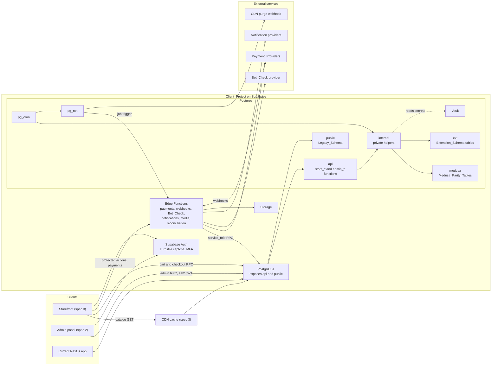

# Design Document: Supabase Medusa Backend

## Overview

The Backend is a commerce system that runs only on Supabase. Its Commerce_Schema copies the database schema of Medusa v2.22.4, the Pinned_Medusa_Version, so a store can move to Medusa later by copying data (Req 1). Commerce logic is ported from Medusa's MIT-licensed core and corrected where the Medusa_Issue_Register records a defect. Nothing in the Backend depends on Plusmark's products, brand or Supabase project: each Client_Project gets its store data from Deployment_Config, Store_Settings and the Store_Seed.

Design goals, in priority order:

1. **Security and abuse resistance.** Clients reach commerce data only through checked `api` functions. No Commerce_Schema or Extension_Schema table is granted to `anon` or `authenticated`.
2. **Correct money and stock under concurrency.** Exact `numeric` arithmetic, Stock_Claims taken under row locks, and order placement in one database transaction.
3. **Portability to Medusa.** Medusa_Parity_Tables stay unmodified. The Parity_Check and the Export_Rehearsal prove it in CI.
4. **Low running cost.** Hot paths run inside Postgres and Public_Catalog_Read responses are cacheable at a CDN, so small Supabase plans carry normal traffic.

Main choices (details in Key Decisions):

- State-changing commerce operations and catalog reads are PL/pgSQL functions inside Postgres. Edge Functions handle only external I/O: Payment_Provider calls, Webhook_Handlers, notification sending, Bot_Check verification, media upload validation and payment reconciliation.
- Medusa_Parity_Tables live in a `medusa` schema, Extension_Schema tables in `ext`, private helpers in `internal`, and the Store_API and Admin_API functions in `api`, the only new schema exposed through the Supabase API. `public` keeps the Legacy_Schema while the current app still uses it (Req 18.8).
- Supabase Auth is the identity provider (Assumption 4). `ext` tables link Auth users to Medusa customer and user records and hold hashed Cart_Tokens and Order_Access_Tokens.
- Public_Catalog_Read responses carry CDN cache headers. Catalog_Change_Events and per-scope catalog versions let spec 3 refresh cached pages (Req 3).
- pg_cron and pg_net form the Scheduler. Correctness never depends on a job running on time.

Interfaces for later specs:

| Spec | Uses from the Backend |
|---|---|
| 2 (admin panel) | `api.admin_*` functions, Roles and Permissions, Audit_Log, Analytics_Events |
| 3 (storefront) | `api.store_*` functions, cache headers, catalog versions, Catalog_Change_Events, the Bot_Check Edge Function |
| 4 (provisioning) | Migrations, Edge Functions, the Secret and configuration manifest, the Store_Seed |

## Architecture

### System context

### Request paths

| Path | Entry point | Where the logic runs |
|---|---|---|
| Public_Catalog_Read | HTTP GET to an `api.store_*` function, through the CDN | STABLE function in a read-only transaction |
| Cart, Promotions, shipping, Cash_On_Delivery checkout | POST RPC to `api.store_*` | One PL/pgSQL transaction per call |
| Bot_Check-protected actions | Edge Function, then an `api` function as `service_role` | Token check in the Edge Function, then one transaction |
| Online payment | Edge Function calls the Payment_Provider, then the completion function | Provider call outside the transaction, completion in one transaction (KD-1) |
| Payment webhooks | Webhook_Handler verifies the signature, then calls an `api` function | One idempotent transaction per event |
| Admin actions | POST RPC to `api.admin_*` with an aal2 JWT | Permission check, change and Audit_Log row in one transaction |
| In-database jobs | pg_cron calls an `internal` function | One transaction per batch |
| Provider jobs | pg_cron, then pg_net, then an Edge Function | Lease rows in `ext` (KD-6) |

### Callers and credentials

| Caller | Credential | Can call |
|---|---|---|
| Visitor or Guest_Customer | anon (publishable) key, plus a Cart_Token or Order_Access_Token as a parameter | Public_Catalog_Read; Guest_Cart and guest Order functions that check the token |
| Registered_Customer | Supabase Auth JWT | Functions that act on the caller's own Cart, Orders, addresses and Wishlists |
| Admin_User | Supabase Auth JWT with `aal = aal2` | `api.admin_*`, each gated by `internal.has_permission()` (KD-8) |
| Edge Functions | Service-role key, held only as an Edge Function secret | Service-only `api` functions: Bot_Check-protected actions, webhook processing, reconciliation |
| Scheduler | pg_cron runs jobs as `postgres`; pg_net sends a job secret read from Vault | `internal` job functions; the job endpoints of Edge Functions (KD-7) |

### Repository layout

| Path | Contents | Deployed |
|---|---|---|
| `supabase/migrations/` | Backend migrations, added after the existing ones: the generated Medusa schema first, then allowed additions, `ext`, `internal` and `api` | Yes |
| `supabase/functions/` | Edge Functions (TypeScript on Deno) | Yes |
| `supabase/config-manifest.json` | Secret and configuration manifest (Req 19.3) | Read by spec 4 tooling |
| `tools/medusa-reference/` | Schema pipeline, Parity_Check, Export_Rehearsal and differential-test oracle, with its own `package.json` and lockfile | No |
| `docs/medusa-issue-register.md` | Medusa_Issue_Register | No |
| `NOTICE` | Medusa sources and license notices | No (kept in the repository) |

## Key Decisions

Each decision states what was chosen, why, and what follows from it. A **Problem** line records an issue found in the proposed decision and how this design handles it.

### KD-1: Logic placement is hybrid

- **Decision.** Every state-changing commerce operation and every catalog read is a PL/pgSQL function declared `SECURITY DEFINER` with `SET search_path = ''` and schema-qualified names. This covers cart mutations, price selection, tax and totals in exact `numeric` arithmetic, Promotion evaluation and usage counters, Stock_Claims under row locks, order placement, Order_Changes, Idempotency_Key records, Rate_Limiter counters and audit triggers. Edge Functions (TypeScript on Deno) handle only external I/O: Payment_Provider calls, Webhook_Handlers, Notification_Service sending, Bot_Check verification, media upload validation and payment reconciliation.
- **Why.** Checks and writes run in the same transaction, next to the data. Hot paths use no Edge Function invocations, so they avoid the invocation quota and cold starts, and a client reaches the logic in one HTTP call.
- **Trade-off accepted.** Medusa's TypeScript logic is ported to SQL instead of copied verbatim. The pinned `@medusajs` packages act as test oracles: differential tests run the same inputs through Medusa's code and through the Backend's functions and compare the outputs.
- **Consequences.** Stock_Claims lock inventory rows in ascending ID order, so concurrent checkouts cannot deadlock. No function waits on the network, so transactions stay short.
- **Problem:** with online payment, order placement cannot be one transaction end to end; the Edge Function authorizes or verifies the payment first and then calls the completion transaction, so a failed completion must void or refund the payment, and reconciliation catches any payment left without an Order.

### KD-2: Schemas and exposure

| Schema | Contents | Exposed through the Supabase API | Grants to `anon` and `authenticated` |
|---|---|---|---|
| `medusa` | Medusa_Parity_Tables with Medusa's exact table names | No | None |
| `ext` | Extension_Schema tables | No | None |
| `internal` | Private helper functions | No | None |
| `api` | `store_*` (Store_API) and `admin_*` (Admin_API) functions | Yes, the only new exposed schema | EXECUTE on chosen functions |
| `public` | Legacy_Schema during coexistence (Req 18.8) | Yes, unchanged | Unchanged |

- **Decision.** RLS is enabled on every `medusa` and `ext` table with no permissive policy, so access is denied by default.
- **Why.** Separate schemas avoid name collisions with Legacy_Schema tables, confine the Parity_Check to one schema, and make `api` the whole client-facing surface.
- **Consequences.** Postgres grants EXECUTE on new functions to PUBLIC by default, so migrations revoke it and change default privileges in all four new schemas before granting EXECUTE per function. `api` functions return `jsonb` or types defined in `api`, never `medusa` or `ext` row types, so a table change cannot expose a column.
- **Problem:** RLS does not apply to `SECURITY DEFINER` functions owned by the table owner, so here RLS only backs up the grants; each `api` function must check access itself (Cart_Token, Customer link or Permission), and tests must cover every check.

### KD-3: Ownership links outside Medusa tables

- **Decision.** `ext` tables link `auth.users` to Medusa customer records (Registered_Customers) and Medusa user records (Admin_Users), and store Cart_Tokens and Order_Access_Tokens as SHA-256 hashes. No Medusa table gains a column (Req 1).
- **Why.** Supabase Auth is the identity provider (Assumption 4), and Medusa_Parity_Tables stay unmodified.
- **Consequences.** A token is 32 random bytes from pgcrypto's `gen_random_bytes`, encoded as base64url and returned once; only its hash is stored. Clients pass tokens as parameters in POST bodies, never in URLs, so tokens stay out of logs and CDN cache keys. Knowing a Cart or Order ID grants nothing without the token (MIR-3).
- **Problem:** a move to Medusa does not carry Supabase Auth credentials, so Customers and Admin_Users must set new passwords there unless the new host keeps Supabase Auth; the Export_Rehearsal creates its own Medusa admin user for the same reason.

### KD-4: Bot_Check gateway

- **Decision.** Bot_Check-protected Store_API actions go through one Edge Function. It verifies the Turnstile token, or the token of another configured challenge provider, with the provider, then calls the matching `api` function with the service-role key. Those functions are executable by `service_role` only, and the gateway passes the caller's verified identity and client IP as parameters. Supabase Auth's built-in Turnstile captcha protects sign-up, sign-in and password reset.
- **Why.** Postgres must not make synchronous HTTP calls inside a transaction: the call would hold locks and a connection while it waits. pg_net is asynchronous and cannot return a verification result to the running transaction.
- **Consequences.** A failed Bot_Check writes a Security_Event and returns a generic error. The Auth captcha secret is an Auth setting, separate from the gateway's secret, and both appear in the manifest (KD-7).

### KD-5: Public catalog behind a CDN (Req 3, spec 3)

- **Decision.** Public_Catalog_Read functions are STABLE `api` functions callable with HTTP GET through PostgREST. Each sets `Cache-Control: public, s-maxage=<n>, stale-while-revalidate=<m>` through PostgREST's `response.headers` setting and returns the same output for the same parameters and catalog data: stable sort order with ID tie-breaks and no volatile values. A read without a Sales_Channel uses the Default_Sales_Channel (Assumption 11). Catalog writes insert Catalog_Change_Events into `ext` and increase a per-scope catalog version (store, Sales_Channel, product, category, collection). A version function exposes these versions, so the spec 3 edge layer can build versioned cache keys. If a purge webhook is configured, a Scheduler job sends pending events to it in batches through pg_net, so a bulk edit causes one call instead of one per row.
- **Why.** Anonymous catalog traffic is the largest load, and a CDN keeps it off the database (KD-10).
- **Consequences.** Where a response includes Stock_State, a Catalog_Change_Event fires only when a variant's Stock_State label changes, not on every sale. Inventory_Hold expiry involves no write, so the hold-cleanup job emits those events, and cached Stock_State can lag by that job's interval plus `s-maxage`. Checkout always re-checks stock exactly. An integration test confirms that the `Cache-Control` header reaches clients through the Supabase API gateway.
- **Problem:** Price_List start and end times change Calculated_Price without any write, so a Scheduler job emits Catalog_Change_Events at those times, and each response caps `s-maxage` at the seconds left until the next price boundary among its rows.
- **Problem:** a shared cache must never hold Customer_Group prices, so the GET catalog functions ignore the caller's session and price for the anonymous context only; signed-in pricing uses separate POST functions that return `Cache-Control: private, no-store`.

### KD-6: Scheduler and asynchronous work

- **Decision.** pg_cron runs in-database jobs directly: Cart expiry, abandonment detection, Inventory_Hold cleanup and retention cleanup. For jobs that call providers (payment reconciliation, notification sending), pg_cron calls an Edge Function through pg_net. An `ext.job_run` table records every run with job name, start, end, status, counts and error. In-database jobs call `pg_try_advisory_xact_lock`, the transaction-scoped form of `pg_try_advisory_lock` that is released when the run's transaction ends, and skip the run when another run holds the lock (Req 19.8). Notifications go through an outbox table whose rows senders claim with `FOR UPDATE SKIP LOCKED`. Available_Quantity counts only Active_Inventory_Holds, so an Inventory_Hold past its expiry stops counting without any job, and stock correctness never waits for the Scheduler (Req 5).
- **Consequences.** Notification delivery is at least once. Each outbox row carries a stable key that is passed to providers that support idempotent sends.
- **Problem:** a lock taken in a pg_cron session or inside one RPC ends before the invoked Edge Function finishes, so provider jobs and outbox senders use lease rows instead: a `lease_until` value set in the same statement that claims rows with `SKIP LOCKED`, cleared on completion, and reclaimable after it expires if a run crashes.

### KD-7: Secrets and configuration

- **Decision.** Provider credentials (Payment_Provider keys, webhook signing secrets, notification provider keys, the Bot_Check secret) are Edge Function secrets. Secrets that Postgres needs, such as the credential pg_net sends to Edge Functions and the purge webhook token, are stored in Supabase Vault and read only by `internal` functions. Clients hold only the project URL and the anon (publishable) key. A machine-readable manifest lists every Secret and configuration value with its name, where it is stored (Edge Function secret, Vault, Auth setting or Store_Settings), whether it is required, and which components read it (Req 19.3).
- **Problem:** if pg_net sent the service-role key, a leak from the database would expose full API access, so pg_net sends a dedicated job secret that only the Scheduler endpoints of Edge Functions accept.

### KD-8: Admin access

- **Decision.** Admin_Users sign in through Supabase Auth with MFA. Every `admin_*` function first calls `internal.has_permission(permission)`, which requires a JWT with `aal = 'aal2'`, an active `ext` link from the Auth user to a Medusa user record, and a Role that grants the Permission. Roles and Permissions are this project's own `ext` tables (Req 13). Medusa's Enterprise Edition RBAC is not used (Assumption 2).
- **Why.** Permissions are read from tables on every call, not from JWT claims, so removing a Role or disabling an Admin_User takes effect on the next request while the old JWT is still valid.
- **Consequences.** A denial writes a Security_Event. A schema test lists every `api.admin_*` function and fails if its body does not start with the permission check. The Store_Seed creates the first Admin_User link and an owner Role from Deployment_Config.

### KD-9: Data formats

- **Decision.** IDs use Medusa's format: an entity prefix plus a ULID, for example `prod_` followed by 26 Crockford base32 characters. `internal.generate_id(prefix)` generates them, with prefixes taken from the pinned Medusa models. Every money amount is written with its Raw_Amount_Field in the exact JSON shape the Pinned_Medusa_Version writes, confirmed from the reference database during porting. Deletes set `deleted_at`, and reads exclude soft-deleted rows.
- **Consequences.** `ext_` check constraints keep each amount consistent with its Raw_Amount_Field. The Export_Rehearsal proves that the formats load into Medusa.
- **Problem:** Medusa sets `updated_at` and applies soft-delete cascades in application code, not in the schema, so `ext_` triggers maintain `updated_at` and the Backend's delete functions apply the same cascades explicitly; differential tests compare the resulting rows.

### KD-10: Small-plan awareness

- **Decision.** Catalog and cart calls invoke no Edge Functions. Order placement invokes at most one: the Bot_Check gateway for Guest_Customers, or payment confirmation. Registered_Customers placing Cash_On_Delivery or zero-total Orders invoke none. Analytics_Events arrive in batches, one call per batch, with a maximum batch size and Rate_Limiter limits. Retention jobs bound the growth of high-volume tables such as Analytics_Events, Rate_Limiter counters, Idempotency_Key records and `ext.job_run` history.
- **Why.** Free Supabase projects have small database quotas and pause after a period of inactivity, which stops the API and pg_cron. Production stores need a paid plan; spec 4 checks the exact plan limits at deployment time.

## Medusa Version Pin and Schema Parity

### Version pin

- The Pinned_Medusa_Version is **Medusa v2.22.4**, the latest GitHub release at design time (November 2026).
- `tools/medusa-reference/medusa-pin.json` records the version, the git tag, the tag's commit SHA, the exact version of every installed `@medusajs` package, the module set of the reference installation, the Postgres major version used (the same as the Client_Project's), and the Enterprise paths excluded by the license review. The pipeline fails if the tag, the commit or an installed package differs from the record.
- Changing the pin is a reviewed change: regenerate the reference, review the schema diff, add a forward migration for the difference, re-run the Parity_Check, the Export_Rehearsal and the differential tests, and update the Medusa_Issue_Register.

### Schema generation pipeline

The pipeline lives in `tools/medusa-reference/`, a dev-only folder with its own `package.json` and lockfile. It is never deployed, and the Next.js build and type-check exclude it, so Medusa packages never enter the app's dependencies.

1. Install the pinned `@medusajs` packages at the recorded versions.
2. Start a scratch Postgres of the recorded major version with an empty database.
3. Run Medusa's own migrations (`medusa db:migrate`) for the recorded module set. This also creates the module link tables.
4. Dump the schema only (`pg_dump --schema-only --no-owner --no-privileges`).
5. Rewrite the schema name to `medusa`. Strip ownership, `SET` statements and other environment-specific statements, and create any extension Medusa needs in Supabase's `extensions` schema instead.
6. If Medusa's migrations insert rows outside Medusa's migration-tracking tables, append those rows, so both databases start with the same data.
7. Write the result as one Supabase migration, `supabase/migrations/<timestamp>_medusa_v2_22_4_schema.sql`, with a header naming the version, the commit and Medusa's MIT notice. CI regenerates the file and fails if the output differs from the committed file.

### Allowed additions

Changes to Medusa_Parity_Tables are limited to RLS settings and policies, grants, triggers, extra indexes and check constraints. They live in separate migrations after the generated one, and every extra index, check constraint and trigger has a name starting with `ext_`. Tables, columns, types, defaults and Medusa-defined constraints are never added, changed or dropped.

### Parity_Check (Req 1)

1. Rebuild the reference database from the version and commit in the pin file. If the reference cannot be built, the check fails.
2. Apply the full Backend migration set to a local Supabase database (Supabase CLI), because Backend migrations use Supabase roles and schemas.
3. Introspect both databases through `pg_catalog` and compare them with the schema name normalized: tables, including partitioned tables; columns with type (`format_type`), default (`pg_get_expr`), nullability, identity and generation; unique indexes with their columns, expressions and predicates; Medusa's other indexes; every Medusa-defined constraint (primary key, foreign key with its actions, unique, check); enum types with their labels; and sequences.
4. Ignore only the allowed additions: RLS flags and policies, privileges, and `ext_`-prefixed indexes, check constraints and triggers.
5. Fail on any other difference, listing each differing object.

CI runs the Parity_Check on every change to `supabase/migrations/` or the pin file, and before each release.

### Export_Rehearsal (Req 1)

1. Reset a local Supabase database with the Backend migrations and run the Store_Seed with a sample Deployment_Config.
2. Create a sample store through `api` functions only: products and variants, Price_Lists, Promotions, Customers, Carts, guest and registered Orders, Order_Changes and Reservations. The data is therefore what Backend logic writes.
3. Dump the data of the `medusa` schema only, excluding Medusa's migration-tracking tables, and rewrite the schema name to the reference's schema.
4. Load the dump into a freshly migrated Reference_Medusa_Installation whose tables have been emptied, except the migration-tracking tables.
5. Boot Medusa v2.22.4. Create a Medusa admin user and a publishable API key there, because Supabase Auth data does not move (KD-3).
6. For every sample record, call Medusa's store and admin APIs and compare fields and totals (item, discount, shipping, tax and grand totals) with the results of the Backend's `api` functions.
7. Fail if Medusa does not boot, rejects the data, or returns any difference that the Medusa_Issue_Register does not list as expected.

### License handling (Req 1, Req 13)

- Only MIT-licensed Medusa material is copied or adapted. Each adapted file, including the generated schema migration, keeps Medusa's copyright and MIT license notice in a header comment, with the upstream path and the pinned commit.
- A root `NOTICE` file lists every source: upstream path, version, commit, adapted file and license.
- Material listed in `ENTERPRISE-LICENSE.md` at the pinned tag, including RBAC, is never copied or used as a porting source. Roles and Permissions are this project's own design (KD-8).
- Gate: before any porting, a reviewer reads `LICENSE` and `ENTERPRISE-LICENSE.md` at the pinned tag (Assumption 2) and records the excluded paths in the pin file. A CI check fails if a `NOTICE` entry points into an excluded path. Status: not yet done; it blocks all porting work.

### Medusa_Issue_Register

The register is `docs/medusa-issue-register.md`. Each entry has an ID, the Medusa behavior with its source path at the pinned commit, the problem, the fix, the test that proves the fix, and a status: candidate, confirmed or rejected. Only confirmed entries justify a logic difference from Medusa, and the Export_Rehearsal and differential tests treat them as expected differences. A candidate that the v2.22.4 source does not confirm is closed as rejected.

Seed candidates, to verify against the v2.22.4 source during porting:

| ID | Candidate Medusa behavior | Problem | Backend fix |
|---|---|---|---|
| MIR-1 | Stock is reserved only at cart completion | Stock can sell out while a Customer is paying | Inventory_Holds during payment, counted in Available_Quantity (Req 5) |
| MIR-2 | Per-customer Promotion limits count per customer record | A buyer bypasses the limit with new guest identities | Usage also counted by normalized email and phone |
| MIR-3 | Guest Cart and Order access relies on knowing the ID | Anyone who learns an ID can read or change the Cart, or read the Order | Cart_Token and Order_Access_Token (KD-3) |
| MIR-4 | No built-in limit on promotion code attempts | Codes can be guessed by brute force | Rate_Limiter on code attempts, with one generic error for invalid codes (Req 8) |
| MIR-5 | Totals keep full precision and are rounded only for display or provider conversion | Rounded parts may not add up, and the charged amount can differ by a minor unit from the displayed sum | Round at fixed steps and define totals as sums of rounded parts (Req 4.10–4.11) |

## Components and Interfaces

Each component lists its responsibility, its functions, the steps where correctness matters, and the requirements it satisfies.

### Conventions for api functions

Every function in the `api` schema follows these rules.

**Function families.**

| Family | Granted to | Access check or scope |
|---|---|---|
| `api.store_*` | `anon`, `authenticated` | Ownership is checked inside the function through the Cart_Token, the Order_Access_Token or the Customer link |
| Customer-only `api.store_*` | `authenticated` | `auth.uid()` maps to a Customer through `ext.customer_auth_link` |
| `api.admin_*` | `authenticated` | The first statement is `internal.require_permission(code)` (KD-8) |
| `api.service_*` | `service_role` only | Bot_Check-protected actions, payment confirmation, webhooks and job endpoints |

**Function attributes.** Every function is `SECURITY DEFINER` with `SET search_path = ''` and a function-level `lock_timeout` (default 3 s), and returns `jsonb`. Catalog reads are `STABLE` and called with GET. PostgREST runs GET requests read-only, so these reads write nothing. All other functions are `VOLATILE` and called with POST.

**Inputs.**

- Functions take named parameters. PostgREST rejects unknown parameter names.
- `internal.validate_input(value, spec)` checks nested `jsonb`: types, required keys, string caps (default 500 characters, free text 2,000), ranges, enums, formats (email, ISO country code, ISO currency code) and arrays of at most 100 items. It rejects unknown keys and control characters, trims strings and returns field-level errors (Req 14.6).
- Amount-like keys (`price`, `amount`, `total`, `discount`, `tax`) are stripped from input and ignored (Req 4.8).
- The only client-supplied total is `p_expected_total` at order placement. It is compared with the server-computed total and never used in a calculation (Req 9).

**Responses and errors.**

- Success returns the resource with HTTP 200.
- An expected rejection returns `{"error": {"code": ..., "message": ..., "fields": ..., "details": ...}}`, where `fields` and `details` are optional. The function sets the HTTP status through PostgREST's `response.status` setting, and sets `Retry-After` through `response.headers` for 429 and 503.
- Inner-block pattern for rejections:
  1. The function's logic runs in an inner block.
  2. A rejection raises the reserved SQLSTATE `BK000` carrying the error code.
  3. The rollback to the block's savepoint undoes the inner writes.
  4. The handler writes only what must survive (Rate_Limiter counters, failed-attempt counters, Security_Events), sets the status and returns the envelope. The transaction then commits.
- Unexpected errors are written to `ext.error_log` with the request ID and return `internal_error` (500) without SQL details.
- Lock timeouts, deadlocks and serialization failures return `concurrency_conflict` (503, `Retry-After: 1`).
- GET rejections have no side effects.

**Actor context.** The actor context is held in transaction-local settings: `app.actor_type` (`guest`, `customer`, `admin`, `job`, `webhook` or `system`), `app.actor_id`, `app.request_id` (taken from the request headers, otherwise generated) and `app.client_identifier`. The Audit_Log, Security_Event and Analytics_Event triggers read these settings.

**Idempotency.** Functions that create Orders, payments, captures or refunds take `p_idempotency_key` (8 to 128 characters). `ext.idempotency_record`, unique on `(scope, key)`, stores the request fingerprint, the status and the response.

- A concurrent duplicate waits on the unique index, then receives the stored response.
- The same key with a different fingerprint returns `idempotency_conflict` (409).
- Stored responses never contain raw tokens.

**Rate limits.** Every POST `api.store_*` function first calls `internal.check_rate_limit(action, scopes)`, which a later pass defines. GET reads rely on page caps, statement timeouts and edge limits (spec 3).

**Feature flags and settings.**

- `internal.require_feature(name)` raises `feature_disabled` (Req 2).
- `internal.setting(key)` reads Store_Settings on every call, so a saved change applies to the next request (Req 2.10).

### Catalog reads and catalog administration

**Responsibility:** anonymous, CDN-cacheable catalog reads; admin catalog writes; media upload (Req 3).

| Function | Method and caller | Key parameters | Returns | Default Cache-Control |
|---|---|---|---|---|
| `store_get_store`, `store_list_regions` | GET, anonymous | none | Store; Regions | `public, s-maxage=600` |
| `store_list_products` | GET, anonymous | `p_sales_channel_id`, `p_region_id`, `p_currency_code`, `p_q`, `p_category_ids`, `p_collection_ids`, `p_tag_ids`, `p_type_ids`, `p_options`, `p_price_min`, `p_price_max`, `p_sort`, `p_page`, `p_page_size`, `p_v` | `{items, page, page_size, total, facets}` | Catalog default |
| `store_get_product` | GET, anonymous | `p_handle` plus the Sales_Channel, Region, currency and `p_v` context | One product | Catalog default |
| `store_list_categories` | GET, anonymous | `p_v` | Active, non-internal categories | Catalog default |
| `store_list_collections` | GET, anonymous | `p_v` | Collections | Catalog default |
| `store_list_product_handles` | GET, anonymous (sitemaps) | `p_after`, `p_limit` (at most 1,000) | Product handles after the cursor | Catalog default |
| `store_variant_availability` | GET, anonymous | Up to 100 variant IDs | Stock_State per variant | `public, s-maxage=15` |
| `store_catalog_versions` | GET, anonymous | none | Catalog version per scope | `public, max-age=0, s-maxage=5` |
| `store_price_for_customer` | POST, authenticated | Variant IDs plus context | Calculated_Price per variant, including Customer_Group prices | `private, no-store` |

- **Catalog default cache:** `public, max-age=60, s-maxage=600, stale-while-revalidate=86400` from Store_Settings, with `s-maxage` capped at the next price boundary (KD-5). The functions ignore `p_v`; it exists so the edge can vary cache keys by catalog version.
- **Context parameters:** if `p_sales_channel_id` is omitted, the Default_Sales_Channel applies (Req 3.6). An unknown or disabled Sales_Channel, Region or currency returns `invalid_parameter` naming that parameter (Req 3.7). The currency defaults to the Region's currency and must belong to the Region. Results include only published products linked to the Sales_Channel (Req 3.4) and only active, non-internal categories (Req 3.5).
- **Read model:** `ext.catalog_product_index`, plus `ext.catalog_variant_price` with anonymous-context prices per currency and Region and `valid_until` set to the next price boundary. Statement-level triggers queue product IDs in `ext.catalog_dirty`. Admin catalog functions rebuild dirty rows before they return; Scheduler jobs are the safety net.
- **Search and filters:** `p_q` (at most 100 characters) searches a `tsvector` over title, subtitle, description and tags, built with the configured text-search configuration (default `simple`), plus `pg_trgm` similarity on titles. Filters combine with AND across filter types and OR within a type. The category filter includes descendant categories. The price filter uses the Calculated_Price in the request currency (Req 3.12). Facets cover the full filtered set across all pages (Req 3.13).
- **Sort:** `newest` (default), `price_asc`, `price_desc`, `title_asc`, or `relevance` (only with `p_q`). Ties are broken by product ID. Responses are built in a fixed key order, so the same inputs and data give identical bytes (Req 3.9).
- **Paging:** `p_page_size` defaults to 24, maximum 100. `p_page × p_page_size` may not exceed a configured depth cap (default 5,000); deeper crawls use `store_list_product_handles`.
- **Public fields:** one builder, `internal.public_product_json`, builds every public product object; no parameter selects columns or relations. `metadata` includes only the keys listed in Store_Settings `catalog.public_metadata_keys` (Req 3.8). Customer_Group prices are available only through `store_price_for_customer` (Req 3.10).
- **GET errors:** GET calls run read-only, so they cannot write `ext.error_log`. Unexpected errors are caught, written to the Postgres log with `RAISE LOG` and the request ID, and returned as `internal_error` without SQL details.
- **Catalog_Change_Events:** statement-level triggers emit one event per affected record and increment the version of each affected scope. They cover product, variant, option, price, price list, price rule, category and its links, collection, tag, type, image, the product–Sales_Channel link, `ext.product_attribute` and the default Sales_Channel setting. Events are written in the changing transaction, so they exist at commit (Req 3.11). Stock_State events come from the Inventory_Service (Req 5.16).
- **Admin writes** (Permission `catalog:write`):
  - `admin_upsert_product`
  - `admin_set_product_status`
  - `admin_delete_product`: soft delete with Medusa's cascades (KD-9).
  - `admin_upsert_variant`: rejects an option-value set already used by a non-deleted variant of the same product (Req 3.3).
  - `admin_upsert_category`: rejects a parent that is the category itself or one of its descendants, found with a recursive CTE. A parent change takes a transaction-level advisory lock on the category tree, so concurrent moves cannot form a cycle (Req 3.2).
  - `admin_upsert_collection`
  - `admin_set_product_attributes`: writes `ext.product_attribute` rows (key, value, rank, filterable) (Req 3.14).
- **Media upload:** Edge Function `admin-media-upload` requires an aal2 session and Permission `catalog:write`, checked through `api.admin_authorize_upload`. It counts bytes while streaming and returns `file_too_large` once the body exceeds the maximum (default 10 MB) (Req 3.16). It accepts a file only when its magic bytes match one of these types, whatever the file name or declared content type; anything else returns `unsupported_file_type` (Req 3.15):
  - JPEG: `FF D8 FF`
  - PNG: `89 50 4E 47 0D 0A 1A 0A`
  - WebP: `RIFF` at offset 0 and `WEBP` at offset 8
  - AVIF: `ftyp` at offset 4 with brand `avif` or `avis`
- **Media storage:** accepted files go to the public-read bucket `catalog-media` at `<product_id>/<id>.<ext>` and are recorded through `api.service_add_product_image`. Clients cannot write to the bucket; its `allowed_mime_types` and `file_size_limit` are a second check. Legacy Cloudinary URLs stay as image URLs (Req 18).

### Pricing_Engine

**Responsibility:** selects the Calculated_Price and Original_Price of variants for a pricing context (Req 4.1–4.6).

**Medusa data used:** `price_set`; `price` (`amount`, `currency_code`, `min_quantity`, `max_quantity`, `price_list_id`); `price_rule`; `price_list` (`status`, `starts_at`, `ends_at`, and `type`, which is `sale` or `override`); `price_list_rule`; `price_preference` (tax-inclusive flag per Region or currency).

| Function | Key parameters | Returns |
|---|---|---|
| `internal.anonymous_pricing_context` | `region_id`, `currency_code` | Pricing context (`jsonb`) |
| `internal.cart_pricing_context` | `cart_id` | Pricing context (`jsonb`) |
| `internal.calculate_prices` | `variant_ids text[]`, `context jsonb` | `setof internal.price_result`: `variant_id`, `price_set_id`, `currency_code`, `calculated_amount`, `calculated_price_id`, `price_list_id`, `price_list_type`, `original_amount`, `original_price_id`, `is_calculated_tax_inclusive`, `is_original_tax_inclusive` |
| `internal.next_price_boundary` | `scope` | Next price boundary for the scope |

- **Pricing context keys:**
  - `currency_code` (required) and `region_id`.
  - `customer.groups.id`: only for Carts linked to a Registered_Customer and for `store_price_for_customer`.
  - `quantity`: the line item quantity, used for quantity tiers.
  - `time`: the transaction timestamp, so one call sees one consistent time.
- **Selection:** a port of Medusa v2.22.4 `calculatePrices`. The differential tests are the oracle, including for tie-breaks. For each variant:
  1. The candidates are the prices in the variant's Price_Set that have the context currency, the context `quantity` within `[min_quantity, max_quantity]` (a null bound is open), and every price rule satisfied.
  2. A price-list candidate also needs an active list, `starts_at <= time < ends_at` (a null bound is open), and every list rule satisfied.
  3. Candidates form three groups: default prices (no price list), sale-list prices and override-list prices. Within each group, the best price is the most specific one: the most satisfied rules, then the narrowest quantity tier, then the lowest amount, then ID.
  4. If an override candidate exists, Calculated_Price and Original_Price are both the best override price.
  5. Otherwise, if a sale candidate exists, Calculated_Price is the lower of the best sale price and the best default price. Original_Price is the best default price, or the Calculated_Price when no default price exists.
  6. Otherwise, both are the best default price.
  7. With no candidate, the variant is unpriced (Req 4.4). `store_cart_add_item` returns `variant_unpriced` naming the variant (Req 4.5), and catalog reads show the variant as not purchasable.
  8. Tax inclusivity comes from the `price_preference` for the Region, else the one for the currency; with neither, the price is tax-exclusive.
- **Both prices:** the Store_API returns the Calculated_Price and the Original_Price for each variant (Req 4.6).
- **Price boundaries:** `internal.next_price_boundary` returns the earliest future `starts_at` or `ends_at` among the price lists that apply to the scope. The catalog `s-maxage` cap and the `price_boundary` job both use it (KD-5).
- **Admin writes** (Permission `pricing:write`): `admin_upsert_prices` and `admin_upsert_price_list`. They reject negative amounts, an unknown currency, an `ends_at` at or before `starts_at`, and overlapping quantity tiers with the same rules in one Price_Set.

### Tax_Calculator and Totals_Calculator

**Responsibility:** computes tax lines, and Cart and Order totals, with exact arithmetic and rounding that adds up (Req 4.7–4.17).

**Rows written:** `cart_line_item_tax_line`, `cart_shipping_method_tax_line`, `cart_line_item_adjustment` and `cart_shipping_method_adjustment`; the Order equivalents at placement.

| Function | Key parameters | Result |
|---|---|---|
| `internal.refresh_cart` | `cart_id` | Re-prices the Cart, re-evaluates Promotions, re-taxes, drops shipping methods that no longer apply, and writes the Medusa rows |
| `internal.cart_totals` | `cart_id` | `jsonb` with Medusa's field names (`subtotal`, `discount_total`, `shipping_total`, `tax_total`, `total`, `original_total`) per line, per shipping method and for the Cart |
| `internal.order_totals` | `order_id` | The same `jsonb` for an Order |

- **Tax address:** the shipping address, else the billing address (Req 4.14), else the Region's Default_Tax_Region (Req 4.15). With none, Cart reads return totals without tax plus the warning `tax_not_computable`, and placement returns `tax_configuration_error`. At placement, a country with no tax region returns `tax_configuration_error` naming the country (Req 4.16).
- **Rate selection:** a port of Medusa's system tax provider; the differential tests confirm it. It uses the country tax region, plus its province child region when the address province has one.
  1. Rates whose rules match the line's product or product type apply (Req 4.12).
  2. Otherwise, the default rate of the most specific region applies. A combinable province rate adds the parent country's default rate.
  3. Shipping methods use the rates with a matching shipping-option rule, else the default rate (Req 4.13).
- **Rounding:** exact numeric arithmetic, with rounding half away from zero to the currency's `decimal_digits` from `medusa.currency` (ISO 4217) (Req 4.9–4.10).
- **Tax-exclusive steps per line** (shipping methods follow the same steps):
  1. subtotal = round(`unit_price` × `quantity`).
  2. The discount allocations give the line discount.
  3. net = subtotal − discount, never below 0.
  4. Each tax line = round(net × rate / 100).
  5. Line total = net + the sum of the line's tax lines.
- **Tax-inclusive steps per line:**
  1. gross = round(`unit_price` × `quantity`), so the total before discounts equals unit price × quantity (Req 4.17).
  2. Discounts reduce gross to gross_net.
  3. Total tax = round(gross_net × R / (100 + R)), where R is the sum of the line's rates. It is split across the line's tax lines in proportion to rate, by the largest-remainder method.
  4. Line total = gross_net.
- **Discount allocation:** each Promotion's discount is rounded to the minor unit, then spread over its eligible lines in proportion to their remaining discountable amount. The split uses the largest-remainder method in minor units, with ties broken by line item ID. A line's allocation never exceeds its remaining amount, and any excess moves to the next eligible line. When every line is exhausted, the discount shrinks (Req 8.3).
- **Totals:** Cart and Order totals are sums of the rounded line and shipping parts and are never rounded separately, so the parts add up exactly (Req 4.11). The payable amount × 10^`decimal_digits` is therefore an integer (Req 10).
- **Server data only:** no function signature accepts amounts (see Conventions), so totals always come from server data (Req 4.7, 4.8).

### Promotion_Engine

**Responsibility:** evaluates, applies and counts Promotions, and enforces their limits and abuse controls (Req 8).

**Medusa data used:** `promotion`; `promotion_application_method`; `promotion_rule` and `promotion_rule_value`; the application method's target and buy rules; `promotion_campaign`; `promotion_campaign_budget`.

**Extension_Schema tables:** `ext.promotion_setting` (`promotion_id`, `per_customer_limit`, and `stacking`, which is `combinable` or `exclusive`, plus a `usage_limit` only if v2.22.4 has no equivalent); `ext.promotion_usage` (`promotion_id`, `campaign_id`, `order_id`, `customer_id`, `email_norm`, `phone_norm`, `amount`, `currency_code`, and `status`, which is `active` or `reverted`).

| Function | Key parameters | Result |
|---|---|---|
| `api.store_cart_apply_code` | `p_cart_id`, `p_cart_token`, `p_code` | Applies the code through the code entry steps below, then returns the Cart |
| `api.store_cart_remove_code` | `p_cart_id`, `p_cart_token`, `p_code` | Removes the code, then returns the Cart |
| `internal.evaluate_promotions` | `cart_id` | Called by `internal.refresh_cart`; keeps the Promotions that still apply and removes the rest |
| `internal.record_promotion_usage` | `order_id` | Records the Order's Promotion usage at placement |
| `internal.revert_promotion_usage` | `order_id` | Reverts the Order's Promotion usage at cancellation |
| `api.admin_upsert_promotion`, `api.admin_upsert_campaign` | Promotion or campaign fields | Creates or updates the row (Permission `promotion:write`) |

- **Evaluation on every Cart change** (no locks): automatic Promotions and applied codes are checked against their rules, dates, status, Customer_Group (only for Carts linked to a Registered_Customer), currency and budget. Failing Promotions are removed and listed once in the Cart response as `removed_promotions`, each with a reason (Req 8.2). A fixed-value Promotion whose currency differs from the Cart's does not apply.
- **Supported model** (Req 8.1): standard and buy-get Promotions; automatic and code Promotions; percentage and fixed values; item, shipping and order targets; and `each` and `across` allocation. Discounts never take a line, a shipping method or the Cart below zero (Req 8.3).
- **Code entry** (`api.store_cart_apply_code`):
  1. Check the code-attempt block for the Cart, the Customer and the Client_Identifier.
  2. Normalize the code: trim it and convert it to upper case.
  3. An unknown, expired, inactive or exhausted code returns the generic error `invalid_code` (Req 8.7).
  4. A valid code whose rules the Cart does not meet returns `promotion_rules_not_met` with the unmet rule, for example the minimum Cart value and the amount still needed (Req 8.8).
  5. Both failure kinds count toward one limit: by default 5 failures within 10 minutes per Cart, Customer or Client_Identifier, followed by a 30-minute block (Req 8.9). The counters survive the rejection through the inner-block pattern.
  6. Re-applying a code that is already on the Cart changes nothing.
  7. Stacking: an exclusive Promotion cannot combine with other Promotions, and the number of codes per Cart is capped, by default at 1 (Req 8.6).
- **Placement under locks** (Req 8.4–8.5):
  1. Placement locks the `promotion_campaign_budget` rows `FOR UPDATE` in ascending ID order, checks the usage count and spend against the limit and budget, and then increments them.
  2. For per-customer limits, placement takes a transaction advisory lock on `hashtextextended('promo:' || promotion_id || ':' || identity, 0)` for each of `customer_id`, `email_norm` and `phone_norm`, in sorted order. It then counts the `active` `ext.promotion_usage` rows that match any of them.
  3. A failed check rejects placement with `promotion_invalid` and the recomputed totals (Checkout_Service).
- **Identity normalization:** `email_norm` is the email, trimmed and lower-cased, with plus-suffixes kept (configurable). `phone_norm` is the phone number in E.164 format, using the Region's default country code.
- **Cancellation** (Req 8.10): `internal.revert_promotion_usage` marks the usage `reverted` and decrements the `promotion_campaign_budget` usage and spend under the same row locks. Per-customer counts include only `active` rows, so this also restores the per-customer count.
- **Admin validation:** `admin_upsert_promotion` and `admin_upsert_campaign` reject a percentage outside 0–100, a fixed value below 0, a buy-get quantity below 1, an `ends_at` at or before `starts_at`, and a code that is not unique after normalization.
- **Lock order shared with checkout:** the Cart row, then the `inventory_level` rows, then the `promotion_campaign_budget` rows, then the Promotion advisory locks, then the `payment_collection` row.

### Inventory_Service

**Responsibility:** tracks stock per Inventory_Item per Stock_Location, holds stock with Inventory_Holds during payment, claims it with Reservations for Orders, and keeps the Inventory_Movement ledger and each variant's Stock_State (Req 5).

**Medusa data used:** `inventory_item`; `inventory_level`, with its stocked, reserved and incoming quantities (Req 5.1); `reservation_item`; the variant–Inventory_Item link, with `required_quantity` (Req 5.2); `stock_location`; the Sales_Channel–Stock_Location link.

**Extension_Schema tables:** `ext.inventory_hold` (`cart_id`, `line_item_id`, `inventory_item_id`, `location_id`, `quantity`, `expires_at`, and `status`, which is `active`, `released`, `converted` or `expired`); `ext.cart_hold_window` (`cart_id` and the accumulated Cart_Hold_Time); `ext.inventory_movement` (`inventory_item_id`, `location_id`, `delta`, `reason`, `actor`, `reference`, `created_at`, and `field`, which is `stocked`, `reserved` or `held`); `ext.stock_location_priority` (`sales_channel_id`, `location_id` and `rank`).

| Function | Key parameters | Result |
|---|---|---|
| `internal.sellable_quantity` | `variant_id`, `sales_channel_id` | Returns the variant's Sellable_Quantity under the location rule below |
| `internal.hold_cart_inventory` | `cart_id` | Creates the Cart's Inventory_Holds through the hold steps below |
| `internal.release_cart_holds` | `cart_id`, `reason` | Releases the Cart's Active_Inventory_Holds with the given reason |
| `internal.convert_holds_to_reservations` | `cart_id`, `order_id` | Turns the Cart's Active_Inventory_Holds into Reservations at placement |
| `internal.claim_order_stock` | `order_id` | Claims stock at placement for the Order's lines without Active_Inventory_Holds |
| `api.admin_adjust_inventory` | `p_inventory_item_id`, `p_location_id`, `p_delta`, `p_reason` | Changes the stocked quantity by the delta (Permission `inventory:adjust`) |
| `api.store_variant_availability` | See Catalog reads and catalog administration | Reports each variant's Stock_State (Req 5.14) |

- **Available_Quantity:** the stocked quantity minus the reserved quantity minus the quantity of the holds whose `status` is `active` and whose `expires_at` is after `now()`. A hold therefore stops counting the moment it expires, with no job involved (KD-6, Req 5.11).
- **Location rule:** a line's Stock_Claim takes every linked Inventory_Item from one Stock_Location: the first, in the Sales_Channel's `ext.stock_location_priority` order and then by location ID, that can supply the whole line. Sellable_Quantity uses the same rule: the best single Stock_Location's minimum, over the linked Inventory_Items, of `floor(Available_Quantity / required_quantity)` (Req 5.2). A variant that manages inventory and has no linked Inventory_Item has a Sellable_Quantity of 0 (Req 5.3).
- **Hold steps** (`internal.hold_cart_inventory`, at payment initiation):
  1. Lock the Cart row.
  2. If the Cart_Hold_Time, renewals included, exceeds the configured maximum, by default 60 minutes, reject with `hold_time_exceeded` (Req 5.6).
  3. Release the Cart's Active_Inventory_Holds, so that the new holds replace them instead of adding to them (Req 5.5).
  4. Lock the needed `inventory_level` rows `FOR UPDATE` in ascending ID order.
  5. Pick each line's Stock_Location and check its availability. Variants that allow backorders skip the check.
  6. Any failing line rejects the whole call with `out_of_stock`, naming the variant and its Sellable_Quantity, and the call creates no holds: all or nothing (Req 5.7, 5.8).
  7. Insert the holds with `expires_at` set to `now()` plus the configured hold period, by default 15 minutes (Req 5.4).
- **Placement** (Req 5.10): in the placement transaction, `internal.convert_holds_to_reservations` turns the Active_Inventory_Holds into `reservation_item` rows and increases `inventory_level.reserved_quantity`. `internal.claim_order_stock` claims the lines without Active_Inventory_Holds (Cash_On_Delivery Orders, zero-total Orders and lines whose holds expired) directly, under the same locks.
- **Concurrent claims** (Req 5.9): every Stock_Claim locks its `inventory_level` rows in ascending ID order, so concurrent claims serialize. For variants that disallow backorders, the reserved quantity plus the quantity in Active_Inventory_Holds therefore never exceeds the stocked quantity.
- **Inventory_Movement ledger** (Req 5.12): an `AFTER INSERT OR UPDATE` trigger on `inventory_level` writes an `ext.inventory_movement` row for each changed quantity field, with the `reason` taken from a transaction-local setting (default `unknown`). On insert, each nonzero quantity counts as a change from zero, so the stock set when a level row is first created is also recorded. Hold changes write `held` movements. Each `inventory_level` row's stocked quantity therefore always equals the sum of its `stocked` deltas. `api.admin_adjust_inventory` rejects an adjustment that would take the stocked quantity below zero (Req 5.13).
- **Fulfillment and returns:** fulfillment decreases the stocked and reserved quantities, and a received resaleable Return increases the stocked quantity (Order changes component).
- **Stock_State** (Req 5.14–5.16): each variant's Stock_State is computed from its Sellable_Quantity and the configured low-stock threshold, by default 5. The exact count is shown only at or below the threshold. After a stock change, a trigger compares the variant's Stock_State and reported count before and after the change and emits a Catalog_Change_Event only when they differ. The `hold_cleanup` job runs every 30 seconds and does the same for holds that expired.
- **Bot defense:** the Cart_Hold_Time cap and the Rate_Limiter on payment initiation stop bots from keeping limited stock held.

### Cart functions

**Responsibility:** creates and changes Carts with server-side pricing, checks Cart ownership, attaches or merges a Guest_Cart at sign-in, and tracks Cart abandonment and expiry (Req 7).

**Medusa data used:** `cart`; `cart_address`; `cart_line_item` and `cart_shipping_method`, with their adjustments and tax lines.

**Extension_Schema tables:** `ext.cart_token` (`cart_id`, `token_hash` and `revoked_at`); `ext.cart_state` (`cart_id`, `last_activity_at`, `last_checkout_step`, `abandoned_at`, `abandoned_total`, `recovered_at`, `expired_at`, `closed_at`, `close_reason` and `quotation_id`).

Clients call the functions below with POST and send the Cart_Token in the request body. Every function except `api.store_create_cart` also takes `p_cart_id` and `p_cart_token`, which the table leaves out.

| Function | Key parameters | Result |
|---|---|---|
| `api.store_create_cart` | `p_region_id`, `p_sales_channel_id`, `p_attribution` | Creates and returns a Cart; for a Guest_Customer, also returns a Cart_Token that is shown only once (Req 7.1) |
| `api.store_get_cart` | — | Returns the Cart |
| `api.store_cart_add_item` | `p_variant_id`, `p_quantity` | Adds the variant to the Cart in the given quantity (Req 7.1) |
| `api.store_cart_update_item` | `p_line_item_id`, `p_quantity` | Sets the line item's quantity (Req 7.1) |
| `api.store_cart_remove_item` | `p_line_item_id` | Removes the line item (Req 7.1) |
| `api.store_cart_set_email` | `p_email` | Sets the Cart's email |
| `api.store_cart_set_addresses` | `p_shipping_address`, `p_billing_address` | Sets the Cart's shipping and billing addresses |
| `api.store_cart_set_region` | `p_region_id` | Changes the Cart's Region |
| `api.store_cart_list_shipping_options` | — | Returns the shipping options available for the Cart |
| `api.store_cart_set_shipping_method` | `p_shipping_option_id` | Sets the Cart's shipping method |
| `api.store_cart_transfer` | — | Attaches or merges the Guest_Cart at sign-in, under the sign-in rules below (Req 7.5–7.13) |

- **Ownership** (`internal.authorize_cart`, Req 7.4): a Cart linked to a Customer needs a session whose `auth.uid()` maps to that Customer. A Guest_Cart needs a Cart_Token whose SHA-256 hash matches an unrevoked `ext.cart_token` row. Any failure returns the same `not_found` error as a missing Cart.
- **Change steps** (every function that changes a Cart):
  1. Lock the Cart row `FOR UPDATE`, so concurrent changes to one Cart apply one at a time.
  2. Reject a completed, expired or closed Cart with `cart_not_modifiable`.
  3. Validate the input. Item changes follow the item rules below.
  4. Apply the change.
  5. Call `internal.refresh_cart`, which recomputes the Cart's prices, adjustments, taxes and totals on the server (Req 7.2). It also recomputes them when the Cart's Region or Customer changes, and drops shipping methods that no longer apply.
  6. Update `ext.cart_state.last_activity_at` and `last_checkout_step`.
- **Item rules** (Req 7.3): the variant must be published, linked to the Cart's Sales_Channel, not deleted and priced. The quantity must be a positive integer. The variant's total quantity in the Cart is capped at a configured maximum, by default 100, and the number of line items per Cart at a configured maximum, by default 50. For a variant that disallows backorders, its quantity in the Cart may not exceed its Sellable_Quantity, and the error reports the variant's Stock_State. `api.store_create_cart` rejects a disabled Region or Sales_Channel.
- **Creation limits:** the Rate_Limiter caps `api.store_create_cart` per Client_Identifier, by default at 20 calls per hour, to stop Cart spam.
- **Sign-in** (`api.store_cart_transfer`, Req 7.5–7.13): the Registered_Customer calls it in an authenticated session with the Guest_Cart's Cart_Token.
  - If the Registered_Customer has no active Cart in the Guest_Cart's Sales_Channel, the function attaches the Guest_Cart to the Customer and sets its email from the Customer (Req 7.5).
  - Otherwise it locks both Carts in ascending ID order and merges the Guest_Cart into the Customer's active Cart (Req 7.6). Quantities of the same variant add up in one line item (Req 7.7), within the per-variant cap (Req 7.8), the line-item cap (Req 7.10) and, for variants that disallow backorders, the Sellable_Quantity (Req 7.9). Line items and quantities that do not fit are returned in `not_merged`, with the variant and the left-out quantity (Req 7.11).
  - Either way, the function revokes the Cart_Token (Req 7.13). A merged Guest_Cart is closed with `close_reason` set to `merged` (Req 7.12).
- **Abandonment** (Req 7.14): a job runs every 5 minutes. It selects each Cart that has at least one line item, a known email or Customer and no Order, is not closed or expired, has a `last_activity_at` older than the configured period, by default 60 minutes, and still has a null `abandoned_at`. For each such Cart it sets `abandoned_at` and `abandoned_total`, records the last Checkout_Step, and emits a `cart_abandoned` Analytics_Event. The null check means a re-run creates no duplicates, and merged Guest_Carts are skipped because they are closed.
- **Recovery** (Req 7.15): when an Order is placed from a Cart whose `abandoned_at` is set, the placement transaction records `recovered_at`.
- **Expiry** (Req 7.16): an hourly job sets `expired_at` on each Cart that is not yet expired and whose `last_activity_at` is older than the configured period, by default 30 days, and releases that Cart's Active_Inventory_Holds. The Cart data stays for the retention period set under Requirement 16.

### Customer accounts and guest access

**Responsibility:** links Auth users to Customers, gives guests safe access to their Orders, manages addresses and Customer_Groups, and handles account deletion (Req 6).

**Extension_Schema tables:** `ext.customer_auth_link` (`auth_user_id` as the primary key and a unique `customer_id`); `ext.order_access_token` (`order_id`, `token_hash`, `expires_at`, `revoked_at` and `source`, which is `placement` or `code`); `ext.one_time_code` (`purpose`, `subject_id`, `recipient_hash`, a salted `code_hash`, `expires_at`, `attempts` and `consumed_at`); `ext.country_address_format` (`country_code`, `required_fields` and `postal_code_pattern`); `ext.deletion_request` (`customer_id`, `requested_at`, `status` and `erase_after`).

`api.store_get_customer`, `api.store_update_customer` and the address functions need an authenticated session.

| Function | Key parameters | Result |
|---|---|---|
| `internal.on_auth_user_created` | — | `AFTER INSERT` trigger on `auth.users`; creates or links the user's Customer (Req 6.1) |
| `internal.on_auth_email_confirmed` | — | `AFTER UPDATE OF email_confirmed_at` trigger on `auth.users`; links guest Orders with the confirmed email (Req 6.5) |
| `api.store_get_guest_order` | `p_order_access_token` | Returns the Order that the token grants access to (Req 6.3) |
| `api.service_request_order_access` | `p_display_id`, `p_email` | Called through the Bot_Check gateway; sends a One_Time_Code when an Order matches and always returns the same `accepted` response (Req 6.4) |
| `api.store_verify_order_access` | `p_display_id`, `p_email`, `p_code` | Returns a new Order_Access_Token for a valid One_Time_Code (Req 6.4) |
| `api.store_get_customer` | — | Returns the signed-in Customer |
| `api.store_update_customer` | `p_profile` | Updates the signed-in Customer's profile |
| `api.store_list_addresses` | — | Returns the Customer's addresses (Req 6.6) |
| `api.store_upsert_address` | `p_address` | Creates or updates one of the Customer's addresses, under the address rules below (Req 6.6) |
| `api.store_delete_address` | `p_address_id` | Deletes one of the Customer's addresses (Req 6.6) |
| `account-deletion` Edge Function, which calls `api.service_request_account_deletion` | — | Starts deletion of the signed-in Customer's account, under the deletion rules below (Req 6.8) |
| `api.admin_set_customer_group_members` | `p_customer_group_id`, `p_customer_ids` | Sets the Customer_Group's members; needs the `customer:write` Permission (Req 6.7) |

- **Sign-up** (`internal.on_auth_user_created`, Req 6.1): the trigger inserts a `medusa.customer` row with `has_account` set to true, and inserts the `ext.customer_auth_link` row with `INSERT ... ON CONFLICT DO NOTHING` on `auth_user_id`, so repeated or concurrent events leave exactly one Customer per Auth user. If a Customer with `has_account` set to true already has the same email and no link, as a migrated Customer does, the trigger links that Customer instead of creating a duplicate.
- **Guest checkout** (Req 6.2): placing a Cart with no Customer link needs the `guest_checkout` feature, or placement fails with `feature_disabled`. It also needs an email and a phone, or placement fails with field errors.
- **Order_Access_Token** (Req 6.3): placement of a guest Order issues an Order_Access_Token and returns it once. `ext.order_access_token` stores only its hash, and the token expires after a configured period, by default 90 days. `api.store_get_guest_order` takes only the token, never an Order ID, so unknown, expired, revoked and wrong tokens all return the same `not_found` error.
- **Order lookup** (Req 6.4):
  - `api.service_request_order_access` always returns the same `accepted` response, whether or not an Order matches.
  - Sends are limited per normalized email, by default to 3 per 15 minutes. Every request counts toward the limit, matched or not, so reaching the limit reveals nothing.
  - On a match, the function draws a 6-digit One_Time_Code uniformly from `gen_random_bytes`, stores a salted hash of the code in `ext.one_time_code` and queues an email with the code to the Order's email address. The code expires after a configured period, by default 10 minutes.
  - `api.store_verify_order_access` issues a new Order_Access_Token for a correct, unexpired and unused code. A wrong code increments `attempts`, and the code becomes invalid after a configured number of attempts, by default 5. Wrong, expired and used codes all return `invalid_code`. Verification is also rate-limited per Client_Identifier.
- **Guest Order linking** (`internal.on_auth_email_confirmed`, Req 6.5): when `auth.users.email_confirmed_at` becomes non-null, the trigger moves each Order whose email matches and whose Customer has no account to the Registered_Customer, and writes an Audit_Log entry. An unverified email links nothing.
- **Addresses** (Req 6.6): only the Customer who owns an address can read or change it. The country must belong to a Region of the store. Required fields come from `ext.country_address_format`. The postal code must match the country's `postal_code_pattern`, and a country with no pattern skips the format check. A Customer can have at most a configured number of addresses, by default 20.
- **Customer_Groups** (`api.admin_set_customer_group_members`, Req 6.7): Admin_Users manage membership. Pricing and Promotion evaluation read the current membership each time they run. A Cart not linked to a Registered_Customer gets no Customer_Group benefits, whatever email it holds.
- **Account deletion** (Req 6.8):
  - The `account-deletion` Edge Function requires a session whose `amr` sign-in timestamp is within a configured window, by default 10 minutes.
  - It records an `ext.deletion_request` row through `api.service_request_account_deletion`. Then, through the Auth admin API, it bans the Auth user, which blocks sign-in, and signs out all of the user's sessions.
  - The erasure job waits until the Customer's open Orders are closed, meaning completed, canceled or past the return window. It then erases or anonymizes the Customer's personal data within a configured period, by default 30 days, keeping only the Order fields that the legal retention rules require. Finally it deletes the Auth user.

### Checkout_Service

**Responsibility:** validates a Cart and turns it into exactly one Order (Req 9).

- **Entry points:** `api.store_complete_cart(p_cart_id, p_cart_token, p_idempotency_key, p_expected_total)` serves Registered_Customers who pay by Cash_On_Delivery or whose Cart total is zero. `api.service_complete_cart` handles guest placement through the Bot_Check gateway, payment confirmation and webhooks. Both call `internal.complete_cart`.
- **Placement:** `internal.complete_cart` runs these steps in one transaction:
  1. **Idempotency** (Req 9.3): insert an `ext.idempotency_record` with scope `complete_cart` and the Cart ID as its fingerprint. A concurrent duplicate waits on the unique index, then returns the stored response. The same key used for another Cart returns `idempotency_conflict`.
  2. **Cart lock** (Req 9.3): lock the Cart. If the Cart already has an Order through Medusa's order–cart link, return that Order. Reject an expired or closed Cart.
  3. **Checks** (Req 9.1): run `internal.refresh_cart`, then run these checks in order, each failing with its own error code:
     - `missing_email`
     - `missing_shipping_address` when any item requires shipping
     - `missing_billing_address` when the store requires a billing address
     - `missing_shipping_method` or `invalid_shipping_method`
     - `not_serviceable`, naming the items that cannot be served (Req 11.5)
     - `tax_configuration_error`
     - `totals_changed` when `p_expected_total` differs from the current total, returning the current totals (Req 9.4)
  4. **Stock:** claim stock in the shared lock order. The Cart's Active_Inventory_Holds become Reservations, and lines without a hold are claimed directly. On an unpaid Cart a failure returns `out_of_stock`; a paid Cart follows **Paid Cart rejected** below.
  5. **Promotions:** record Promotion usage under the Promotion locks. A failure returns `promotion_invalid` with the recomputed totals.
  6. **Payment:** a zero total needs no payment. Cash_On_Delivery re-checks the COD_Rules, failing with `cod_not_eligible`, and is authorized without capture. Online payment needs the Payment_Collection authorized or captured for exactly the total and currency. If no such payment exists, placement returns `payment_required`; if the amount or currency differs, it returns `payment_mismatch`.
  7. **Order write** (Req 9.2, 9.5): write the Order into Medusa's tables. That covers the order; its items and line items, with snapshots of product title, variant title, SKU, unit price and options; adjustments; tax lines; shipping methods; addresses; `order_summary`; and the links to the Cart, the Payment_Collection and the Promotions.
  8. **Cart close:** set the Cart's `completed_at` and, if the Cart was abandoned, its `recovered_at`.
  9. **Guest access:** for a Guest_Customer, issue an Order_Access_Token. Stored responses hold no raw tokens, so a replay issues a new token for the same Order.
  10. **Follow-up:** queue the `order.placed` notification and the `order_placed` Analytics_Event, then store the response in the idempotency record.
- **Atomicity** (Req 9.2): any failure rolls back all of the placement's writes, so no partial Order exists.
- **Paid Cart rejected** (Req 9.8): the placement steps run in an inner block. When that block fails after a successful payment, because stock cannot be reserved or for any other reason, its exception handler records an `ext.payment_incident`. For a stock failure, the configured Out_Of_Stock_Policy chooses between placing the Order as a backorder, with Reservations that allow backorder, and queuing a full void or refund; the default is refund. Any other failure queues a full void or refund. In both cases the Customer and Admin_Users are notified.
- **Order states** (Req 9.6): Orders use the order status values of Medusa v2.22.4, and payment and fulfillment statuses are derived the way Medusa derives them. `ext.order_status_transition` lists the allowed transitions, and a trigger rejects any other transition with `invalid_status_transition`. A status change locks the Order row, so concurrent changes apply one at a time.
- **Display number** (Req 9.7): each Order gets a unique number from Medusa's `display_id` sequence, shown with an optional display prefix from Store_Settings. No function accepts a display number alone; guest lookup also needs the email and a One_Time_Code.

### Payments and Webhook_Handler

**Responsibility:** creates payment sessions, confirms payments, processes provider webhooks, runs captures and refunds, and applies the COD_Rules (Req 10).

- **Medusa data:** `payment_collection`, `payment_session`, `payment`, `capture`, `refund`, `refund_reason`, `payment_provider` and the Region–provider link.
- **Extension_Schema data:**
  - `ext.webhook_event`: `provider`, a unique `event_id`, `status` and `summary`.
  - `ext.provider_operation`: `kind` (`capture`, `refund` or `void`), `payment_id`, `amount`, `idempotency_key`, `status` (`pending`, `succeeded`, `failed` or `unknown`) and `provider_ref`.
  - `ext.payment_incident` and `ext.cod_refusal`.
  - `ext.cod_block`: `customer_id`, `email_norm`, `phone_norm`, `reason` and `reenabled_at`.
- **Payment_Provider_Interface** (Req 10.1): the interface in `supabase/functions/_shared/payments` is modeled on the payment provider contract of Medusa v2.22.4. Each provider implements `initiate`, `authorize`, `capture`, `refund`, `cancel`, `getStatus` and `parseWebhook`. `parseWebhook` verifies the signature over the raw body and returns `event_id`, `type`, the provider reference, `amount_minor` and `currency`.
- **Payment start** (Req 10.2, 10.3): the Edge Function `payment-initiate` runs two steps:
  1. **Session:** it calls `api.service_begin_payment`, which locks the Cart, refreshes it and rejects a provider that is not enabled for the Region with `provider_not_enabled`. The function then creates or updates the Payment_Collection for the total computed on the server, cancels stale payment sessions whose amount differs from that total, creates the Inventory_Holds and returns `amount_minor`.
  2. **Provider:** it calls the provider's `initiate`. For Razorpay, this creates a Razorpay order for the amount in paise, with the payment session ID as its receipt.
- **Minor units** (Req 10.3): `amount_minor` is `total × 10^decimal_digits` for the currency, so it is an integer by construction. Converting it back must give the stored amount exactly, and a non-integer result is rejected.
- **Confirmation** (Req 10.4): the Edge Function `payment-confirm` first verifies the provider response that the client sends. For Razorpay, that means checking the HMAC-SHA256 of `order_id|payment_id`, computed with the key secret. It then fetches the payment from the provider. The status, `amount_minor`, currency and order reference must match the payment session. A mismatch returns `payment_mismatch` and records a Security_Event. On a match, it calls `api.service_complete_cart`.
- **Webhook_Handler** (Req 10.5, 10.6): the Edge Function `payments-webhook/<provider>` handles each delivery in this order:
  1. **Raw body:** read the raw request body.
  2. **Secret:** if the provider's signing Secret is missing, return 503.
  3. **Signature** (Req 10.5): if the signature is missing or invalid, return 401, record a Security_Event and change no data. Signatures are compared in constant time.
  4. **Parse:** parse the verified body into the event fields that `parseWebhook` returns.
  5. **Deduplication** (Req 10.6): `api.service_process_payment_event` inserts the `ext.webhook_event` row with `ON CONFLICT DO NOTHING`. Duplicate or concurrent deliveries of an event are therefore processed once and return 200.
  6. **Status order:** status changes are monotonic in the order `pending` < `authorized` < `captured` < `partially_refunded` < `refunded`. `canceled` and `failed` are reachable only from `pending` or `authorized`. An event that arrives out of order therefore never moves a status backwards.
  7. **Completion:** a verified success event for a Cart that has no Order yet runs the Cart completion path.
  8. **Failure:** a processing failure rolls back all writes, including the `ext.webhook_event` row, and returns 500 so that the provider retries.
- **Captures and refunds** (Req 10.7, 12.7): each runs as two database phases around one provider call:
  1. **Reserve:** lock the payment row. For a capture, check that the captured amount plus pending captures stays within the authorized amount; for a refund, check that the refunded amount plus pending refunds stays within the captured amount. Insert a `pending` `ext.provider_operation` with an idempotency key, then commit.
  2. **Call:** the Edge Function calls the provider.
  3. **Record:** mark the operation `succeeded` and write Medusa's `capture` or `refund` row, or mark it `failed`.
- **At most once** (Req 10.7): a timeout leaves the operation `unknown`. Before any resend, reconciliation asks the provider for operations with that reference. Each operation therefore reaches the provider at most once.
- **Timeouts:** every provider call times out after a configured period, by default 10 seconds. A provider error or timeout changes no payment or Order status and returns `provider_unavailable` (503, retryable).
- **Enabling providers** (Req 10.2, 19.4): the Edge Function `admin-providers` checks that the provider's Secrets exist before it calls `api.service_set_region_providers`. If one is missing, it returns `provider_credentials_missing`, naming the missing Secret.
- **Cash_On_Delivery provider:** a Cash_On_Delivery payment is authorized when the Order is placed, with no money moved. It is captured only when the cash receipt is recorded through `api.admin_record_cod_payment`. Refunds are recorded manually, with a reason.
- **COD_Rules** (Req 10.8): `internal.cod_eligible` allows Cash_On_Delivery only when all of these hold:
  - the Region has Cash_On_Delivery enabled
  - the total is at most the configured maximum; by default there is no maximum
  - a Serviceability_Rule marks the postal code as COD-available; a postal code with no matching rule is not eligible
  - the Customer is not blocked, where a block matches on `customer_id`, `email_norm` or `phone_norm`
  - the refusals since the last re-enable are below the configured threshold, by default 2
  - optionally, when an SMS provider is configured, the phone number is verified with a One_Time_Code
- **Refusals and re-enabling:** `api.admin_record_cod_refusal` (Req 10.9) records a refusal, and `api.admin_reenable_cod` (Req 10.11) re-enables Cash_On_Delivery. Both need the Permission `cod:manage`. Reaching the refusal threshold blocks Cash_On_Delivery for the Customer (Req 10.10). Re-enabling resets the refusal count.

### Fulfillment_Service and Serviceability_Rules

**Responsibility:** offers Shipping_Options, answers postal code checks, and records fulfillments, shipments and deliveries (Req 11).

**Medusa data used** (Req 11.1): `fulfillment_set`; `service_zone`; `geo_zone` (`country`, `province`, `city` or `zip`, with postal expressions); `shipping_profile`; `shipping_option`; `shipping_option_rule`; `shipping_option_type`; `fulfillment`; `fulfillment_item`; `fulfillment_label`; `fulfillment_address`; `fulfillment_provider`.

**Extension_Schema tables:** `ext.serviceability_rule` (`country_code`, either `postal_from` and `postal_to` or `postal_pattern`, `deliverable`, `cod_available`, `eta_min_days`, `eta_max_days` and `priority`); `ext.shipping_quote` (`cart_id`, `shipping_option_id`, `address_hash`, `amount` and `expires_at`).

| Function | Key parameters | Result |
|---|---|---|
| `api.store_check_postal_code` | `p_country_code`, `p_postal_code` | Called with GET and cached with `public, s-maxage=3600`; returns `serviceable`, `cod_available`, `eta_min_days` and `eta_max_days` (Req 11.4) |
| `api.store_cart_list_shipping_options` | See the Cart functions | Returns the Cart's available Shipping_Options; see Option selection below (Req 11.2) |
| `api.admin_create_fulfillment` | `p_order_id`, `p_location_id`, `p_items` | Creates a fulfillment as described in Fulfillment steps below; needs the Permission `order:fulfill` |
| `api.admin_mark_shipped` | `p_fulfillment_id`, `p_tracking` | Records the shipment and its tracking details; needs the Permission `order:fulfill` |
| `api.admin_mark_delivered` | `p_fulfillment_id` | Records the delivery; needs the Permission `order:fulfill` |
| `api.admin_cancel_fulfillment` | `p_fulfillment_id` | Cancels a fulfillment that has not shipped; needs the Permission `order:fulfill` |
| `api.admin_upsert_shipping_option` | The Shipping_Option's fields | Creates or updates a Shipping_Option; needs the Permission `shipping:write` |
| `api.admin_upsert_serviceability_rules` | A list of Serviceability_Rules | Creates or updates Serviceability_Rules; needs the Permission `shipping:write` |

- **Option selection** (Req 11.2): a Shipping_Option is offered for a Cart only when all of these hold:
  - its service zone has a geo zone that contains the shipping address, checked by country and then by province, city and postal expression
  - the Cart meets the option's rules, for example that the option is enabled in the store and is not a return option
  - its shipping profile covers the Cart's items
- **Prices** (Req 11.3): the server computes every option's price, using one of these price types:
  - **Flat:** a fixed amount from the option's Price_Set.
  - **Order-value threshold:** price rules on the Cart's item total choose the amount, as in Medusa's conditional shipping prices.
  - **Provider-calculated:** the Edge Function `shipping-quote` gets a price from the provider and stores it in `ext.shipping_quote` for a configured period, by default 30 minutes.
- **Stored quotes:** `internal.refresh_cart` uses the stored quote. If that quote has expired, the option needs a new quote before the Order can be placed.
- **Serviceability** (Req 11.4):
  - **Rule matching:** the most specific matching Serviceability_Rule wins. An exact postal code (`postal_from` equal to `postal_to`) beats a range, a range beats a pattern, and `priority` decides between rules of the same kind.
  - **Deliverable:** an address is deliverable only when a Shipping_Option covers it and, if its country has Serviceability_Rules, a matching rule marks it deliverable. A country with no rules relies on service zones alone, and the postal code check returns no delivery estimate for it.
  - **Placement** (Req 11.5): placing an Order fails with `not_serviceable` when any item cannot be delivered, and the error names those items.
- **Fulfillment_Provider_Interface** (Req 11.6): the interface is modeled on the fulfillment provider contract of Medusa v2.22.4. Each provider implements `validateFulfillmentData`, `calculatePrice`, `createFulfillment`, `cancelFulfillment`, `createReturnFulfillment` and `getFulfillmentDocuments`. The manual provider used at launch runs inside Postgres and makes no external call.
- **Fulfillment steps** (Req 11.7, 11.8): `api.admin_create_fulfillment` runs these steps:
  1. **Lock:** lock the Order row.
  2. **Quantities** (Req 11.8): each item's quantity must not exceed its ordered quantity minus its fulfilled quantity. A larger quantity returns `fulfillment_quantity_exceeded`.
  3. **Location:** check that the Stock_Location serves the Order's Sales_Channel.
  4. **Write:** write the fulfillment rows and update Medusa's fulfilled quantity for each item.
  5. **Stock:** decrease the stocked and reserved quantities at the location through the Inventory_Movement ledger.
- **Shipment and delivery** (Req 11.7): `api.admin_mark_shipped` stores the tracking number, tracking URL and carrier as fulfillment labels and sets `shipped_at`. `api.admin_mark_delivered` sets `delivered_at`.
- **Events** (Req 11.7): creating, shipping and delivering a fulfillment emit `order.fulfillment_created`, `order.shipped` and `order.delivered` respectively. These events drive notifications and Analytics_Events.
- **Cancellation:** a fulfillment can be canceled only before it is shipped. Canceling restores the Reservations and stock that the fulfillment consumed.

### Order changes and refunds

**Responsibility:** handles cancellations, Returns, exchanges, claims, order edits and refunds as Medusa Order_Changes, with every amount computed on the server (Req 12).

**Medusa data used** (Req 12.1): `order_change`; `order_change_action`; `order_item`, which holds each version's quantities (`fulfilled_quantity`, `shipped_quantity`, `delivered_quantity`, `return_requested_quantity`, `return_received_quantity`, `return_dismissed_quantity` and `written_off_quantity`); `order_summary`, one per version; `return`; `return_item`; `return_reason`; `order_exchange` and `order_exchange_item`; `order_claim` and `order_claim_item`; `order_transaction`; `refund_reason`.

**Extension_Schema tables:** `ext.refund_link` (`refund_id` plus exactly one of an `order_change_id`, a cancellation or a manual note).

| Function | Key parameters | Result |
|---|---|---|
| `api.store_cancel_order` | `p_order_id`, plus an Order_Access_Token or a session | Cancels the Customer's Order; see Cancellation below (Req 12.2) |
| `api.admin_cancel_order` | `p_order_id` | Cancels an Order; see Cancellation below (Req 12.2); needs the Permission `order:cancel` |
| `api.store_request_return` | `p_order_id`, the items and a return reason | Requests a Return when the Optional_Feature for self-service returns is enabled; see Returns below (Req 12.3) |
| `api.admin_create_return` | `p_order_id` and the items | Creates a Return; needs the Permission `order:update` |
| `api.admin_receive_return` | `p_return_id`, `p_items` (each with a `resaleable` flag), `p_location_id` | Receives a Return's items; see Returns below (Req 12.5); needs the Permission `order:update` |
| `api.admin_create_exchange` | `p_order_id`, the returned items and the new items | Creates an exchange; needs the Permission `order:update` |
| `api.admin_create_claim` | `p_order_id` and the claimed items | Creates a claim; needs the Permission `order:update` |
| `api.admin_begin_order_edit`, `api.admin_order_edit_add_item`, `api.admin_order_edit_update_item`, `api.admin_order_edit_remove_item`, `api.admin_confirm_order_edit` | The Order and the item changes | Start an order edit, change its items and confirm it; need the Permission `order:update` |
| `api.admin_refund_payment` | `p_payment_id`, `p_amount`, `p_reason_id`, `p_note`, `p_idempotency_key` | Refunds part or all of a payment; see Refund cap and Refund reasons below (Req 12.7, 12.8); needs the Permission `payment:refund` |

- **Engine** (Req 12.1): the engine is a port of the order change flows of Medusa v2.22.4. Each action updates the per-version quantities in `order_item` and the version's `order_summary`. Confirming a change increments the Order's version and keeps the original lines and the earlier versions. Differential tests compare the resulting rows with the rows Medusa produces.
- **Locking:** every change function locks the Order row with `FOR UPDATE`, so changes to one Order apply one at a time.
- **Cancellation** (Req 12.2): only an Order without fulfillments can be canceled. A Customer can cancel only within a configured window, by default 30 minutes after placement. Canceling runs these steps:
  1. **Reservations:** release the Order's Reservations through the Inventory_Movement ledger.
  2. **Payments:** void uncaptured payments and refund captured payments through the payment provider's operations.
  3. **Promotions:** revert the Order's Promotion usage.
  4. **Status:** set the Order's status to `canceled` and emit `order.canceled`.
- **Returns** (Req 12.3, 12.4, 12.5):
  - **Customer requests** (Req 12.3): a Customer can request a Return only when the self-service returns Optional_Feature is enabled and the request falls within a configured return window, by default 7 days after delivery. Each request needs a return reason.
  - **Quantities** (Req 12.4): for each item, the requested quantity must not exceed the fulfilled quantity minus the return requested and return received quantities. A larger quantity returns `return_quantity_exceeded`. Exchanges and claims use the same check.
  - **Receiving** (Req 12.5): `api.admin_receive_return` restocks the items marked resaleable at the chosen Stock_Location through the Inventory_Movement ledger, with the reason `return_restock`. The other items are recorded as written off.
- **Amounts** (Req 12.6):
  - **Returned units:** each returned unit refunds its share of the line total. The shares are allocated by largest remainder, so returning every unit refunds exactly the line total. Shipping is refunded only when the store is configured to refund it.
  - **Differences:** exchanges and order edits compute the difference in the Order total on the server. An increase creates a new Payment_Collection for the Customer to pay, and a decrease creates a refund.
- **Refund cap** (Req 12.7): an Order's succeeded and pending refunds together may never exceed its captured amount. The check runs under the payment row lock (see Payments and Webhook_Handler).
- **Refund reasons** (Req 12.8): every refund needs a `refund_reason` and an `ext.refund_link` row. A refund with no Order_Change or cancellation behind it needs a manual note.
- **Audit:** every admin change writes Audit_Log entries (see Admin access, Roles and Audit_Log).

### Admin access, Roles and Audit_Log

**Responsibility:** decides who may call the Admin_API and with which Permissions, and records every change that an Admin_User, a job or a webhook makes (Req 13).

**Extension_Schema tables:** `ext.admin_user_link` (`auth_user_id` as the primary key, a unique `user_id` for the Medusa `user` row, and `status`, either `active` or `disabled`); `ext.permission` (`code`, `resource`, `action`, `description`); `ext.role` (a unique `name` and `is_system`); `ext.role_permission`; `ext.admin_user_role`; `ext.admin_invite` (`email`, `role_ids`, `token_hash`, `expires_at`, `accepted_at`, `invited_by`); `ext.audit_log` (`occurred_at`, `actor_type`, `actor_id`, `action`, `table_name`, `record_id`, the changed fields with their old and new values, and `request_id`), partitioned by month.

| Function | Key parameters | Result |
|---|---|---|
| `internal.has_permission` | A Permission code | Returns true when the caller passes the Permission check for that code; see Permission check below (Req 13.1, 13.3) |
| `internal.require_permission` | A Permission code | Denies the call with `permission_denied` when the caller fails the Permission check; see Permission check below (Req 13.6) |
| `api.admin_me` | None | Returns the calling Admin_User with its Roles and Permissions |
| `api.admin_invite_user` | The email and the Role IDs | Creates an invitation; see Invitations below; needs the Permission `admin_user:manage` |
| `api.admin_set_user_roles` | The Admin_User and the Role IDs | Replaces the Admin_User's Roles; see Last owner below (Req 13.5); needs the Permission `admin_user:manage` |
| `api.admin_disable_user` | The Admin_User | Sets the Admin_User's status to `disabled`; see Last owner below (Req 13.5); needs the Permission `admin_user:manage` |
| `api.admin_accept_invite` | `p_token` | Accepts the invitation for the signed-in Auth user and grants the invited Roles; see Invitations below; needs only an authenticated session, and MFA enrolment is then required before any other admin call |
| `api.admin_upsert_role` | The Role's name and its Permission codes | Creates or updates a custom Role; see Predefined Roles below (Req 13.4); needs the Permission `role:manage` |
| `api.admin_delete_role` | The Role | Deletes a custom Role; needs the Permission `role:manage` |
| `api.admin_list_audit_log` | Filters and paging | Lists Audit_Log entries; see Audit_Log below (Req 13.7); needs the Permission `audit:read` |

- **Permission check** (Req 13.1, 13.3): a call passes only when the JWT has `aal` set to `aal2`, the Auth user has an `active` row in `ext.admin_user_link`, and one of its Roles holds the Permission. The link, the Roles and the Permissions are read from tables on every call, so disabling an Admin_User or removing a Permission takes effect on the next call. A denial returns `permission_denied` (403), and the Security_Event it records survives through the inner-block pattern (Req 13.6). No RLS policy grants Admin_Users access to tables, so every admin path runs through a checked function.
- **Predefined Roles** (Req 13.4): the Roles below have `is_system` set and cannot be edited. Owners build custom Roles from the Permission list.
  - `owner`: every Permission.
  - `manager`: every Permission except `role:manage` and `admin_user:manage`.
  - `catalog_editor`: `catalog:write`, `pricing:write` and `inventory:adjust`.
  - `order_manager`: `order:update`, `order:cancel`, `order:fulfill`, `payment:capture`, `payment:refund` and `cod:manage`.
  - `support_agent`: `order:read`, `customer:read` and return creation.
  - `analyst`: `reports:read` and the other read-only Permissions.
- **Own implementation** (Req 13.2): the design takes no code, schema or documentation from Medusa's Enterprise Edition RBAC. The Medusa `user` rows exist only for schema parity.
- **Last owner** (Req 13.5): every Role assignment and every Admin_User status change locks the `owner` Role row with `FOR UPDATE`, applies the change, then counts the active owners. If none remain, the function rejects the change with `last_owner_required`. The lock serializes concurrent removals, so two removals at the same time cannot leave zero owners.
- **Invitations:** an invitation is single-use, stored as a hash and valid for a configured period, by default 72 hours. Accepting an invitation that was already accepted or has expired returns `invite_invalid` (Req 2.17).
- **Audit_Log** (Req 13.7): a generic row trigger, `internal.audit_row`, runs on the admin-managed Medusa and `ext` tables. When the `app.actor_type` setting is `admin`, `job` or `webhook`, it writes one entry per changed row with the actor, the action, the table, the record ID, the changed fields with their old and new values, the time and the request ID. The trigger redacts token hashes and provider payload columns.
- **Append-only** (Req 13.8): no role has `UPDATE`, `DELETE` or `TRUNCATE` grants on `ext.audit_log`, and `BEFORE UPDATE OR DELETE` and `BEFORE TRUNCATE` triggers raise an error for every role, the table owner included. Entries are kept indefinitely by default. When a retention period is configured, only a maintenance job owned by `postgres` removes entries, and it removes whole monthly partitions.

### Rate_Limiter, Bot_Check gateway and Security_Events

**Responsibility:** limits requests per client identity, runs Bot_Checks for the listed actions, and records rejected requests (Req 14.3, 14.4, 14.5, 14.8).

**Extension_Schema tables:** `ext.rate_limit_rule` (`action`, `limit`, `window_seconds`, `block_seconds`, and `scope`, one of `ip`, `session`, `cart`, `customer`, `email` or `phone`); `ext.rate_limit_counter` (`key` and `window_start` as the primary key, and `count`), an `UNLOGGED` table; `ext.rate_limit_block` (`key`, `blocked_until`); `ext.security_event` (`occurred_at`, `type`, `actor_type`, `actor_id`, `client_identifier`, `action`, the redacted `details`, and `request_id`).

| Function | Key parameters | Result |
|---|---|---|
| `internal.check_rate_limit` | The action and the scopes | Returns `allowed`, or `rate_limited` (429 with a `Retry-After` header); see Counting below (Req 14.4) |
| `internal.client_identifier` | None | Returns the Client_Identifier for the request; see Client_Identifier below |
| `internal.record_security_event` | The type and the details | Writes a Security_Event with redacted details; see Security_Events below (Req 14.8) |
| Edge Function `bot-gateway` | The action, the challenge token and the payload | Runs the Bot_Check, then calls the matching `api.service_*` action function; see Bot_Check gateway below (Req 14.5) |

- **Counting** (Req 14.4): each rule counts requests in fixed windows of `window_seconds` and approximates a sliding window from the current window's count plus the previous window's count, weighted by the share of the previous window that the sliding window still covers. An `INSERT ... ON CONFLICT (key, window_start) DO UPDATE SET count = count + 1 RETURNING count` keeps counts exact under concurrency. When a request goes over the limit and the rule has `block_seconds`, the function also writes a block to `ext.rate_limit_block`. `Retry-After` gives the time until the window ends, or until the block ends when the rule writes one. The counter and the block survive the rejection through the inner-block pattern.
- **Default rules:** the rules below are adjustable in Store_Settings.
  - Cart creation: 20 per hour per IP.
  - Cart changes: 120 per minute per Cart.
  - Promotion code failures: 5 per 10 minutes per Cart, per Customer and per Client_Identifier, then a 30-minute block.
  - Order-access code sends: 3 per 15 minutes per email.
  - Order-access code checks: 10 per 15 minutes per IP.
  - Payment initiation: 10 per 10 minutes per Cart.
  - Guest order placement: 5 per hour per IP.
  - Enquiries and Quotation requests: 5 per hour per IP.
  - Reviews: 3 per day per Customer.
  - Analytics_Events: 300 per 10 minutes per session.
- **Client_Identifier:** `internal.client_identifier` returns the HMAC-SHA256 of the client IP, with an IPv6 address reduced to its /64 prefix, keyed with a salt from Vault. The salt rotates on a configured schedule, by default monthly. The IP comes from the spec 3 edge proxy's signed header when one is present: `x-client-ip` plus an HMAC over the IP and a timestamp, keyed with a secret in Vault, and the timestamp must be at most 60 seconds old. Otherwise the IP comes from the address that Supabase's gateway records. Unsigned IP headers sent by the client are ignored, so a client cannot change its identity. Raw IPs are never stored.
- **Bot_Check gateway** (Req 14.5): `bot-gateway` receives the action, the challenge token and the payload. The action must be on the configured list, by default guest order placement, order-access requests, Enquiries, Quotation requests and review submission. Sign-up, sign-in and password reset use Supabase Auth's captcha instead. The gateway verifies the token with Turnstile's `siteverify` endpoint, sending the secret, the token, the remote IP and an idempotency key. It accepts the token only when `success` is true, `action` is the expected action, `hostname` is on the allowed list and `challenge_ts` is at most 5 minutes old. It then verifies the user's JWT when the request carries one, and calls the matching `api.service_*` function with the verified identity and the Client_Identifier. A failed Bot_Check returns `bot_check_failed` (403) and records a Security_Event. When Turnstile is unreachable, the gateway returns `bot_check_unavailable` (503), so it fails closed.
- **Not-found rule** (Req 14.3): a request for a missing record and a request that lacks proof of ownership of the record return the same `not_found` code, status and message.
- **Security_Events** (Req 14.8): `internal.record_security_event` writes an event for signature failures, permission denials, rate-limit blocks, failed Bot_Checks, failed token checks and payment mismatches. It passes the details through `internal.redact`, which removes keys matching `token`, `secret`, `password`, `code`, `otp`, `signature` or `authorization`, and any value shaped like a JWT. Events are kept for a configured period, by default 180 days.

### Notification_Service

**Responsibility:** turns business events into messages and delivers them through providers without blocking the business transaction (Req 15).

**Medusa tables:** `notification` (`to`, `channel`, `template`, `data`, `trigger_type`, `resource_id`, `resource_type`, `receiver_id`, `idempotency_key`, `external_id`, `provider_id`, `status`) and `notification_provider` (Req 15.6).

**Extension_Schema tables:** `ext.notification_delivery` (`notification_id`, `attempts`, `next_attempt_at`, `lease_until`, `last_error`); `ext.notification_rule` (`event_name`, `channel`, `template_id`, `enabled`, and `recipient_type`, either `customer` or `admin` with a Role); `ext.notification_template` (`channel`, `locale`, `subject`, `body`, `version`); `ext.marketing_consent` (`customer_id` or `email_norm`, `channel`, `granted_at`, `source`, `revoked_at`).

| Function | Key parameters | Result |
|---|---|---|
| `internal.enqueue_notifications` | The event name, the resource and the data | Called by triggers and functions; queues a notification per recipient of each enabled rule for the event; see Queue and At most once below (Req 15.3, 15.4) |
| Edge Function `notifications-send` | None; a job endpoint that the wake-up request and `pg_cron` call | Claims a batch, renders and sends it, and records each result; see Sending below (Req 15.5) |
| `api.service_claim_notifications` | The batch size (`p_batch_size`) | Returns due notifications and leases them; see Sending below (Req 15.5) |
| `api.service_complete_notification` | The notification (`p_id`) and the provider result (`p_result`) | Records the outcome and schedules any retry; see Sending below (Req 15.5) |
| Edge Function `unsubscribe` | The token | Shows the confirmation page, and on POST calls `api.service_unsubscribe`; see Marketing below (Req 15.8) |
| `api.service_unsubscribe` | The token (`p_token`) | Verifies the HMAC signature and revokes the consent (Req 15.8) |
| `api.admin_upsert_notification_rule` | The rule | Creates or updates a rule; requires Permission `settings:write` (Req 15.2) |
| `api.admin_upsert_notification_template` | The template | Creates or updates a template version; requires Permission `settings:write` (Req 15.7) |

- **Queue** (Req 15.3): for each enabled rule that matches the event, `internal.enqueue_notifications` inserts Medusa `notification` rows with status `pending`, and their `ext.notification_delivery` rows, inside the business transaction. It also queues a `pg_net` request that wakes `notifications-send`. `pg_net` queues requests in a table, so the wake-up fires only if the transaction commits. A `pg_cron` job every minute is the fallback. Order placement never waits for a provider.
- **At most once** (Req 15.4): `idempotency_key` combines the event key, the recipient and the channel, and a unique constraint covers it, so enqueuing the same event again does nothing. The key is also passed to providers that accept one.
- **Sending** (Req 15.5): `notifications-send` claims a batch through `api.service_claim_notifications`, which locks due rows with `FOR UPDATE SKIP LOCKED` and sets `lease_until` (KD-6). It renders each template and calls the provider. On success, `api.service_complete_notification` sets the status to `success` and stores the `external_id`. On failure, it increments `attempts`, stores the error in `last_error` and sets `next_attempt_at` to now plus `1 minute × 2^(attempts - 1)`, with jitter. After a configured number of attempts, by default 5, the status becomes `failure`.
- **Providers** (Req 15.1): the Notification_Provider_Interface is modeled on Medusa v2.22.4's notification provider contract. It defines `send(to, channel, content, idempotency_key)`, which takes the rendered content and returns the `external_id`. At launch there is one adapter, for an HTTP email API, with Resend as the reference adapter. Deployment_Config chooses the provider per Client_Project, so other email APIs can plug in. An HTTP API avoids depending on outbound SMTP from Edge Functions. SMS and WhatsApp adapters come later through the same interface.
- **Templates** (Req 15.7): templates use Mustache-style placeholders with HTML escaping and no code execution. The store name, logo URL, colors, support contacts and footer come from Store_Settings. Each template has one version per locale. When a template is missing, the notification is recorded as a failure and nothing is sent.
- **Default event mapping** (Req 15.2): the mapping below is stored as `ext.notification_rule` rows, so it is editable as data.
  - `order.placed`, `payment.failed`, `order.shipped`, `order.delivered`, `order.canceled` and `refund.issued` go to the Customer.
  - Order-access codes go to the Customer as transactional messages.
  - `inventory.low_stock`, `enquiry.created` and `quotation.requested` go to the Admin_Users holding a chosen Role.
- **Marketing** (Req 15.8): abandoned-cart reminders and other marketing messages go only to recipients with active consent in `ext.marketing_consent`. Each one carries a one-click unsubscribe: `List-Unsubscribe` and `List-Unsubscribe-Post` headers per RFC 8058, with an HMAC-signed token. The link opens a confirmation page, and unsubscribing is a POST, so mail scanners that prefetch links cannot unsubscribe anyone. Transactional messages need no marketing consent.

### Analytics capture

**Responsibility:** records storefront and business activity from day one, so that spec 2 can build reports, trends and predictions (Req 16).

**Extension_Schema tables:** `ext.analytics_event`, partitioned by month on `occurred_at` (`event_type`, `occurred_at`, `received_at`, `session_id`, `customer_id`, `sales_channel_id`, `region_id`, `cart_id`, `order_id`, `product_id`, `variant_id`, `properties`, `client_identifier`, and `source`, either `client` or `server`); `ext.cart_attribution` and `ext.order_attribution` (`utm_source`, `utm_medium`, `utm_campaign`, `utm_term`, `utm_content`, `referrer_host`, `landing_path`); and the rollup tables `ext.daily_sales_rollup` (`date` in the store timezone, `sales_channel_id`, `region_id`, `currency_code`, `orders`, `units`, `gross`, `discounts`, `shipping`, `tax`, `refunds`, `net`), `ext.daily_product_rollup` (views, cart adds, units and revenue per variant) and `ext.daily_funnel_rollup` (sessions, product views, cart adds, checkouts started and Orders).

| Function | Key parameters | Result |
|---|---|---|
| `api.store_track_events` | The session (`p_session_id`) and the events (`p_events`) | Called with POST; records a batch of at most 50 client events; see Client ingestion below (Req 16.3) |
| `internal.emit_event` | The event type (`type`), the references (`refs`) and the properties (`properties`) | Called by server code and triggers; records a server event; see Server events below (Req 16.2) |
| `internal.refresh_rollups` | The first date to refresh (`from_date`) | Called by the rollup job; recomputes the daily rollups from that date; see Admin read access below (Req 16.7) |
| `api.admin_report_sales`, `api.admin_report_products`, `api.admin_report_funnel`, `api.admin_report_abandoned_carts` | The report filters | Return aggregate reports; require Permission `reports:read`; see Admin read access below (Req 16.7) |
| `api.admin_export_events` | The cursor | Returns analytics events one cursor page at a time; requires Permission `reports:read` (Req 16.7) |

- **Event types** (Req 16.1): the client sends `product_viewed`, `search_performed`, `collection_viewed` and `checkout_step_viewed`. `search_performed` comes from the client because catalog reads are GET requests, which cannot write. The server emits `cart_created`, `cart_item_added`, `cart_item_updated`, `cart_item_removed`, `checkout_step_completed`, `promotion_code_attempted` with its outcome, `order_placed`, `payment_authorized`, `payment_captured`, `payment_failed`, `order_canceled`, `return_requested`, `return_received`, `refund_issued`, `cart_abandoned` and `cart_recovered`. Inventory_Movements stay in their own ledger, outside `ext.analytics_event`.
- **Server events** (Req 16.2): `internal.emit_event` writes each server event in the same transaction as the change it records, so revenue and stock figures come only from server-verified data. Client events never feed revenue reports.
- **Client ingestion** (Req 16.3): `api.store_track_events` accepts only allow-listed event types, and checks each event against the payload schema for its type. It clamps `occurred_at` to between 24 hours ago and 5 minutes ahead. Invalid events are dropped and counted in the response. Ingestion is rate-limited per session, by default 300 per 10 minutes, and per Client_Identifier.
- **Privacy** (Req 16.6): `session_id` is a random UUID that the client generates, never derived from personal data. `client_identifier` is the hashed IP address. Events hold no raw IP address, email or name.
- **Attribution** (Req 16.4): `api.store_create_cart` accepts the UTM source, medium, campaign, term and content, the referrer and the landing path, each length-capped and lower-cased. The first attribution on a Cart is kept in `ext.cart_attribution` and copied to `ext.order_attribution` when the Order is placed.
- **Retention** (Req 16.5): each table's retention period is configurable. The defaults are 25 months for analytics events, removed by dropping monthly partitions; 13 months after expiry for Carts; 180 days for Security_Events; 7 days for idempotency records; and 1 day for rate-limit counters. Orders, promotion usage and Inventory_Movements are kept unless a period is configured.
- **Admin read access** (Req 16.7): read-only views in a reporting schema back the `api.admin_report_*` functions. The schema is not exposed through the API, and only those functions use the views. Reports are aggregates, so no customer personal data appears in them. The rollup job calls `internal.refresh_rollups` every 15 minutes for the last 3 days, to absorb late events and refunds. A full rebuild function handles backfills.
- **For spec 2**: the daily rollups by product, Sales_Channel, Region and currency are the time series for trend and prediction models.

### Extension features

**Responsibility:** stores reviews, Enquiries, Quotations and Wishlists in Extension_Schema tables that reference Commerce_Schema records by ID (Req 17.1). Each is an Optional_Feature. When a feature is disabled, its functions return `feature_disabled` (Req 2.8).

**Extension_Schema tables:** `ext.product_review` (`product_id`, `customer_id`, `rating` from 1 to 5, `title`, `body`, `verified_purchase`, `moderated_by`, `moderated_at`, and `status`, one of `pending`, `approved` or `rejected`; unique on `product_id` and `customer_id`); `ext.product_rating_summary` (`product_id`, `average`, `count`, `distribution`); `ext.enquiry` (`type`, `product_id`, `name`, `email`, `phone`, `message`, and `status`, one of `new`, `in_progress` or `closed`); `ext.quotation` (`customer_id`, `email_norm`, `region_id`, `currency_code`, `expires_at`, `cart_id`, and `status`, one of `requested`, `priced`, `accepted`, `converted`, `expired` or `declined`) and `ext.quotation_item` (`variant_id`, `quantity`, `quoted_unit_price`); and `ext.wishlist` (`customer_id`, `name`) and `ext.wishlist_item` (`wishlist_id`, `product_id`, `variant_id`; each item unique within its Wishlist).

| Function | Key parameters | Result |
|---|---|---|
| `api.service_submit_review` | The product, the rating, the title and the body | Called through the Bot_Check gateway with a Registered_Customer identity; creates or edits that Customer's review of the product; see Reviews below (Req 17.2, 17.3) |
| `api.store_list_reviews` | The product (`p_product_id`) and the page (`p_page`) | Called with GET and cached with the catalog; returns approved reviews and the rating summary; see Reviews below (Req 17.4) |
| `api.admin_moderate_review` | The review and its new status | Approves or rejects a review; requires Permission `review:moderate`; see Reviews below (Req 17.4) |
| `api.service_submit_enquiry` | The type, the product, the contact details and the message | Called through the Bot_Check gateway; records an Enquiry; see Enquiries below (Req 17.5) |
| `api.service_request_quotation` | The email and the items | Called through the Bot_Check gateway; records a Quotation request; see Quotations below (Req 17.5) |
| `api.admin_price_quotation` | The Quotation, the quoted unit prices and the expiry | Prices a Quotation; requires Permission `quotation:manage`; see Quotations below (Req 17.6) |
| `api.store_accept_quotation` | The Quotation (`p_quotation_id`) | Requires an authenticated session; converts a priced Quotation into a Cart once; see Quotations below (Req 17.6, 17.7) |
| `api.store_list_wishlists`, `api.store_upsert_wishlist`, `api.store_delete_wishlist`, `api.store_wishlist_add_item`, `api.store_wishlist_remove_item` | The Wishlist and the item | Require an authenticated session; list and change the Customer's own Wishlists; see Wishlists below (Req 17.8) |

- **Reviews** (Req 17.2-17.4): a Registered_Customer has at most one review per product. Submitting again edits the existing review and returns it to `pending`. `verified_purchase` is computed at submission and re-evaluated when a fulfillment is marked delivered. It is true only when a delivered Order of that Customer contains the product. Public reads return approved reviews only, with the average and count from `ext.product_rating_summary`. The summary is recalculated when a review's status or rating changes, and each summary change emits a Catalog_Change_Event for the product. The title and body are stored as plain text, capped at 120 and 2,000 characters.
- **Enquiries** (Req 17.5): an Enquiry is stored with status `new`. The `enquiry.created` event notifies the configured Admin_Users.
- **Quotations** (Req 17.5-17.7): a request needs an email and at least one item. It is stored as `requested` and notifies the Admin_Users. An Admin_User sets the quoted unit prices and an expiry, which makes the Quotation `priced`, and the requester is notified. Acceptance needs a Registered_Customer session whose verified email matches the Quotation's email, or whose Customer already owns the Quotation. `api.store_accept_quotation` locks the Quotation row. Another owner's Quotation returns `not_found` (Req 14.3). An expired, converted or declined Quotation returns `quotation_unavailable` (Req 17.7). On success, one transaction creates a Cart for that Customer whose line items use the quoted prices as custom prices (Medusa's `is_custom_price`), links the Cart through `ext.cart_state.quotation_id`, and sets the Quotation to `converted`. A Quotation therefore converts only once (Req 17.6).
- **Quotation Carts**: `internal.refresh_cart` does not re-price the quoted line items, and the Cart item functions reject changes to them. Promotions do not apply to a Quotation Cart unless configured.
- **Wishlists** (Req 17.8): only the owner can read or change a Wishlist. A Customer has at most 20 Wishlists of at most 200 items each, and both limits are configurable. Adding an unpublished product is rejected. The Migration_Tool migrates legacy saved boards into Wishlists.

### Migration_Tool

**Responsibility:** copies Legacy_Schema data into the Commerce_Schema and Extension_Schema, verifies it, and gates the cutover (Req 18).

**Execution:** an operator script, `scripts/migrate-legacy.mjs`, starts the Migration_Tool's `internal` SQL functions. The script takes the database URL from the environment, never from the app. There are two modes: `dry_run`, which writes only the report, and `apply`.

**Extension_Schema tables:** `ext.migration_map` (`entity`, `legacy_id`, `new_id`; primary key on `entity` and `legacy_id`); `ext.migration_run` (`mode`, `started_at`, `finished_at`, `report`, and `status`, one of `running`, `passed` or `failed`); and `ext.order_import` (`order_id`, `legacy_id`, `imported_at`).

**Mapping** (Req 18.1): the Migration_Tool copies legacy data in `public` as follows.

| Legacy table in `public` | Target |
|---|---|
| `categories` | `product_category`, keeping the tree |
| `products` | `product`, including `handle` (from `slug`) and `status` |
| `product_variants` | `product_variant`; a Price_Set with `price_inr` as an INR price; `inventory_item` and `inventory_level` at the default Stock_Location, with `stock`, and with `track_inventory` as `manage_inventory`; and `lead_time_days` as an `ext.product_attribute` |
| `products.media` and `media` | `image` rows, keeping the Cloudinary URLs |
| Catalog attribute data | `ext.product_attribute` |
| `profiles` | `customer` with `has_account` set to true, plus an `ext.customer_auth_link` |
| `profiles` with role `admin` | Admin_User links with the manager Role |
| `addresses` | `customer_address` |
| `orders` and `order_items`, including guest Orders | Medusa Orders with line items, addresses, `order_summary` and payment records, keeping the Razorpay references |
| `product_reviews` | `ext.product_review`, with the slug resolved to the product ID, the moderation status kept and `verified_purchase` recomputed |
| `saved_boards` | One default `ext.wishlist` per Customer |
| `coupons` | Promotions with campaign budgets, keeping the code, value, limits, dates and status |
| `shipping_methods` | Flat-price Shipping_Options in the default service zone |
| `site_content` | Store_Settings and content keys |
| `payment_events` | `ext.webhook_event`, keeping the dedupe history |

- **Re-runs** (Req 18.2): every record is upserted through `ext.migration_map`, so a changed legacy row updates its mapped record and a re-run duplicates nothing. A record whose slug or reference has no target is skipped with a reason.
- **Auth link** (Req 18.3): Customers keep their existing `auth.users` rows, so their passwords and Google sign-in keep working.
- **Imported Orders** (Req 18.4): each imported Order keeps its dates, totals, statuses and payment references, and is recorded in `ext.order_import`. A numeric legacy order number becomes the `display_id`, and the sequence is then set above the highest imported `display_id`. A non-numeric order number is kept in the Order's `metadata`. The transaction-local setting `app.import_mode` makes triggers skip notifications, Reservations, Promotion usage, Inventory_Holds and new-activity Analytics_Events. Rollups are rebuilt afterwards from Order data, so history appears in reports without fake activity events.
- **Report** (Req 18.5): for each entity, the report gives the source, migrated, skipped and failed counts, with a reason for each skipped or failed record. It also gives source and target checksums of Order totals per currency, Order line counts and stock per variant.
- **Cutover gate** (Req 18.6-18.7): any count or checksum mismatch marks the run `failed`. The owner confirms the cutover with `api.admin_confirm_migration(p_run_id)`, which requires the owner Role and an `apply` run whose status is `passed`. Until the owner confirms, the legacy tables are read-only inputs and are never modified. Dropping the legacy tables is a later step outside this spec.
- **Coexistence** (Req 18.8): the new schemas cannot collide with `public` table names, and the current app keeps using the `public` tables unchanged. Orders placed in the current app during the transition are picked up by re-running the migration before cutover.

### Store_Settings and Store_Seed

**Responsibility:** the store's configuration, kept as data, and the creation of a new store (Req 2).

**Medusa data used:** `store`, `store_currency`, `currency`, `region`, `region_country`, `sales_channel` and `stock_location`.

**Extension_Schema tables:** `ext.setting_definition` (`key`, `type`, `allowed_values`, `min`, `max`, `default` and `description`); `ext.store_setting` (`key`, `value`, `updated_at` and `updated_by`); `ext.seed_run` (`seed_version`, `config_hash` and `applied_at`).

| Function | Key parameters | Result |
|---|---|---|
| `internal.setting` | `key` | Returns the setting's current value |
| `internal.require_feature` | `name` | Fails the call with `feature_disabled` when the named Optional_Feature is disabled |
| `api.admin_get_settings` | — | Returns the Store_Settings (Permission `settings:write`) |
| `api.admin_update_settings` | Setting keys and values | Updates the given Store_Settings (Permission `settings:write`). A value that fails its definition returns a field error, and the previous value stays (Req 2.11) |
| `api.admin_upsert_region` | Region fields and countries | Creates or updates the Region. A country that already belongs to another Region is rejected, and the error names the country (Req 2.3) |
| `api.admin_update_store_currencies` | Currency codes | Sets the store's currencies. Removing a currency that a Region uses is rejected, and the error names the Region (Req 2.4) |
| `internal.seed_store` | `p_config` | Creates a new store under the Store_Seed rules below. The operator script `scripts/seed-store.mjs` runs it, and spec 4 wraps that script |

- **Settings as data** (Req 2.1, 2.10, 2.12): the store name, currencies, tax rates, countries, postal code rules, brand text, Optional_Features, limits, cache values, retention periods and job intervals are stored as rows, and code reads them on every call. Seed data is the only place where client values appear. One store holds many currencies, Regions, Sales_Channels and Stock_Locations (Req 2.2). Product types, options and option values are also data (Req 2.5-2.6).
- **No-shipping Orders** (Req 2.7): when every line's variant has `requires_shipping` set to false, placement needs no shipping address and no shipping method.
- **Optional_Features** (Req 2.8-2.9): the functions of a disabled Optional_Feature return `feature_disabled`, and the feature's records stay unchanged.
- **Store_Seed** (Req 2.13, 2.15, 2.16): the input is the store section of Deployment_Config. It holds the store name, the default currency, one Region (with its countries, tax region and default tax rate), a Sales_Channel name, a Stock_Location address, one flat-price Shipping_Option, the enabled Payment_Providers and the owner's email. The seed runs in one transaction, so a failure leaves nothing behind. It is idempotent through natural keys and `ext.seed_run`, so a re-run changes nothing. It ends by creating an owner invitation that is valid for 72 hours (Req 2.17). The invitation is sent by email when an email provider is configured; otherwise the operator script prints it.
- **Smoke check** (Req 2.14): after seeding, an automated check adds one published product with stock and places a Cash_On_Delivery or zero-total Order through the `api` functions.

### Deployment and Scheduler jobs

**Responsibility:** deployment, project configuration and the scheduled jobs (Req 19).

- **Deploy** (Req 19.1): `supabase db push` applies the migrations in this order: the existing legacy migrations, the generated Medusa schema, the allowed additions, and then the `ext`, `internal` and `api` schemas. `supabase functions deploy` ships the Edge Functions. The migrations also create the Storage buckets, the `pg_cron` jobs and the Vault entries. `supabase/config.toml` sets the exposed schemas (`api`, plus `public` during coexistence) and is applied with the Supabase CLI. No step needs manual SQL.
- **Project values** (Req 19.2): no project reference, URL, key or client name appears in code. Edge Functions read environment secrets, and Postgres reads Vault and Store_Settings.
- **Manifest** (Req 19.3): the manifest is `supabase/config-manifest.json` (KD-7).
- **Missing values** (Req 19.4): `internal.require_secret(name)` and the Edge Function config loader fail the operation with `missing_configuration`. The error names the missing value and never includes its contents.
- **Upgrades** (Req 19.5): migrations are forward-only. Each release is tested by upgrading a database that holds the previous release's data.

**Jobs** (Req 19.6): each job reads its interval from Store_Settings. The table gives the default intervals.

| Job | Default interval | Runs in | Work |
|---|---|---|---|
| `hold_cleanup` | Every 30 s | Database | Expired holds and Stock_State events |
| `catalog_purge` | Every 30 s | Database, then `pg_net` | Batched purge webhook |
| `price_boundary` | Every minute | Database | Price list boundary events and the read-model refresh |
| `catalog_reindex` | Every 5 minutes | Database | Safety-net reindex |
| `cart_abandonment` | Every 5 minutes | Database | Abandoned Carts |
| `cart_expiry` | Hourly | Database | Expired Carts |
| `payment_reconciliation` | Every 5 minutes | Edge Function | See Reconciliation below |
| `notification_send` | Every minute, plus wake-ups | Edge Function | Pending notifications |
| `rollup_refresh` | Every 15 minutes | Database | Rollups |
| `erasure` | Daily | Database and Edge Function | Erasure requests |
| `retention_cleanup` | Daily | Database | Data past its retention period |

`internal.reschedule_jobs()` updates `cron.job` when an interval setting changes.

- **Run records** (Req 19.6): `ext.job_run` holds the start and end times, the outcome, the number of items processed and any error for every run.
- **Overlap** (Req 19.8): database jobs take a transaction-level advisory lock with `pg_try_advisory_xact_lock`, and Edge Function jobs take leases. A run that cannot get its lock or lease is skipped and recorded as `skipped`.
- **Reconciliation** (Req 19.7): `payment_reconciliation` calls the provider's `getStatus` for every Payment_Collection that has been pending or authorized for longer than a configured age (default 30 minutes), and for every provider operation whose status is unknown. It applies any change through the same function that a verified webhook uses, so the two paths cannot disagree.

## Data Models

Medusa_Parity_Tables come from the generated migration of Medusa v2.22.4, so this section lists no Medusa columns. Each component subsection gives its Extension_Schema columns. This section adds the shared conventions, the relations, and the keys, indexes and default retention of each Extension_Schema table.

### Conventions

- IDs: Extension_Schema tables use `internal.generate_id` with an `ext` prefix. The high-volume append-only tables (`analytics_event`, `audit_log`, `security_event`, `inventory_movement`, `error_log`) use a `bigint` identity instead.
- Timestamps: `created_at` and `updated_at` are `timestamptz` with default `now()`.
- Money: amounts are `numeric`, stored next to a `currency_code`.
- Foreign keys to `medusa` tables use `ON DELETE RESTRICT`, since Medusa soft-deletes its rows.
- Link rows that reference `auth.users` use `ON DELETE CASCADE`.
- Every `ext` table has RLS enabled with no policy (KD-2).
- No function returns a token hash or a code hash.

### Relations

Entity names use the schema as an underscore prefix (`medusa_cart` is `medusa.cart`), because Mermaid does not accept dots in entity names.

```mermaid
erDiagram
    auth_users ||--o| ext_customer_auth_link : has
    ext_customer_auth_link |o--|| medusa_customer : links
    auth_users ||--o| ext_admin_user_link : has
    ext_admin_user_link |o--|| medusa_user : links
    ext_admin_user_role }o--|| ext_role : assigns
    ext_role ||--o{ ext_role_permission : grants
    ext_role_permission }o--|| ext_permission : includes
    medusa_cart ||--o{ ext_cart_token : has
    medusa_cart ||--o| ext_cart_state : has
    medusa_cart ||--o{ ext_inventory_hold : holds
    medusa_cart ||--o{ ext_cart_attribution : has
    medusa_order ||--o{ ext_order_access_token : has
    medusa_order ||--o{ ext_order_import : "imported by"
    medusa_order ||--o{ ext_order_attribution : has
    medusa_order ||--o{ ext_promotion_usage : records
    medusa_promotion ||--o| ext_promotion_setting : has
    medusa_promotion ||--o{ ext_promotion_usage : counts
    medusa_inventory_item ||--o{ ext_inventory_hold : "held by"
    medusa_inventory_item ||--o{ ext_inventory_movement : logs
    medusa_product ||--o{ ext_product_review : has
    medusa_product ||--o{ ext_product_attribute : has
    medusa_product ||--o{ ext_catalog_product_index : "indexed in"
    medusa_product ||--o{ ext_wishlist_item : "saved in"
    medusa_payment ||--o{ ext_provider_operation : has
    medusa_notification ||--o{ ext_notification_delivery : has
    medusa_customer ||--o{ ext_wishlist : owns
    medusa_customer ||--o{ ext_quotation : requests
    medusa_customer ||--o{ ext_deletion_request : files
```

### Extension_Schema index

| Area | Tables | Keys and indexes | Default retention |
|---|---|---|---|
| Identity and access | `customer_auth_link`, `admin_user_link`, `role`, `permission`, `role_permission`, `admin_user_role`, `admin_invite` | `customer_auth_link`: primary key `auth_user_id`, unique `customer_id`. `admin_invite`: unique `token_hash`. | Kept; invites removed 30 days after expiry. |
| Tokens and codes | `cart_token`, `order_access_token`, `one_time_code` | `cart_token`, `order_access_token`: unique `token_hash`, index on the owning ID. `one_time_code`: index on `recipient_hash` and `expires_at`. | Tokens 30 days after expiry; codes 1 day after expiry. |
| Cart and checkout | `cart_state`, `cart_hold_window`, `idempotency_record` | `cart_state`: primary key `cart_id`; partial index on `last_activity_at` for open, not-abandoned Carts. `idempotency_record`: unique (`scope`, `key`). | Carts per Requirement 16; idempotency records 7 days. |
| Inventory | `inventory_hold`, `inventory_movement`, `stock_location_priority` | `inventory_hold`: partial index on (`inventory_item_id`, `location_id`) where `status = 'active'`; index on `expires_at`. `inventory_movement`: index on (`inventory_item_id`, `location_id`, `created_at`). | Holds 30 days after release; movements kept. |
| Promotions | `promotion_setting`, `promotion_usage` | `promotion_setting`: primary key `promotion_id`. `promotion_usage`: partial indexes on (`promotion_id`, `customer_id`), (`promotion_id`, `email_norm`) and (`promotion_id`, `phone_norm`), each where `status = 'active'`. | Kept. |
| Payments | `webhook_event`, `provider_operation`, `payment_incident`, `cod_refusal`, `cod_block` | `webhook_event`: unique (`provider`, `event_id`). `provider_operation`: unique `idempotency_key`; partial index on rows with status `pending` or `unknown`. | Webhook events 90 days; the rest kept. |
| Fulfillment | `serviceability_rule`, `shipping_quote` | `serviceability_rule`: index on `country_code` and the postal bounds. `shipping_quote`: primary key (`cart_id`, `shipping_option_id`). | Quotes 1 day. |
| Catalog read model | `catalog_product_index`, `catalog_variant_price`, `catalog_dirty`, `catalog_change_event`, `catalog_version`, `product_attribute` | `catalog_product_index`: GIN on the `tsvector`, trigram GIN on `title`, GIN on the category, tag and option arrays. `catalog_variant_price`: index on (`currency_code`, `region_id`, `calculated_amount`). `catalog_change_event`: index on `created_at`. `catalog_version`: primary key `scope`. `product_attribute`: unique (`product_id`, `key`). | Change events 30 days. |
| Settings | `setting_definition`, `store_setting`, `seed_run`, `country_address_format`, `rate_limit_rule` | — | Kept. |
| Abuse and audit | `rate_limit_counter`, `rate_limit_block`, `security_event`, `audit_log`, `error_log` | `rate_limit_counter`: `UNLOGGED`, primary key (`key`, `window_start`). `security_event`, `audit_log`: monthly partitions. | Counters 1 day; Security_Events 180 days; `audit_log` kept; `error_log` 30 days. |
| Notifications | `notification_delivery`, `notification_rule`, `notification_template`, `marketing_consent` | `notification_delivery`: partial index on `next_attempt_at` where `status = 'pending'`. `marketing_consent`: unique (`subject`, `channel`). | Kept. |
| Analytics | `analytics_event`, `cart_attribution`, `order_attribution`, the daily rollup tables | `analytics_event`: monthly partitions; indexes on (`event_type`, `occurred_at`) and on `session_id`. Rollup tables: primary key on the date plus their dimensions. | Events 25 months; rollups kept. |
| Extensions | `product_review`, `product_rating_summary`, `enquiry`, `quotation`, `quotation_item`, `wishlist`, `wishlist_item` | `product_review`: unique (`product_id`, `customer_id`); index on (`product_id`, `status`). `wishlist_item`: unique (`wishlist_id`, `product_id`, `variant_id`) with `NULLS NOT DISTINCT`, because `variant_id` can be null. | Kept. |
| Migration, jobs and deletion | `migration_map`, `migration_run`, `order_import`, `job_run`, `deletion_request` | `job_run`: index on the job name and `started_at`. | `job_run` 90 days; the rest kept. |

### Partitions

The `retention_cleanup` job creates monthly partitions 3 months ahead and drops partitions that are past their retention. Retention values come from Store_Settings.

A partitioned table's primary key includes its partition column, so `analytics_event`, `audit_log` and `security_event` use (`id`, `occurred_at`).

## Security Model

This section shows how the Backend meets Req 14.1 (RLS and the access matrix), Req 14.2 (direct writes rejected) and Req 14.7 (Secrets kept server-side), and which control answers each abuse case. Component details are in the component subsections above.

### Access matrix

| Database role | What it may do |
|---|---|
| `anon` | USAGE on the `api` schema and EXECUTE on the public `store_*` functions only: catalog reads, token-checked Cart and guest Order functions, the postal code check and event tracking. No table privileges. |
| `authenticated` | Everything `anon` may do, plus the customer-only `store_*` functions and the `admin_*` functions, which check Permissions inside. No table privileges. |
| `service_role` | EXECUTE on `api.service_*` only. No table privileges in the new schemas, so even a leaked service-role key cannot read Medusa tables directly. |
| `postgres` | Owner. Runs migrations, pg_cron jobs and operator scripts. |

### Grants and RLS

These controls meet Req 14.1 and Req 14.2.

- Everything on the `medusa`, `ext`, `internal` and `reporting` schemas and their objects is revoked from `PUBLIC`, `anon`, `authenticated` and `service_role`.
- Default privileges are changed so new functions are not executable by `PUBLIC`. EXECUTE is then granted per function, by family (`store_*`, `admin_*`, `service_*`).
- RLS is enabled on every `medusa` and `ext` table, with no policy.
- Direct inserts, updates and deletes by `anon` or `authenticated` fail with `permission denied` (Req 14.2).
- A CI test lists every table in `medusa` and `ext` and fails unless RLS is on and no API role (`anon`, `authenticated`, `service_role`) holds a privilege on it. The same test checks that each `api` function's grants match its family.

### Supabase project settings

- Exposed schemas are `api`, plus `public` during coexistence. `medusa`, `ext`, `internal` and `reporting` are never exposed.
- `pg_graphql` is disabled, since no table is meant to be reachable.
- The Realtime publication excludes `medusa` and `ext` tables.
- Auth: email confirmation on, leaked-password protection on, TOTP MFA enabled, Turnstile captcha on, JWT expiry at most 1 hour, Auth rate limits set.
- Storage: the `catalog-media` bucket is public-read with no client writes.
- Statement timeouts stay at most 3 s for `anon` and 8 s for `authenticated`.

### Tokens and Secrets

These controls meet Req 14.7.

- Tokens are 256-bit random values in base64url. Only their SHA-256 hashes are stored. Clients send them only in POST bodies, never in URLs. Every token has an expiry and can be revoked.
- One_Time_Codes are stored as salted hashes, with a short expiry and an attempt cap.
- Secrets live only in Edge Function secrets and Vault. Clients get only the project URL and the anon key.
- A CI check scans the built client bundle and every `NEXT_PUBLIC_` variable for secret patterns: `sb_secret_` keys, service-role JWTs, payment provider secrets and webhook secrets.

### SQL safety

- No dynamic SQL is built from client input.
- Where dynamic SQL is needed (partitions, rollups), it uses `format()` with `%I` and `%L` on server-chosen values only.
- Every function sets `search_path = ''` and uses schema-qualified names.
- No function returns a `medusa` or `ext` row type.

### Abuse cases and controls

| Abuse case | Control | Component |
|---|---|---|
| Price or total tampering | Server-side pricing, amount keys stripped from client input, `totals_changed` | Pricing_Engine, Totals_Calculator, Checkout_Service |
| Promotion code guessing | One generic error, attempt limit and block | Promotion_Engine |
| Promotion reuse through new guest identities | Per-customer counts by normalized email and phone, under advisory locks | Promotion_Engine |
| Overselling under concurrent checkouts | Row locks taken in ID order | Inventory_Service |
| Stock hoarding by bots | Hold period, Cart_Hold_Time cap, rate limits | Inventory_Service |
| Cart and Order spam | Creation limits, Bot_Check on guest placement | Cart functions, Checkout_Service |
| Fake Cash_On_Delivery Orders | COD_Rules, refusal blocks, optional phone code | Payments |
| ID guessing and enumeration | Tokens instead of IDs, one `not_found` response, same-response lookups | Conventions, Customer accounts |
| Webhook spoofing and replay | Raw-body signatures, event dedupe, monotonic statuses | Payments |
| Double charge or double Order | Idempotency records, the Cart–Order link, the provider operation ledger | Checkout_Service, Payments |
| Refund abuse | Caps, Permissions, reasons, Audit_Log | Order changes, Admin access |
| Insider abuse | Least-privilege Roles, MFA, last-owner rule, append-only Audit_Log | Admin access |
| Scraping and cache busting | CDN caching, page and depth caps, fixed parameter set, statement timeouts, edge limits in spec 3 | Catalog reads |
| Stored script injection | Plain-text storage, length caps, escaped templates, output escaping in spec 3 | Extension features, Notification_Service |
| Client IP spoofing | Only the signed proxy header is trusted | Rate_Limiter |
| Leaked service-role key | No table grants in the new schemas, service functions only, a separate job secret for pg_net | Grants, KD-7 |

## Correctness Properties

*A property is a characteristic or behavior that should hold true across all valid executions of a system, essentially a formal statement about what the system should do. Properties serve as the bridge between human-readable specifications and machine-verifiable correctness guarantees.*

These properties are checked with property-based tests (fast-check) against a local Supabase database. Concurrency properties run parallel sessions, and Property 5 is a differential test against the pinned Medusa packages.

### Property 1: Totals add up

*For any* Cart with random prices, quantities, Promotions and tax rates, priced tax-inclusive or not, every amount has no more decimal digits than the currency allows, and the Cart total equals the sum of its rounded parts.

**Validates: Requirements 4.9, 4.10, 4.11**

### Property 2: No negative amounts

*For any* Cart and any mix of Promotions, every line item amount, shipping method amount and Cart total is at least 0, and each Promotion allocation to a line is at most that line's amount.

**Validates: Requirements 8.3**

### Property 3: Discount conservation

*For any* Cart and any applied Promotion, the Promotion's allocations across lines sum exactly to its rounded discount.

**Validates: Requirements 4.11, 8.3**

### Property 4: Tax-inclusive gross

*For any* tax-inclusive line item, its total before discounts equals unit price times quantity, rounded to the currency's decimal digits.

**Validates: Requirements 4.17**

### Property 5: Price selection matches Medusa

*For any* random Price_Sets, Price_Lists and pricing contexts, Calculated_Price and Original_Price equal the results of `calculatePrices` in the pinned Medusa v2.22.4 packages, and when no candidate price exists the variant is unpriced.

**Validates: Requirements 1.14, 4.3, 4.4**

### Property 6: Client amounts ignored

*For any* store request, adding amount-like keys to the request leaves the response unchanged.

**Validates: Requirements 4.8**

### Property 7: Minor-unit round trip

*For any* payable total, its minor-unit amount is an integer, and converting that amount back gives exactly the original total.

**Validates: Requirements 10.3**

### Property 8: No overselling

*For any* interleaving of concurrent Stock_Claims on variants without backorders, the reserved quantity plus active holds at each location stays at most the stocked quantity.

**Validates: Requirements 5.9**

### Property 9: Holds all or nothing

*For any* hold call, holds are created either for every line with managed inventory or for none, and any number of repeated calls leaves at most one active hold per line.

**Validates: Requirements 5.5, 5.8**

### Property 10: Expired holds do not count

*For any* point in time, Available_Quantity excludes every hold whose `expires_at` has passed, without any job having run.

**Validates: Requirements 5.11**

### Property 11: Ledger balance

*For any* sequence of stock operations, each stocked quantity equals the sum of its stocked movements and is never negative.

**Validates: Requirements 5.12, 5.13**

### Property 12: Promotion limits hold under concurrency

*For any* set of concurrent uses of a Promotion, its usage stays at most the usage limit, its spend at most the budget, and the uses per identity (Customer, email or phone) at most the per-customer limit.

**Validates: Requirements 8.4, 8.5**

### Property 13: Cancel restores usage

*For any* Order that applies Promotions, placing and then canceling it returns each Promotion's usage, spend and per-customer counts to their values before placement.

**Validates: Requirements 8.10**

### Property 14: Code attempts

*For any* sequence of Promotion code attempts, the failures accepted per Cart, Customer or Client_Identifier within a window never exceed the limit, and every invalid code gets the identical error.

**Validates: Requirements 8.7, 8.9**

### Property 15: Idempotent placement

*For any* repeated or concurrent placements of one Cart, exactly one Order is created, and requests with the same idempotency key get the same Order.

**Validates: Requirements 9.3**

### Property 16: Atomic placement

*For any* placement that fails at any step, no Order rows, Reservations or Promotion usage remain, and the Cart is not completed.

**Validates: Requirements 9.2**

### Property 17: Order snapshot

*For any* Order and any later catalog changes, the Order's line snapshots and totals stay unchanged.

**Validates: Requirements 9.5**

### Property 18: Status transitions

*For any* sequence of status requests, Orders move only along allowed transitions.

**Validates: Requirements 9.6**

### Property 19: Webhook order independence

*For any* repetition or permutation of a payment's verified webhook events, the final payment status is the same, and the status never moves backwards.

**Validates: Requirements 10.6**

### Property 20: Capture and refund caps

*For any* set of concurrent capture and refund requests, the captured amount stays at most the authorized amount, and the refunded amount stays at most the captured amount.

**Validates: Requirements 10.7, 12.7**

### Property 21: Uniform not-found

*For any* Cart, Order, address, Return, Quotation or Wishlist, a request without proof of ownership gets the same response as a request for a nonexistent ID.

**Validates: Requirements 6.3, 7.4, 14.3**

### Property 22: No raw secrets at rest

*For any* issued Cart_Token, Order_Access_Token or One_Time_Code, no table, log or idempotency record holds its raw value, and no Security_Event details contain it.

**Validates: Requirements 14.8**

### Property 23: Rate limit bound

*For any* stream of requests under a rate limit rule, the requests accepted per key within any window never exceed the rule's limit.

**Validates: Requirements 14.4**

### Property 24: Catalog determinism

*For any* catalog request parameters and catalog data, repeating the request gives byte-identical responses, and no response contains a field outside the public field list.

**Validates: Requirements 3.8, 3.9**

### Property 25: Catalog filters

*For any* combination of catalog filters, every returned product matches every filter, and each facet count equals the count over the full filtered set.

**Validates: Requirements 3.12, 3.13**

### Property 26: Acyclic categories

*For any* sequence of concurrent category parent changes, the category graph remains a forest.

**Validates: Requirements 3.2**

### Property 27: Unique variant options

*For any* product and any sequence of variant changes, no two non-deleted variants of the product share an option-value set.

**Validates: Requirements 3.3**

### Property 28: Cart merge conservation

*For any* Guest_Cart merge, the merged quantity per variant equals the capped sum of both Carts' quantities, and for each variant the quantity moved from the Guest_Cart plus the quantity reported in `not_merged` equals the Guest_Cart's quantity.

**Validates: Requirements 7.7, 7.8, 7.9, 7.10, 7.11**

### Property 29: Cart limits

*For any* sequence of Cart changes, no line item has a quantity of 0 or less, and the per-variant and line-item caps are never exceeded.

**Validates: Requirements 7.3**

### Property 30: Abandonment idempotent

*For any* number of abandonment job runs, each qualifying Cart is marked once, and no closed Cart is ever marked.

**Validates: Requirements 7.14**

### Property 31: Audit complete and append-only

*For any* admin change, one audit entry is written per changed row with the correct old and new values, and every update or delete of an audit entry fails.

**Validates: Requirements 13.7, 13.8**

### Property 32: Last owner

*For any* sequence of concurrent Role and status changes, at least one active owner remains.

**Validates: Requirements 13.5**

### Property 33: Fulfillment and return quantities

*For any* Order item and any sequence of fulfillments and Returns, the fulfilled quantity stays at most the ordered quantity, and the requested plus received return quantities stay at most the fulfilled quantity.

**Validates: Requirements 11.8, 12.4**

### Property 34: Notifications at most once

*For any* event enqueued any number of times, the system produces one notification per recipient and channel.

**Validates: Requirements 15.4**

### Property 35: Settings validation

*For any* invalid setting value, the update is rejected and the stored value stays unchanged.

**Validates: Requirements 2.11**

### Property 36: Seed and migration idempotent

*For any* unchanged input, re-running the Store_Seed or the Migration_Tool creates nothing new, and the migration checksums match.

**Validates: Requirements 2.15, 18.2, 18.5**

### Property 37: One-time codes

*For any* One_Time_Code and any sequence of attempts, the code works only if it is correct, unexpired, unused and under the attempt cap, and lookup responses are identical whether or not the submitted details match.

**Validates: Requirements 6.4**

### Property 38: One Customer per sign-up

*For any* number of repeated or concurrent sign-up events for one Auth user, exactly one linked Customer exists afterward.

**Validates: Requirements 6.1**

## Error Handling

Every expected rejection returns the error envelope defined in "Conventions for api functions". Each envelope includes the request ID for support.

### Error codes

| HTTP status | Codes | Retryable |
|---|---|---|
| 400 | `invalid_parameter`, `validation_failed` (with field errors) | No |
| 403 | `permission_denied`, `feature_disabled`, `bot_check_failed` | No |
| 404 | `not_found` (also returned when proof of ownership is missing) | No |
| 409 | `cart_not_modifiable`, `idempotency_conflict`, `totals_changed`, `promotion_invalid`, `out_of_stock`, `hold_time_exceeded`, `invalid_status_transition` | No; fix the request and resend |
| 413, 415 | `file_too_large` (413), `unsupported_file_type` (415) | No |
| 422 | `missing_email`, `missing_shipping_address`, `missing_billing_address`, `missing_shipping_method`, `invalid_shipping_method`, `not_serviceable`, `tax_configuration_error`, `variant_unpriced`, `cod_not_eligible`, `payment_required`, `payment_mismatch`, `invalid_code`, `promotion_rules_not_met`, `return_quantity_exceeded`, `fulfillment_quantity_exceeded`, `quotation_unavailable`, `last_owner_required`, `invite_invalid`, `provider_not_enabled`, `provider_credentials_missing` | No |
| 429 | `rate_limited` | Yes, after `Retry-After` |
| 503 | `concurrency_conflict`, `provider_unavailable`, `bot_check_unavailable` | Yes |
| 503 | `missing_configuration` | No, until configured |
| 500 | `internal_error` | Yes, once |

**Client retry rule:** Clients retry 429 after `Retry-After` and 503 after `Retry-After` except `missing_configuration`, and retry `internal_error` at most once. Every retry reuses the same idempotency key, so a retry can never create a second Order, capture or refund.

### Payment compensation

- **Payment succeeded but placement is rejected:** write `ext.payment_incident` and queue a void or refund, or create a backorder under the Out_Of_Stock_Policy.
- **Payment captured but the client never confirmed:** the webhook completes the Order. Otherwise reconciliation completes the Order, or refunds the payment once it is older than the configured age.
- **Unknown provider outcome:** reconciliation checks the provider before any resend.
- **Amount or reference mismatch:** write `ext.payment_incident` and a Security_Event, and queue a refund for Admin_User review.

### Jobs and queues

- Each job batch runs in its own transaction, so one bad row does not block others.
- A failing row is recorded in `ext.job_run` and skipped. A row that fails 3 times (configurable) is quarantined and reported to Admin_Users.
- Leases held by crashed Edge Function runs expire, and their rows become claimable again.
- Notification failures retry with backoff, then stay visible as failed (see Notification_Service).

### Edge Functions

- Every provider call has a timeout.
- A call that the provider makes idempotent with a key may be retried up to 2 times with backoff within the request. Any other call is left to reconciliation.
- Edge Functions return the same error envelope and never pass provider error bodies to clients.

### Logging

- POST functions write unexpected errors to `ext.error_log`; GET functions use `RAISE LOG`.
- Neither returns SQL details to clients.
- Security_Events record security rejections (see Rate_Limiter, Bot_Check gateway and Security_Events).

## Testing Strategy

Tests run against a local Supabase stack (`supabase start`) in single-run mode, never in watch mode. The repository has no test framework yet, so this design adds pgTAP for SQL tests and Vitest with fast-check for TypeScript tests.

### Test layers

| Layer | Tool | What it covers |
|---|---|---|
| Database unit tests | pgTAP through `supabase test db` | The main path of each `api` function and every error code it can return. |
| Property-based tests | Vitest with fast-check, calling `api` functions through supabase-js and `pg` | Properties 1-38, with at least 100 runs per property and 1,000 runs for the money properties (1-4, 6, 7). Generators produce Carts, Price_Sets, Price_Lists, Promotions, tax rates, stock levels and event sequences. |
| Concurrency tests | A `pg` connection pool running parallel sessions | Stock_Claims, placements, Promotion usage, webhook deliveries, category moves, owner removals and sign-ups (Properties 8, 12, 15, 19, 20, 26, 32, 38). |
| Differential tests | `tools/medusa-reference` with the pinned `@medusajs` pricing, tax, totals and order change logic | Runs that logic on generated inputs and compares the results with the Backend's (Property 5, Req 1.14). Confirmed Medusa_Issue_Register entries are expected differences. |
| Edge Function tests | Deno tests with provider fakes | Signature checks with known test vectors, timeouts, duplicate and out-of-order webhooks, and unknown capture outcomes. One end-to-end smoke test runs in Razorpay test mode. |
| Schema parity | Docker with a scratch Postgres and Medusa v2.22.4 | The Parity_Check and the Export_Rehearsal (Req 1). |
| Security tests | The grants and RLS test, the admin function check and the client bundle secret scan | Attempts by `anon` and `authenticated` on every table (Req 14.2), every admin function starting with its Permission check, and no secret reaching the client bundle (Req 14.7). |
| Migration and upgrade tests | The Migration_Tool on an anonymized copy of Plusmark's data | A dry_run then an apply, with the report checked (Req 18). Also an upgrade of a database that holds the previous release's data (Req 19.5). |

### Property test tags

Each property test is tagged `Feature: supabase-medusa-backend, Property N: <title>`, and each property maps to exactly one test.

### CI gates

- Every pull request runs the pgTAP, property-based, concurrency, Edge Function and security tests.
- Changes to `supabase/migrations` or the pin file also run the Parity_Check and the Export_Rehearsal. Both run again before every release.
- Changes to pricing, tax, totals, Promotion or order change code also run the differential tests.

Any failure blocks the merge.
